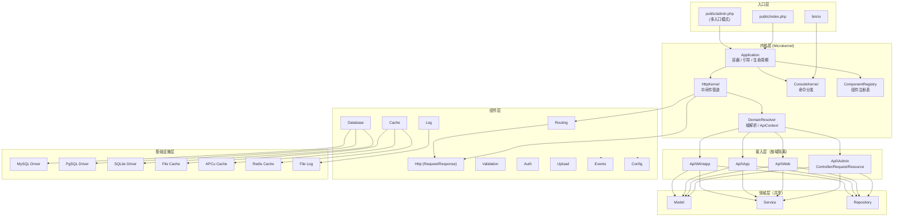

# 夕梦框架 SunsetReverie · 产品规划文档

> **产品代号**：SunsetReverie（中文名：夕梦）
> **文档类型**：产品规划 / 技术方案（PRD + TDD 合并稿）
> **框架定位**：面向纯 API（前后端分离）场景的 PHP 8.3+ 轻量级通用框架
> **文档版本**：v1.7.2（命令清单按实现状态重写）
> **最后修订**：2026-10-29（初稿 2026-10-28）
> **文档状态**：定稿，可据此进入详细设计与编码

---

## 目录

- [0. 文档说明](#0-文档说明)
- [1. 产品概述](#1-产品概述)
- [2. 技术选型与前置约束](#2-技术选型与前置约束)
- [3. 总体架构](#3-总体架构)
- [4. 目录结构与命名规范](#4-目录结构与命名规范)
- [5. 核心机制](#5-核心机制)
- [6. 多 API 域设计（多端接口隔离）](#6-多-api-域设计多端接口隔离)
- [7. HTTP 层设计](#7-http-层设计)
- [8. 数据层设计](#8-数据层设计)
- [9. 缓存层设计](#9-缓存层设计)
- [10. 日志与可观测性](#10-日志与可观测性)
- [11. 安全体系](#11-安全体系)
- [12. 命令行体系](#12-命令行体系)
- [13. 扩展体系（核心章节）](#13-扩展体系核心章节)
- [14. 统一响应与错误码规范](#14-统一响应与错误码规范)
- [15. 性能目标与优化策略](#15-性能目标与优化策略)
- [16. 测试与质量保障](#16-测试与质量保障)
- [17. 文档体系](#17-文档体系)
- [18. 版本规划与路线图](#18-版本规划与路线图)
- [19. 项目治理](#19-项目治理)
- [20. 风险登记与应对](#20-风险登记与应对)
- [21. 附录](#21-附录)

---

## 0. 文档说明

### 0.1 文档目的

本文档同时承担三项职责：

| 职责 | 说明 |
| --- | --- |
| 产品定义 | 明确夕梦框架"做什么、不做什么、为谁而做"，作为需求验收的唯一基准 |
| 架构约束 | 固化"微内核 + 组件化 + 零 Composer 依赖"的落地方式，防止开发期架构漂移 |
| 实施指南 | 提供目录结构、接口契约、扩展点清单、错误码字典等可直接编码的细节 |

### 0.2 目标读者

- **框架作者 / 维护者**：依据第 3、5、12 章实施编码，依据第 15、18 章保证质量与治理。
- **框架使用者（后端工程师）**：重点阅读第 6～13 章，获取 API 使用方式与约定。
- **前端 / 客户端工程师**：重点阅读第 14 章，获取统一响应格式、错误码、分页与鉴权协议。
- **技术负责人 / 架构评审者**：重点阅读第 1～3、14、17、19 章，评估选型与投入产出。

### 0.3 版本记录

| 版本 | 日期 | 变更摘要 | 作者 |
| --- | --- | --- | --- |
| v1.0.0 | 2026-10-28 | 基线版：完成产品定义、架构设计、全部组件规划与路线图 | 架构组 |
| v1.1.0 | 2026-10-29 | 新增第 6 章「多 API 域设计」：多端接口物理隔离（域定义/解析/路由/中间件/守卫/配置/错误码/部署形态/工具链）；同步修订章节 1、3、4、7、11、12、13、14、15、16、17、18、19、20、21 | 架构组 |
| v1.2.0 | 2026-10-29 | 批次一整合：设计公理+工程原则、产品目标 G1-G10、能力优先级矩阵、永久边界、配置四铁律、环境变量规范与调试校验、早期异常兜底、RequestContext、幂等与并发、数据格式硬约定、时间双轨、分页参数规范、签名 canonical、架构测试 7 条、部署模板、错误码 symbol | 架构组 |
| v1.3.0 | 2026-10-29 | 批次二整合：内核与组件两段式布局、可插拔启动器（Bootstrapper）、可替换域解析器、域级作用域与释放、错误码段位自动拼接、分片上传协议、能力接口、统一 Manager 基类、宏扩展通道、扩展七件套与八条红线、性能参照基线、架构测试扩至 8 项、分维度能力验收 38 项、文档即验收、附录 F 决策台账、附录 G 组件矩阵 | 架构组 |
| v1.4.0 | 2026-10-29 | 批次三整合：版本品牌代号（夕照/拾光/长庚/星野）、内核行数双阈值、复杂模块四层结构、域自包含布局与链式定义、可选 RBAC 组件、属性声明式扩展（13.8）、调试输出禁令（10.7）、跨平台兼容要求、驱动差异表文档、附录 E 写操作与错误示例 | 架构组 |
| v1.4.1 | 2026-10-29 | 目录命名调整：框架内核目录 `src/` → `core/`（组件内部 `src/` 与第三方包结构保持不变）；补 4.1 命名说明、台账 D-25 | 架构组 |
| v1.4.2 | 2026-10-29 | 补齐 CLI 说明：框架仓库补 `bin/sr`、第 12 章扩为 8 节（入口与安装、语法与全局选项、内核能力、命令清单、常用命令详解、自定义注册、输出交互与日志、部署脚本） | 架构组 |
| v1.5.0 | 2026-10-29 | 明确分发模型：私有 Git + Git submodule（不上架 Packagist）；改写 2.4 加载职责、新增 2.7 分发与接入、扩展发现改以本地 `extensions/` 为主、19.1 仓库结构对齐、`sr new` 补入命令表与详解、部署脚本补 submodule 步骤、台账新增 D-26/D-27 | 架构组 |
| v1.5.1 | 2026-10-29 | 默认挂载目录改为 `sunsetreverie` 并说明"必须显式指定"；`sr new` 自动推断框架路径；新增 `sr framework:link` 重算命令；补 `git init` 与"禁止在框架目录内执行"约束 | 架构组 |
| v1.5.2 | 2026-10-29 | 路由组织重构：新增 6.6.1（域自动 / 版本显式分组 / 资源拆文件）、4.2 补域入口文件、7.7.2 修正版本分组路径、7.3.2 标注单域示例、台账 D-28；修复 storage 目录误替换 | 架构组 |
| v1.5.3 | 2026-10-29 | `storage/framework/` 更名为 `storage/compiled/`（11 处引用 + 目录树），补命名理由与台账 D-29 | 架构组 |
| v1.6.0 | 2026-10-29 | 新增 `routing_mode` 配置项（`single` / `directory`，全局唯一）；补 6.6.2 路由模式（两种结构、升级步骤、RM-1～RM-5 启动校验、不做域级覆盖的理由）、`sr route:mode` 命令、台账 D-30 | 架构组 |
| v1.6.1 | 2026-10-29 | 组件目录 `rate-limit/` 改名 `ratelimit/`（与命名空间小写化规则一致）；配置键 `rateLimit.*` → `ratelimit.*`；`ThrottleRequests` 归属由 Http 组件修正为 RateLimit 组件；台账 D-31 | 架构组 |
| v1.6.2 | 2026-10-29 | 新增 7.10.5（存储位置/URL 映射、公开与私有两条访问路径、签名 URL、多域 URL 形态、云存储、禁止事项）；7.3.1 声明不提供静态资源路由；12.5.3 补 `sr serve` 静态处理；附录 H 补 `alias`；台账 D-32 | 架构组 |
| v1.7.0 | 2026-10-29 | 最终评估修复：统一行数阈值（1.4/1.8 对齐 3.4）、14.2 补 6 个错误码并改 PascalCase 常量、附录 A 补 `api.routing_mode`、12.4 补 3 条命令、`sr new --domains` 自动设 directory、补 3 条风险、附录 B 标注节选 | 架构组 |
| v1.7.2 | 2026-10-30 | 命令清单按实现状态重写：25 条已实现 / 14 条计划中 / 11 条明确不做；删除 `sr framework:link`、`sr api:doc` 等 11 条不实现的命令及其正文引用 | 架构组 |
| v1.7.3 | 2026-10-30 | 命令落实现：make:model / make:middleware / make:request / make:seeder / make:domain / migrate:fresh / db:show / route:mode 由「计划中」转入「已实现」，统计更新为 33 / 6 / 11 | 架构组 |
| v1.7.4 | 2026-10-30 | 补齐 Facade 层，文档中的 `Route::get()` / `DB::table()` 等静态写法与实际实现对齐；台账 D-34 | 架构组 |
| v1.7.5 | 2026-10-30 | 明确不做 ORM（8.6 改为 Query Builder 推荐写法）与 Gate（11.2 改为分场景做法）；删除运行时域配置视图（6.9.1） | 架构组 |
| v1.7.6 | 2026-10-30 | 新增 18.3.0 当前验收状态（26 / 38），修正 3 条依赖已弃能力的验收项；台账 D-35 | 架构组 |
| v1.7.7 | 2026-10-30 | DF-1～DF-6 契约测试落地、补 CHANGELOG 与 LICENSE；18.3.0 达成度更新为 30 / 38 | 架构组 |

### 0.4 术语表

| 术语 | 英文 | 释义 |
| --- | --- | --- |
| 内核 | Kernel | 负责引导、生命周期编排与请求分发的极薄层，不含业务与基础设施实现 |
| 容器 | Container | 依赖注入容器，实现 PSR-11，负责对象构建与生命周期（单例/瞬时） |
| 组件 | Component | 可独立开关、可替换实现的横切能力单元（路由、数据库、缓存、日志等） |
| 服务提供者 | Service Provider | 组件向内核注册自身能力的唯一入口，扩展的第一顺位手段 |
| 驱动 | Driver | 同一契约下的多实现（MySQL / PgSQL / SQLite、File / APCu / Redis） |
| 扩展点 | Extension Point | 框架预留的、无需修改核心代码即可介入流程的稳定接口 |
| 钩子 | Hook | 事件（Event）与过滤器（Filter）的统称，用于非侵入式介入生命周期 |
| 契约 | Contract | 组件对外暴露的接口（interface），调用方只依赖契约不依赖实现 |
| 包 | Package | 以 Composer 风格组织的第三方扩展单元，可被自动发现并注册 |
| 应用骨架 | Skeleton | 由框架提供的项目模板，含目录、配置、入口文件与示例代码 |
| 零依赖 | Zero Dependency | `core/` 下所有代码不 require 任何 `vendor/` 中的类 |
| **API 域** | Api Domain | 一套独立的路由空间 + 中间件栈 + 认证守卫 + 配置视图 + 错误码空间 + 文档空间，服务特定客户端群体（如 admin/web/app/miniapp） |
| **接入层** | Api Layer | 按域物理拆分的 HTTP 适配代码（Controller/FormRequest/Resource/Middleware），只做协议表达，不含业务规则 |
| **领域层** | Domain Layer | 与 HTTP 无关的业务实现（Model/Service/Repository/Event），被所有域共享 |
| **域解析** | Domain Resolution | 请求进入时依据域名/前缀/强制入口判定所属域的过程，早于路由匹配 |
| **跨域引用** | Cross-domain Reference | `App\Api\X` 引用 `App\Api\Y` 的反模式写法，由 `lint:isolation` 拦截 |

---

## 1. 产品概述

### 1.1 一句话定义

> **夕梦（SunsetReverie）是一个"内核极薄、能力齐全、约定统一、可无限生长"的 PHP 8.3+ 纯 API 框架——核心代码 100% 自研零 Composer 依赖，同时完整兼容 Composer 生态。**

### 1.2 命名与品牌

| 项目 | 内容 |
| --- | --- |
| 英文名 | SunsetReverie |
| 中文名 | 夕梦 |
| 完整称谓 | 夕梦框架 SunsetReverie Framework |
| 命名寓意 | "夕"= 日落时分的沉稳与秩序；"梦"= 轻灵、可自由生长。寓意"结构沉稳、形态轻盈" |
| 命名空间根 | `SunsetReverie\` |
| 应用命名空间根 | `App\` |
| 包名前缀（Composer） | `sunsetreverie/*` |
| 项目口号 | *Light core. Endless growth.*（轻内核，无限生长） |
| CLI 命令名 | `sr`（SunsetReverie 缩写） |

### 1.3 我们要解决的四个真实痛点

| 编号 | 痛点 | 现状 | 夕梦的解法 |
| --- | --- | --- | --- |
| P1 | **重型框架过重** | Laravel 单请求启动需加载数百文件，自带 Blade、队列、广播等 API 项目用不到的能力，内存与心智负担高 | 微内核，按需注册组件；默认装配集仅覆盖 API 必需能力 |
| P2 | **微框架太"素"** | Slim / Laminas 只有路由与中间件，鉴权、验证、上传、迁移全部自行拼装，每个项目重复造轮子 | 内置"API 项目最小完备集"：路由、容器、验证、认证、上传、迁移、日志、缓存 |
| P3 | **扩展要动核心** | 许多自研框架增加功能需修改 Kernel 或 Router 源码，导致升级困难、多项目分叉 | 七级扩展点 + 服务提供者机制，**新增能力零改动核心**，并可打包跨项目复用 |
| P4 | **前后端协作有歧义** | 响应结构、错误码、分页字段、鉴权头各项目自定义 | 框架级统一协议：响应包络、错误码分段、分页结构、时间格式、请求追踪 ID 全部标准化 |
| P5 | **多端接口混作一团** | 后台、前台、App、小程序接口写在同一套路由与控制器里，靠中间件 `if` 区分，越权与字段泄漏风险高 | 一等公民"API 域"：路由/中间件/守卫/配置/错误码/文档物理隔离，领域层共享（见第 6 章） |

### 1.4 产品定位（设计公理 + 工程原则）

产品定位由两层构成：**设计公理**回答"这个框架为什么存在"，**工程原则**回答"写代码时遇到取舍怎么选"。公理稳定不变，原则指导每一次评审。

#### 1.4.1 五条设计公理

| 公理 | 内涵 | 落地约束（可验收） |
| --- | --- | --- |
| **轻量** | 只实现中小型 API 项目普遍需要的能力 | 默认装配集不含视图引擎、队列、WebSocket；单请求加载文件数 ≤ 120；基线内存 ≤ 2 MB |
| **可生长** | 业务会长期演进，框架必须为未来功能预留结构化通道 | 所有新增能力必须能通过 ServiceProvider / Hook / Driver 实现；PR 评审拒绝"为某功能改 Kernel" |
| **跨项目复用** | 与业务彻底解耦，同一套框架支撑多个项目 | 框架源码零业务词；业务无关工具（如上传、鉴权）以独立扩展包形式提供（本地 `extensions/` 或独立 Git 仓库） |
| **自主可控** | 核心 100% 自研、可读、可改，不依赖 Composer 生态 | `core/` 内 `use` 语句不得指向 `vendor/` 命名空间；内核代码 ≤ 2,000 行、组件合计 ≤ 15,000 行（口径见 3.4） |
| **多端隔离** | 一个项目常有多套接口（后台/前台/App/小程序），必须物理隔离而非靠分支判断 | API 域为一等公民：路由、中间件、守卫、配置、错误码、日志、上传目录全部按域隔离；跨域引用由静态检查拦截；新增域零改核心 |

#### 1.4.2 七条工程原则

| 原则 | 含义 | 落地约束（可验收） |
| --- | --- | --- |
| **契约优先** | 组件之间只依赖 `Contracts` 中的接口，具体实现可替换 | 组件构造函数不得依赖其他组件的具体类；契约变更需走弃用流程 |
| **显式优于隐式** | 路由、中间件、Provider、通道映射全部显式声明，不做"看不见的自动发现" | 禁止生产环境递归扫描业务目录；自动发现只读受信任的本地清单；中间件顺序可 `route:list` 查看 |
| **安全默认值** | 默认配置面向生产安全，调试能力必须显式开启 | 生产默认关闭 debug、限制请求体、校验上传、脱敏日志；`APP_DEBUG=true` 仅允许非生产环境（见 5.4） |
| **统一但不越界** | 不同域共享底层协议与领域能力，但不共享权限、路由与用户上下文 | 统一的是响应格式/错误码/日志字段，不是控制器与守卫（见 6.12） |
| **能力分级** | 驱动做不到的能力必须显式声明，不做"假兼容" | 高级能力用独立能力接口（`CacheLockInterface`、`SupportsReturning`）表达；不支持时抛明确异常，禁止静默降级 |
| **零依赖 ≠ 重复造轮子** | 核心自研通用基础能力；应用层可用成熟第三方库，通过适配器接入 | 第三方类型不得泄漏进核心契约；安全敏感组件（JWT/OIDC）优先提供适配扩展而非无限自研 |
| **可测试与可替换** | 组件可独立实例化，契约提供测试替身，驱动具备共享测试套件 | 每个驱动必须通过同一套契约测试；扩展开发者不需要复制框架内部实现即可写测试 |

> **关键裁决原则**：当"功能丰富"与"内核轻"冲突时，**一律选择内核轻**；当"性能"与"可读性"冲突时，**先保证可读性，再以缓存/编译手段优化性能**；
> 当"代码复用"与"端隔离"冲突时，**下沉到领域层复用，绝不在接入层共用**；当"兼容性"与"显式性"冲突时，**选择显式报错而非静默兼容**。

### 1.5 目标用户与典型场景

#### 1.5.1 目标用户画像

| 画像 | 特征 | 核心诉求 |
| --- | --- | --- |
| A. 独立开发者 / 小团队 | 1～3 人，同时写前后端，追求交付速度 | 开箱即用、文档齐全、部署简单 |
| B. 外包 / 交付型团队 | 项目多、周期短、需快速复制经验 | 跨项目复用、统一规范、包机制 |
| C. 企业内部平台组 | 需要长期维护、可审计、可定制 | 自主可控、可读可改、无供应链风险 |
| D. 教学 / 技术研究 | 需要清晰可学的架构范例 | 代码规范、架构分层清晰、无黑盒魔法 |

#### 1.5.2 典型应用场景

- 中小型 SaaS 后端 API（用户、订单、权限、通知）
- 微信小程序 / App / H5 的统一后端
- 内部管理系统的数据接口层
- IoT / 硬件上报与指令下发接口
- 快速验证型 MVP（一周内上线）
- 作为 BFF 层，聚合多个上游服务

#### 1.5.3 典型不适用场景（明确劝退）

- 需要服务端渲染页面、SEO 友好的站点（请用 Laravel / Symfony + Twig）
- 超大规模微服务集群治理（需要完整服务网格、链路追踪生态）
- 高并发长连接即时通讯（应选 Swoole / FrankenPHP 常驻方案，夕梦可作对照但不是主战场）
- 需要成熟商业插件生态（如支付、短信 SDK 全覆盖）的企业级项目

### 1.6 非目标（Non-Goals）

非目标分两层：**当前非目标**（这一版不做，未来可能以扩展形式提供）与**永久边界**（由产品定位决定，永不做）。两层分开的好处是：讨论"要不要加队列"时有明确答案，讨论"要不要内置 CMS"时也有明确答案，不会混为一谈。

#### 1.6.1 当前非目标

明确列出"这一版不做"，防止范围蔓延：

1. 不做模板引擎 / 视图层。
2. 不做内置队列与任务调度（保留 Hook 扩展位，v2 后以 Package 形式提供）。
3. 不做 ORM 的全功能实现（不做延迟加载代理、不做二级缓存、不做复杂关联预载优化）。
4. 不做前端资源构建（无 Vite / Mix 集成）。
5. 不追求 PSR 全量兼容（只承诺 PSR-3/4/7/11/15/16/17/18 子集）。
6. 不内置 Docker / K8s 编排能力（仅提供示例 Dockerfile）。
7. 不做多租户、多语言站点、CMS 能力。
8. 不在首版追求 Swoole / Workerman 等常驻运行时的完整支持（但请求作用域与资源清理设计不得阻碍后续适配）。

#### 1.6.2 永久边界

> 除非产品定位重新评审，否则核心**始终**不包含以下内容。任何"顺手加一下"的提案，只要命中此清单，一律拒绝并登记到核心决策台账（附录 F）。

| 编号 | 永久不做 | 判定理由 |
| --- | --- | --- |
| PB-1 | 具体业务（博客、商城、CMS、工单） | 框架与业务彻底解耦是"跨项目复用"的前提 |
| PB-2 | 强制前端框架或内置后台 UI | 纯 API 定位，前端技术栈自由选择 |
| PB-3 | 强制 Composer 运行时依赖 | "核心 100% 自研、无供应链风险"是核心卖点 |
| PB-4 | 默认跨 API 域共享认证 | 跨域共享凭证是最高危的越权来源（见 6.8） |
| PB-5 | 对驱动不支持的能力做不透明模拟 | "假兼容"比"明确不支持"危害大（见 1.4 能力分级原则） |
| PB-6 | 为方便而默认关闭安全检查（调试、CORS 通配、上传校验等） | 安全默认值不可协商，需要放宽必须显式配置 |

### 1.7 竞品对比

| 维度 | Laravel 11 | Slim 4 | ThinkPHP 8 | Webman | Hyperf | **夕梦 SunsetReverie** |
| --- | --- | --- | --- | --- | --- | --- |
| 定位 | 全栈重型 | 微框架 | 国内全栈 | 常驻内存 | 协程微服务 | **纯 API 轻量通用** |
| 核心依赖 | 数十个 Composer 包 | PSR-7 实现 + DI | 若干 | Workerman | Swoole | **零依赖（自研）** |
| 默认启动文件数 | 300+ | 60+ | 150+ | 常驻 | 常驻 | **≤ 120** |
| 内置验证 | ✅ | ❌ | ✅ | ❌ | ✅ | **✅（自研）** |
| 内置认证 | ✅ 多驱动 | ❌ | ✅ | ❌ | ✅ | **✅ JWT/Session/Key** |
| 内置迁移 | ✅ | ❌ | ✅ | ❌ | ✅ | **✅（自研）** |
| 多数据库 | ✅ | 需自配 | ✅ | ✅ | ✅ | **✅ MySQL/PgSQL/SQLite** |
| 多缓存 | ✅ | ❌ | ✅ | ✅ | ✅ | **✅ File/APCu/Redis** |
| 扩展机制 | Provider + 事件 | 中间件 | 中间件 + 行为 | 插件 | 注解 + AOP | **七级扩展点（L0-L6）+ Provider + Hook** |
| 多端接口隔离 | 需自行分组约定 | 无 | 多应用（目录级） | 无 | 无 | **原生 API 域（路由/中间件/守卫/配置/错误码五重隔离）** |
| 学习曲线 | 陡 | 缓 | 中 | 中 | 陡 | **缓（核心 2 小时读完）** |
| 供应链风险 | 中 | 低 | 中 | 中 | 中 | **极低（零依赖）** |

**差异化结论**：夕梦不与 Laravel 比生态丰富度，而是以"**零依赖 + 内核可读 + API 完备集 + 稳定扩展契约**"占据"可控型轻量框架"生态位。

### 1.8 成功度量指标（KPI）

| 类别 | 指标 | 目标值（v1.0） |
| --- | --- | --- |
| 工程 | 内核代码行数（`core/`，不含注释/空行） | ≤ 2,000（目标 1,500） |
| 工程 | 组件代码行数合计（`components/`，不含注释/空行） | ≤ 15,000（目标 12,000） |
| 工程 | `core/` 对 `vendor/` 的类引用数 | **0** |
| 工程 | 单元测试行覆盖率（核心组件） | ≥ 80% |
| 工程 | PHPStan level | 8（自研静态检查脚本兜底） |
| 性能 | 简单 JSON 接口 QPS（4C8G，PHP-FPM，OPT） | ≥ 1,500 |
| 性能 | 单请求峰值内存 | ≤ 2 MB |
| 性能 | 冷启动到路由分发完成耗时 | ≤ 3 ms |
| 易用性 | 从 `git clone` 到跑通第一个接口 | ≤ 5 分钟 |
| 易用性 | 新增一个自定义能力需修改核心文件数 | **0** |
| 质量 | 线上 P0/P1 缺陷数（发布后首月） | 0 |
| 隔离 | 示例项目并行运行 API 域数 | ≥ 4（admin / web / app / miniapp） |
| 隔离 | 跨域越权测试用例通过率（含 token 串用） | 100% |
| 隔离 | 新增一个 API 域需修改核心文件数 | **0**（仅新增配置与目录） |
| 生态 | v1.0 配套示例项目数 | ≥ 3（最小骨架 / 博客四端 API / 多模块后台） |

> **指标承诺边界**：上表的性能数字必须在文档中标注测量环境与复现方式；**没有可复现基准时不得对外承诺固定 QPS**。
> 驱动测试不能只验证"能连接"，必须通过共享契约测试（见 16.1）；覆盖率作为辅助指标，关键安全分支必须有针对性用例，不追求百分比本身。

### 1.9 产品目标与达成方式

KPI 回答"做到多少"，产品目标回答"要达成什么、怎么验证"。每个目标必须有可执行的验证手段，否则视为口号。

| 编号 | 产品目标 | 达成方式（可验证） |
| --- | --- | --- |
| **G1** | 无 Composer 包即可运行核心 | 在无 `vendor/` 的干净环境跑通核心测试与示例 API |
| **G2** | 形成微内核 + 组件化架构 | 核心仅依赖契约；组件可独立启停；依赖方向可被 `lint:architecture` 检查 |
| **G3** | 新功能通过扩展点接入 | 新增示例缓存驱动、认证守卫、业务模块时核心零修改（PR 可验证） |
| **G4** | 原生支持三类数据库 | MySQL 8.0+ / PostgreSQL 16+ / SQLite 3 驱动契约测试全部通过 |
| **G5** | 原生支持三类缓存 | File / APCu / Redis 在各自能力边界内通过契约测试 |
| **G6** | 多 API 域相互隔离 | 四域路由、认证、中间件、限流、文档隔离测试通过（见 6.17） |
| **G7** | API 输出零歧义 | 成功/失败/分页/校验错误/404/500 均符合统一契约（见 7.2、14） |
| **G8** | 兼容应用层 Composer 生态 | 引入第三方库后可自动加载，并可由容器与适配器调用 |
| **G9** | 默认可安全部署 | 生产模式不泄露堆栈、SQL、密钥与敏感请求数据（见 11.6） |
| **G10** | 具备可维护的交付质量 | 单元/契约/集成/隔离测试 + 静态检查 + 升级说明 + 示例项目齐备 |

### 1.10 能力优先级矩阵

优先级定义：**P0** = v1.0 必须交付；**P1** = 1.x 重要增强，不阻塞首版；**P2** = 按需扩展；**非目标** = 不进核心。

| 能力 | 优先级 | 首版范围 |
| --- | --- | --- |
| 微内核、容器、服务提供者 | P0 | 注册、启动、绑定、解析、请求作用域、循环依赖诊断 |
| 配置与环境 | P0 | 多环境、配置缓存、敏感值保护、启动校验 |
| HTTP 请求与响应 | P0 | JSON API、文件下载、流式响应、CORS、请求 ID |
| 路由 | P0 | 参数约束、分组、命名、中间件、域与版本、路由缓存 |
| **多 API 域** | P0 | 独立路由表、中间件栈、守卫、限流、错误码空间、文档 |
| 数据库 | P0 | PDO、三驱动、查询构造、事务与保存点、迁移、分页 |
| 缓存 | P0 | File / APCu / Redis，统一基础契约 + 能力差异说明 |
| 日志 | P0 | JSON Lines、级别、按天轮转、请求上下文、脱敏 |
| 验证 | P0 | 常用规则、嵌套字段、自定义规则、统一错误格式 |
| 认证与授权 | P0 | 多守卫、JWT、刷新轮换、Gate/Policy、限流防爆破 |
| 上传与存储 | P0 | 本地上传、安全校验、存储契约；云存储走扩展 |
| 限流 | P0 | 基于缓存，按域/IP/用户/路由配置 |
| 事件 | P0 | 同步事件、监听器、过滤器；异步投递属于队列扩展 |
| 命令行 | P0 | serve、各类 make 生成器、migrate、route:list、config:cache、lint:isolation |
| OpenAPI 文档 | P1 | 路由元数据导出，生成器可作为独立扩展 |
| 队列与任务调度 | P1 | 先定义边界，数据库/Redis 队列由独立组件交付 |
| PSR 桥接 | P1 | 可选桥接包；核心内联接口已满足互操作（见 2.5） |
| 分片上传 | P1 | 协议先定（见 7.10 上传），实现随后续版本补齐 |
| 常驻运行时适配 | P2 | 适配层独立；核心保证请求状态可清理（见 5.10） |
| 完整 ORM | 非核心目标 | 由独立扩展实现，不进入微内核 |

---

## 2. 技术选型与前置约束

### 2.1 运行环境要求

| 项 | 最低要求 | 推荐 | 说明 |
| --- | --- | --- | --- |
| PHP | 8.3.0 | 8.3 LTS / 8.4 | 使用 8.3 新特性，不向前兼容 8.2 |
| 扩展 | `json`, `mbstring`, `openssl`, `pdo` | + `pdo_mysql` / `pdo_pgsql` / `pdo_sqlite`, `apcu`, `fileinfo`, `sodium` | 按需启用，缺失时给出明确启动报错 |
| Web 服务器 | Nginx / Apache / Caddy | Nginx 1.24+ | 或 `php -S` 用于开发 |
| 数据库 | MySQL 8.0+ / PostgreSQL 16+ / SQLite 3.35+ | MySQL 8.0 | 字符集强制 `utf8mb4` / `utf8mb4_0900_ai_ci` |
| Composer | 2.x（可选） | 2.7+ | 仅在项目需要第三方库时使用 |

**启动时环境自检**：框架引导阶段执行 `EnvironmentChecker`，校验 PHP 版本、必需扩展、必需目录可写、时区设置，任一失败抛出 `BootstrapException` 并输出人类可读的修复指引。

### 2.2 PHP 8.3+ 特性使用清单

框架必须"用得其所"，禁止为了炫技而使用新语法。允许且鼓励使用的特性：

| 特性 | 版本 | 框架中的用途 |
| --- | --- | --- |
| `readonly` 类与属性 | 8.2 | 值对象（`Request`、`Response`、`Route` 定义、错误对象） |
| 构造器属性提升 | 8.0 | 减少样板代码 |
| 枚举（`enum`） | 8.1 | 错误码域、日志级别、HTTP 方法、缓存驱动类型、数据库驱动类型 |
| 枚举方法 / 接口实现 | 8.1 | `ErrorDomain::httpStatus()`、`LogLevel::severity()` |
| 一等可调用语法 `f(...)` | 8.1 | 容器解析、管道处理器、事件监听器 |
| `never` 返回类型 | 8.1 | 异常抛出方法、`abort()` 辅助函数 |
| 只读类常量 / 类型化类常量 | 8.3 | `const string VERSION = '1.0.0'` |
| 动态类常量获取 `Foo::{$name}` | 8.3 | 驱动工厂按配置动态取常量 |
| `#[Override]` | 8.3 | 显式标记覆写，防止父类方法改名导致静默失效 |
| `json_validate()` | 8.3 | 请求体 JSON 快速校验，避免 `json_decode` 全量解析开销 |
| `Random\Randomizer` | 8.2 | 密码学安全随机（非 `rand()`） |
| 命名参数 | 8.0 | 公共 API 提升可读性 |
| 纤程（Fiber） | 8.1 | 仅用于"延迟执行/终止回调"，不用于协程化改造 |

**禁止事项**：不使用 `eval`（路由缓存除外，并为缓存文件增加签名校验）、不使用 `@` 错误抑制符、不使用 `extract()`、不使用可变变量。

### 2.3 "零 Composer 依赖"的边界定义

这是本框架最容易产生争议的约束，必须精确定义：

| 范围 | 是否允许 Composer | 说明 |
| --- | --- | --- |
| `core/`（框架核心） | ❌ 禁止 | 不得 `use` 任何非 `SunsetReverie\` 命名空间的类 |
| `core/` 的 `composer.json` | ✅ 允许存在 | 仅用于声明 PSR-4 自动加载与框架自身元信息，`require` 段只允许 `php` 与 `ext-*` |
| 框架使用的 PSR 接口 | ✅ 内联定义 | 见 2.5 节：框架**自带** PSR 接口定义（`core/Psr/...`），不安装 `psr/log` 等包 |
| 应用骨架 `composer.json` | ✅ 允许 | 业务项目可自由 `require` 第三方库 |
| 框架的可选集成包 | ✅ 允许 | 如 `sunsetreverie/monolog-bridge`，以 Package 形式存在，不进核心 |

**关键设计**：框架内联定义 PSR 接口，并通过"条件加载"保证与 Composer 安装的官方接口二进制兼容：

```php
// core/Psr/Log/LoggerInterface.php
namespace Psr\Log;

// 若项目中已通过 Composer 安装了 psr/log，则不会重复定义
if (!interface_exists(LoggerInterface::class, false)) {
    interface LoggerInterface { /* ... */ }
}
```

> 该文件采用"文件级条件定义"策略，避免 `Cannot declare interface ... already in use` 致命错误。代价是无法使用 `declare(strict_types=1)` 之外的顶层语句限制，已在测试中覆盖两种加载顺序。

### 2.4 Composer 兼容策略

**目标**：核心零依赖，但业务项目能无缝使用 Composer 生态。

> **前提**：夕梦框架**不发布到 Packagist**，仅通过私有 Git 仓库分发（见 2.7）。因此本节讨论的是"业务项目如何使用 Composer"，
> 而不是"框架如何被 Composer 安装"。

**职责分离**：框架自己的类由框架加载器负责，Composer 只负责业务代码与第三方库，两者互不越界。

| 机制 | 实现方式 |
| --- | --- |
| 框架加载器 | 自研 `Autoloader` 负责 `SunsetReverie\`（`core/` + 各 `components/*/src/`），不依赖 Composer |
| Composer 职责 | 业务项目 `composer.json` 只声明 `"App\\": "app/"` 与第三方依赖，不映射框架命名空间 |
| 加载顺序 | 入口先加载 `vendor/autoload.php`（若存在），再由框架注册 SPL 加载器兜底；未命中即放行给下一个加载器 |
| 缺失 vendor 场景 | 无 Composer 时，框架加载器同时按 PSR-4 规则解析 `App\`，项目依旧可运行 |
| Classmap 优化 | `sr optimize` 生成 `storage/compiled/autoload_classmap.php`，生产环境跳过文件系统探测 |
| 扩展发现 | 优先扫描本地 `extensions/`（零 Composer）；Composer 包自动发现为可选能力（见 13.2.3） |
| 版本冲突 | 框架 `composer.json` 仅供本地 `path` 引用与工具链使用，不上架；声明 `provide: psr/log-implementation` 但不声明 `replace` |

入口文件示意：

```php
// public/index.php
declare(strict_types=1);

$basePath = dirname(__DIR__);

// 1) 若存在 Composer 自动加载器，优先加载（负责 App\ 与第三方库）
if (is_file($basePath . '/vendor/autoload.php')) {
    require $basePath . '/vendor/autoload.php';
}

// 2) 框架位置（由 sr new 生成；改名挂载目录时改这一行即可）
$frameworkPath = $basePath . '/sunsetreverie';

// 3) 框架自举：注册 fallback 自动加载器、构建应用、处理请求
require $frameworkPath . '/core/Foundation/autoload.php';

return SunsetReverie\Foundation\Application::boot($basePath)
    ->handleRequest()
    ->send();
```

### 2.5 PSR 标准遵循矩阵

| 标准 | 名称 | 遵循程度 | 说明 |
| --- | --- | --- | --- |
| PSR-1 | 基础编码规范 | ✅ 完全 | — |
| PSR-3 | 日志接口 | ✅ 完全 | 内联定义接口，`Logger` 实现 |
| PSR-4 | 自动加载 | ✅ 完全 | 自研 `Autoloader` |
| PSR-7 | HTTP 消息接口 | ⚠️ 部分 | 实现核心方法，不实现流式上传的完整语义（见 7.1） |
| PSR-11 | 容器接口 | ✅ 完全 | `Container implements ContainerInterface` |
| PSR-12 | 编码风格 | ✅ 完全 | CI 强制检查 |
| PSR-15 | 中间件接口 | ✅ 完全 | 提供适配器，兼容第三方 PSR-15 中间件 |
| PSR-16 | 简单缓存接口 | ✅ 完全 | `CacheRepository implements CacheInterface` |
| PSR-17 | HTTP 工厂 | ✅ 完全 | 提供 `RequestFactory` / `ResponseFactory` 等 |
| PSR-18 | HTTP 客户端 | ✅ 完全 | 自研 cURL 客户端，供 SSRF 安全策略约束 |

### 2.6 无第三方依赖下的自研替代清单

| 通常依赖的库 | 夕梦的自研实现 | 复杂度评估 |
| --- | --- | --- |
| `nikic/fast-route` | `Routing\RouteCompiler`（前缀树 + 正则分组） | 中 |
| `php-di` / `league/container` | `Container\Container`（反射自动装配 + 上下文绑定） | 中 |
| `vlucas/phpdotenv` | `Config\EnvLoader`（支持引号、注释、变量展开、类型推断） | 低 |
| `monolog/monolog` | `Log\Logger` + `Handler\*` | 低 |
| `firebase/php-jwt` | `Auth\Jwt\JwtCodec`（HS256/384/512、RS256、ES256） | 中 |
| `predis/predis` | `Cache\Driver\RedisConnection`（RESP2/RESP3 协议实现） | 高（重点投入） |
| `symfony/var-dumper` | `Support\Dumper`（CLI 彩色 / HTML 折叠） | 低 |
| `ramsey/uuid` | `Support\Uuid`（v4/v7，基于 `Random\Randomizer`） | 低 |
| `nesbot/carbon` | 不引入，直接使用 `DateTimeImmutable` + `Support\Clock` | 低 |
| `filp/whoops` | `Exception\DebugRenderer`（开发环境错误页） | 低 |
| `phpunit/phpunit` | 核心不测，测试期通过 Composer 引入（dev-only，允许） | — |

> **特别说明**：测试框架允许使用 Composer 引入（仅 `require-dev`），因为测试依赖不进入生产运行路径，不违反"核心零依赖"。

---

### 2.7 分发模型与接入方式

#### 2.7.1 分发原则

| 项 | 结论 | 理由 |
| --- | --- | --- |
| 分发渠道 | **私有 Git 仓库**（GitLab / Gitea / 私有 GitHub） | 内部使用，无需进入公共生态 |
| 是否上架 Packagist | **否** | 避免公开维护成本与版本承诺；也避免"发布即意味着长期兼容"的压力 |
| 版本标识 | Git tag（`v1.0.0`、`v1.4.1`…） | 与语义化版本一致，便于锁定与回滚 |
| 骨架来源 | 框架仓库内置 `skeleton/`，由 `sr new` 复制 | 不依赖 `composer create-project` |
| 第三方库 | 业务项目自行 `composer require` | "兼容 Composer"指的是这个场景 |

#### 2.7.2 主推方式：Git submodule

```bash
# 1) 业务项目初始化（必须先建仓库，否则 submodule 无法添加）
mkdir xi-blog && cd xi-blog
git init

# 2) 以 submodule 引入框架，显式指定挂载目录
git submodule add git@git.example.com:team/SunsetReverie.git sunsetreverie
git commit -m "chore: add SunsetReverie framework as submodule"

# 3) 生成项目骨架（复制框架内置模板，自动写入框架路径）
php sunsetreverie/bin/sr new . --force
```

> **关于挂载目录名**：
> - **必须显式指定**：`git submodule add <url>` 省略路径时会用**仓库名**作默认值（如 `SunsetReverie`，首字母大写），
>   与约定的小写 `sunsetreverie` 不一致，在 Linux 上会导致路径匹配失败。
> - **可以自定义**：例如挂到 `vendor/sunset`。`sr new` 会从自身位置推断框架根，把正确的相对路径写进入口文件，
>   **不需要你手改 `public/index.php`**。
> - **生成后再改名**：手动修改 `public/index.php` 里的 `$frameworkPath = $basePath . '/旧目录名';` 一行，并重建 `bin/sr` 软链（`ln -sf ../新目录名/bin/sr bin/sr`）。只有这一行依赖目录名，其余代码不受影响。

引入后的项目结构：

```text
xi-blog/
├── sunsetreverie/                    # submodule，锁定到某个 commit
│   ├── bin/sr
│   ├── core/
│   ├── components/
│   └── skeleton/
├── app/                              # 由 sr new 生成
├── config/
├── routes/
├── storage/
├── public/index.php
├── bin/sr -> ../sunsetreverie/bin/sr # 软链，日常用 ./bin/sr
└── composer.json                     # 可选，仅用于第三方库
```

| 操作 | 命令 | 说明 |
| --- | --- | --- |
| 克隆项目 | `git clone --recursive <repo>` | 漏了 `--recursive` 会得到空的 `sunsetreverie/` |
| 补拉子模块 | `git submodule update --init --recursive` | 忘记初始化时的补救 |
| 升级框架 | `git submodule update --remote sunsetreverie` | 拉到远端默认分支最新提交 |
| 升级到指定版本 | `cd sunsetreverie && git checkout v1.4.1 && cd ..` | 按 tag 锁定 |
| 回滚 | `git submodule update --checkout <旧 commit>` | 框架目录回到旧版本 |
| 查看当前版本 | `php bin/sr about` | 输出框架版本与 commit |

**升级后必做**：

```bash
php bin/sr optimize:clear     # 清掉旧缓存（配置/路由/属性）
php bin/sr optimize           # 重新编译
php bin/sr migrate --force    # 若有新迁移
php bin/sr env:check          # 环境自检
```

#### 2.7.3 备选方式：本地 path repository

适合"框架与业务项目并排开发"的场景（改框架立刻生效）：

```json
{
  "repositories": [
    { "type": "path", "url": "../SunsetReverie", "options": { "symlink": true } }
  ],
  "require": {
    "sunsetreverie/framework": "*"
  }
}
```

- 优点：Composer 统一管理依赖，`vendor/bin/sr` 直接可用；
- 缺点：需要约定本地目录结构，CI 中必须先 clone 框架；
- 注意：`path` 类型**不需要**上架 Packagist，属于本地引用。

#### 2.7.4 两种方式对比

| 维度 | Git submodule（推荐） | path repository |
| --- | --- | --- |
| 版本锁定 | commit / tag，精确 | Composer 版本约束 |
| 离线可用 | ✅ | 需先 clone 框架 |
| 团队一致性 | 强（submodule 指针随仓库走） | 依赖本地目录约定 |
| 升级操作 | `git submodule update` | `composer update` |
| 改框架代码 | 需在 submodule 内改（易误提交） | symlink，直接改 |
| 适用 | 正式项目、生产部署 | 开发期、框架联调 |

#### 2.7.5 CI 与部署

```yaml
# .gitlab-ci.yml 片段
before_script:
  - git submodule update --init --recursive   # 拉取框架
  - composer install --no-dev                  # 仅当项目有第三方依赖
  - php bin/sr env:check
  - php bin/sr optimize
```

> **禁止**在 CI 中使用 `git submodule update --remote`——那会让每次构建都可能拿到不同版本。
> 生产部署只认仓库中已提交的 submodule 指针。

> **挂载点是"项目里的框架目录"，不是框架内部的层级**：`xi-blog/sunsetreverie/` 的内容 = 框架仓库根
> （`core/`、`components/`、`skeleton/`、`bin/`…），与 4.1 完全一致。
> 默认命名为 `sunsetreverie`，是为了让入口里的默认路径 `$basePath . '/sunsetreverie'` 开箱即用。
> `sr new` 生成时自动推断框架位置；已生成的项目若要改挂载目录名，只需改入口里的一行（见上）。

## 3. 总体架构

### 3.1 架构风格：微内核 + 组件化 + 契约驱动

```
┌─────────────────────────────────────────────────────────────┐
│                接入层 Api（按 API 域物理隔离）                 │
│   Api\Admin │ Api\Web │ Api\App │ Api\Miniapp               │
│   Controller / FormRequest / Resource / Middleware / Route  │
│   【规则】域内代码禁止引用其他域（由 lint:isolation 强制）    │
└───────────────────────────┬─────────────────────────────────┘
                            │ 单向调用（上层依赖下层）
┌───────────────────────────▼─────────────────────────────────┐
│                  领域层 Domain（四端共享）                     │
│   Model / Service / Repository / Domain Event / Enum        │
│   【规则】禁止依赖任何接入层代码（依赖倒置）                   │
└───────────────────────────┬─────────────────────────────────┘
                            │ 只依赖契约
┌───────────────────────────▼─────────────────────────────────┐
│                    内核层 Kernel（极薄）                       │
│  Application（容器+引导） │ HttpKernel（管道） │ ConsoleKernel │
│  DomainResolver（域解析） │ 【职责】编排、注册、分发          │
│  【禁止】业务逻辑、SQL、HTTP 细节、驱动实现                    │
└───────────────────────────┬─────────────────────────────────┘
                            │ 契约（interface）+ 服务提供者
┌───────────────────────────▼─────────────────────────────────┐
│                    组件层 Components                         │
│  Routing │ Container │ Http │ Database │ Cache │ Log       │
│  Validation │ Auth │ Upload │ Events │ Config │ Console    │
│  Api（域注册表/上下文/隔离检查）                             │
│  每个组件 = 契约 + 默认实现 + ServiceProvider + 驱动        │
└───────────────────────────┬─────────────────────────────────┘
                            │ 驱动契约
┌───────────────────────────▼─────────────────────────────────┐
│                   基础设施层 Infrastructure                   │
│  MySQL │ PgSQL │ SQLite │ File │ APCu │ Redis │ Smtp(可选)  │
└─────────────────────────────────────────────────────────────┘
```

> **为什么把"接入层"与"领域层"拆开**：多端接口的差异属于"如何对外表达"，业务规则属于"系统如何运转"。
> 前者必须按域隔离，后者必须共享。混淆这两层，就会得到"四份重复的业务代码"或"一个塞满 if 的巨型控制器"。

### 3.2 分层职责与依赖规则

| 层 | 职责 | 允许依赖 | 禁止依赖 |
| --- | --- | --- | --- |
| 接入层（按域拆分） | 协议适配：参数接收、校验、字段裁剪、响应组装 | 领域层、组件层契约、内核 API | 其他域的接入层代码、基础设施层具体类 |
| 领域层（共享） | 业务规则：实体、服务、仓储、领域事件 | 组件层契约、内核 API | 任何接入层代码、HTTP 概念（`Request`/`Response`） |
| 内核层 | 编排、域解析、注册、分发 | 容器、事件、配置契约 | 任何具体驱动、任何业务概念 |
| 组件层 | 能力实现 | 容器、事件、配置、支持库 | 其他组件的**具体实现**（可依赖契约） |
| 基础设施层 | 外部系统适配 | 组件层契约 | 内核层、领域层、接入层 |

**依赖倒置铁律**：
1. 组件的构造函数**只允许**依赖契约（interface）与其他组件的契约。
2. 组件之间的运行时交互一律通过容器解析，禁止 `new` 其他组件的具体类（`Support\*` 工具类除外）。
3. 基础设施层实现组件契约，由 `ServiceProvider` 绑定，**不允许被其他代码直接 `new`**。
4. 接入层之间**零依赖**：`App\Api\Admin` 与 `App\Api\App` 之间不得出现任何 `use`。
5. 领域层**不认识 HTTP**：Service 方法只接受标量/值对象/DTO，不接受 `Request`，不返回 `Response`。

### 3.3 架构总图



### 3.4 内核的"薄"如何度量

内核代码只允许存在于 `core/Foundation/` 与 `core/Kernel/`，且必须满足：

| 约束 | 目标值 | 上限值（硬线） | 超限处理 |
| --- | --- | --- | --- |
| 内核目录总行数（`core/`） | ≤ 1,500 行 | ≤ 2,000 行 | 超过目标需说明理由；超过上限 CI 阻断 |
| 组件合计行数（`components/`） | ≤ 12,000 行 | ≤ 15,000 行 | 同上 |
| 单组件行数 | ≤ 2,500 行 | ≤ 3,000 行 | 超过说明该组件职责过杂，应拆分 |
| 内核类数量 | ≤ 12 个 | ≤ 14 个（含 `DomainResolver`、`ApiContext`） | 超出需评审是否该下沉为组件 |
| 内核中 `if ($driver === 'xxx')` 类分支 | 0 处 | 0 处 | 立即阻断 |
| 内核中 `if ($domain === 'xxx')` 类分支 | 0 处（域行为全部来自配置） | 0 处 | 立即阻断 |
| 内核直接 `new` 的组件具体类 | 0 个（全部通过 Provider 注册） | 0 个 | 立即阻断 |
| 内核对外暴露的 API | 白名单内（见 5.1.2） | 白名单内 | 新增公开方法需 RFC |

> **为什么区分目标值与上限**：目标值是"健康状态"，上限是"不可逾越"。只设一个阈值会导致两种极端——
> 定太死（1,500）则正常演进也被卡住，定太松（2,000）则逐渐膨胀无人警觉。
> 两个数值同时存在时，越过目标会触发"写清楚为什么"，越过上限才会真正阻断。

### 3.5 一次请求的完整生命周期

```
① 入口
   public/index.php
   └─ Application::boot(basePath)
      ├─ EnvLoader      加载 .env → 写入环境变量（不覆盖已存在的真实环境变量）
      ├─ Config         加载 config/*.php → 按文件合并为扁平点语法配置树
      ├─ EnvironmentChecker  校验 PHP 版本/扩展/目录权限
      ├─ Container      创建容器，注册自身与 Config/Event 基础服务
      ├─ ProviderRegistry    读取 config/app.php:providers + 包自动发现
      │   ├─ 阶段一：所有 Provider::register()（仅绑定，不解析）
      │   └─ 阶段二：所有 Provider::boot()（依赖已就绪，可安全解析）
      ├─ Hook: kernel.booted    允许外部在首个请求前介入
      └─ 返回 Application 实例

② 捕获请求
   Application::handleRequest()
   ├─ HttpKernel::capture()  由 SAPI 适配器构建 Request（$_SERVER/$_GET/$_POST/php://input）
   └─ Hook: http.request.captured

③ 域解析（多端隔离的起点，详见第 6 章）
   DomainResolver::resolve(Request)
   ├─ 优先级：独立域名 > 路径前缀 > 请求头（默认关闭）> 默认域
   ├─ forcedDomain（多入口模式，public/admin.php 锁定域）
   ├─ 构建 ApiDomain（全局配置 + 域覆盖深度合并）
   ├─ 写入 ApiContext（scoped，每请求重建）
   ├─ 启动当前域的延迟 Provider（其他域 Provider 完全不加载）
   └─ Hook: api.domain.resolved
   ※ 未匹配 → 404 / 40008 DOMAIN_NOT_FOUND

④ 全局中间件前置（按优先级升序，仅 1～3 个平台级中间件）
   TraceMiddleware      注入/透传 X-Request-Id
   CorsMiddleware       处理预检与响应头
   ...（禁止出现任何业务判断）

⑤ 路由匹配（仅加载【当前域 + 当前版本】的路由表）
   Router::dispatch(Request)
   ├─ 命中静态路由 → 直接返回路由定义
   ├─ 命中动态路由 → 参数绑定 + 约束校验（where）
   ├─ 405 → 收集允许的方法，返回 405 + Allow 头
   └─ 未命中 → NotFoundException（交给异常处理器）
   ※ 只在本域路由表内查找，不探测其他域，避免泄露接口存在性

⑤ 路由中间件管道（Pipeline）
   按声明顺序洋葱模型执行，支持短路（返回 Response）与终止（terminate）

⑥ 域级中间件管道（Pipeline，每域独立栈）
   按该域配置的顺序执行洋葱模型，支持短路（返回 Response）与终止（terminate）
   典型：域限流 → 域认证（守卫绑定域）→ 设备/来源校验 → 域审计

⑦ 控制器执行（当前域命名空间下的控制器）
   ├─ 反射解析方法参数：Request / 路由参数 / 验证 FormRequest / 服务（容器注入）
   ├─ 执行控制器，返回值经 ResponseFactory 规范化：
   │     array|Jsonable   → application/json（200）
   │     Response        → 原样
   │     null            → 204
   │     string          → text/plain
   └─ Hook: http.response.created

⑧ 全局中间件后置（逆序）
   日志写入（含域标识、耗时、状态码、request_id）
   安全响应头注入 + X-Api-Domain / X-Api-Version
   慢请求判定

⑨ 异常路径（任意阶段抛出）
   ErrorHandler::render(Throwable)
   ├─ 按当前域决定错误消息与是否暴露内部细节
   ├─ 开发环境：DebugRenderer（堆栈 + 上下文 + 代码片段）
   ├─ 生产环境：统一 JSON 错误包络 + 记录 error 日志
   └─ 一律保持响应结构与错误码一致

⑩ 收尾
   Application::terminate()
   ├─ 中间件 terminate()（逆序）
   ├─ 终止回调（由 Hook: app.terminating 注册）
   └─ 长驻模式下重置请求级单例（scoped 绑定）
```

### 3.6 启动阶段时序（Provider 两阶段模型）

```
Application::boot
   │
   ├── [Stage 0] 环境准备        EnvLoader / EnvironmentChecker
   ├── [Stage 1] 配置加载        Config loader + 环境覆盖 (config/{env}/*.php) + api.php 域定义
   ├── [Stage 2] 容器初始化      bind(self) / bind(Config) / bind(EventDispatcher) / bind(ApiContext)
   ├── [Stage 3] Provider 注册   foreach provider: register()   ← 只允许 bind/singleton/mergeConfig
   ├── [Stage 4] Provider 启动   foreach provider: boot()       ← 可解析服务、注册路由/中间件/命令
   └── [Stage 5] 引导完成钩子    Event::dispatch('kernel.booted')
```

**两阶段的意义**：`register()` 阶段所有 Provider 的绑定已完成（顺序无关），因此任何 Provider 在 `boot()` 中都可以安全解析其他组件，彻底消除"注册顺序敏感"这一常见框架痛点。

**域级 Provider 的第三阶段**（请求期，非引导期）：

```
DomainResolver 解析出当前域
   └── [Stage D] 域级 Provider 注册与启动
         ├── 仅注册 config/app.php:domain_providers.{currentDomain} 中声明的 Provider
         ├── 其他域的 Provider 完全不加载（零启动成本）
         └── Hook: api.domain.booted（载荷 ApiDomain）
```

> 这是"多域不影响性能"的关键：域级能力（后台审计、小程序会话交换）只在命中该域时才装配。

### 3.7 扩展机制总览（七级扩展点）

| 级别 | 机制 | 适用场景 | 是否改核心 | 稳定性承诺 |
| --- | --- | --- | --- | --- |
| L0 | **API 域** | 新增一套接口（后台/前台/App/小程序/开放平台） | 否 | `config/api.php` 结构稳定 |
| L1 | **配置驱动** | 切换驱动、开关组件、调整参数 | 否 | 配置键向后兼容 |
| L2 | **服务提供者** | 注册新服务、替换实现、注册路由/命令（含域级 Provider） | 否 | `ServiceProvider` 接口稳定 |
| L3 | **Hook（事件/过滤器）** | 在既有流程中插入逻辑、改写数据（含域生命周期钩子） | 否 | 钩子名与载荷结构稳定 |
| L4 | **驱动实现** | 新增数据库/缓存/存储后端 | 否 | 驱动契约稳定 |
| L5 | **宏（Macro）** | 给核心类追加语法糖方法，不改源码 | 否 | `macro()` 签名稳定 |
| L6 | **包（Package）** | 跨项目分发的功能集合（可按域启用） | 否 | 包清单规范稳定 |

> **验收红线**：任何"必须修改 `core/` 才能实现的功能需求"都应被视为框架缺陷，进入 issue 并优先以新增扩展点解决。
> 典型判定：**"再加一套接口"能不能只靠配置与目录完成？** 答"能"才算合格。

### 3.8 生命周期钩子一览表

| 钩子名 | 类型 | 触发时机 | 载荷 | 可改写 |
| --- | --- | --- | --- | --- |
| `kernel.booting` | Event | 引导开始前 | `Application` | 否 |
| `config.loaded` | Filter | 配置加载完成 | `array $config` | ✅ |
| `kernel.booted` | Event | 全部 Provider 启动完成 | `Application` | 否 |
| `api.domain.resolved` | Event | 域解析完成 | `ApiDomain, Request` | 否 |
| `api.domain.booted` | Event | 域级 Provider 启动完成 | `ApiDomain` | 否 |
| `api.domain.middleware` | Filter | 收集域级中间件 | `array $middleware, ApiDomain` | ✅ |
| `api.domain.not_found` | Event | 未匹配到任何域 | `Request` | 否 |
| `http.request.captured` | Event | Request 构建完成 | `Request` | 否 |
| `http.request.received` | Event | 进入全局中间件前 | `Request` | 否 |
| `http.routing.before` | Event | 路由匹配前 | `Request` | 否 |
| `http.routing.after` | Event | 路由匹配后 | `Request`、`Route` 或 `null` | 否 |
| `http.middleware.register` | Filter | 收集全局中间件 | `array $middleware` | ✅ |
| `http.response.created` | Event | Response 生成后 | `Request, Response` | 否 |
| `http.response.sending` | Filter | 发送前 | `Response` | ✅ |
| `http.exception` | Event | 异常被捕获时 | `Throwable, Request` | 否 |
| `db.query.executed` | Event | 每次 SQL 执行后 | `string $sql, array $bindings, float $ms` | 否 |
| `db.connection.established` | Event | 连接建立后 | `ConnectionInterface` | 否 |
| `cache.hit` / `cache.miss` | Event | 缓存命中/未命中 | `string $key` | 否 |
| `log.record` | Filter | 日志写入前 | `array $record` | ✅ |
| `auth.authenticated` | Event | 认证成功 | `Authenticatable $user` | 否 |
| `app.terminating` | Event | 请求收尾 | `Request, Response` | 否 |

### 3.9 组件开关与"按需装配"

`config/app.php` 中的 `components` 段控制组件是否注册：

```php
// config/app.php
return [
    'components' => [
        SunsetReverie\Routing\RoutingServiceProvider::class        => true,
        SunsetReverie\Database\DatabaseServiceProvider::class      => true,
        SunsetReverie\Cache\CacheServiceProvider::class            => true,
        SunsetReverie\Log\LogServiceProvider::class                => true,
        SunsetReverie\Validation\ValidationServiceProvider::class  => true,
        SunsetReverie\Auth\AuthServiceProvider::class              => true,
        SunsetReverie\Upload\UploadServiceProvider::class          => true,
        SunsetReverie\Api\ApiServiceProvider::class                => true,   // 多 API 域支持
        // 未列出的组件不注册，其契约不可解析（容器抛 ComponentNotRegisteredException）
    ],

    // 域级 Provider：仅在请求命中对应域时注册与启动（详见 6.13）
    'domain_providers' => [
        'admin'   => [App\Api\Admin\Provider\AdminServiceProvider::class],
        'app'     => [App\Api\App\Provider\AppServiceProvider::class],
        'miniapp' => [App\Api\Miniapp\Provider\MiniappServiceProvider::class],
    ],
];
```

**收益**：一个只做静态数据查询的接口服务可以关闭 Auth/Upload/Validation，进一步压缩启动开销；
关闭 `ApiServiceProvider` 则退化为单域模式（`config/api.php` 不生效），适合极简项目。

---

## 4. 目录结构与命名规范

### 4.1 框架源码目录

```
sunsetreverie/                        # 框架仓库根（挂载到业务项目的 sunsetreverie/，见 2.7）
├── bin/
│   └── sr                            # 框架 CLI 入口（维护框架自身，见 12.1）
├── core/                             # 【微内核】只做编排与协议，≤ 2,000 行
│   ├── Foundation/                   # 应用引导与生命周期
│   │   ├── Application.php
│   │   ├── EnvironmentChecker.php
│   │   ├── ComponentRegistry.php
│   │   ├── ProviderRepository.php
│   │   ├── Bootstrapper/             # 可插拔启动阶段（见 5.1.4）
│   │   └── autoload.php
│   ├── Kernel/
│   │   ├── HttpKernel.php
│   │   ├── ConsoleKernel.php
│   │   └── KernelInterface.php
│   ├── Container/
│   │   ├── Container.php
│   │   ├── Binding.php
│   │   ├── ContextualBinding.php
│   │   └── Exception/
│   ├── Config/
│   │   ├── Config.php
│   │   ├── EnvLoader.php
│   │   ├── Env.php
│   │   └── ConfigCache.php
│   ├── Api/                          # 多 API 域（域解析属内核职责）
│   │   ├── ApiDomain.php             # 域值对象（readonly）
│   │   ├── ApiContext.php            # 当前域上下文（scoped）
│   │   ├── DomainRegistry.php        # 域注册表（从 config/api.php 构建）
│   │   ├── DomainResolverInterface.php   # 解析器契约（可替换，见 6.3.4）
│   │   ├── DomainResolver.php        # 默认解析：host / prefix / header / forced
│   │   ├── DomainConfig.php          # 域配置视图（惰性深度合并）
│   │   ├── IsolationChecker.php      # 跨域引用静态检查（lint:isolation）
│   │   ├── Middleware/DomainMiddleware.php
│   │   └── ApiServiceProvider.php
│   ├── Routing/
│   │   ├── RouterInterface.php
│   │   ├── Router.php
│   │   ├── Route.php
│   │   ├── RouteGroup.php
│   │   ├── RouteCompiler.php
│   │   ├── RouteCollection.php
│   │   └── RoutingServiceProvider.php
│   ├── Http/                         # HTTP 消息与管道（不含业务中间件）
│   │   ├── Request.php
│   │   ├── RequestContext.php        # 请求期事实来源（见 5.11）
│   │   ├── Response.php
│   │   ├── JsonResponse.php
│   │   ├── RedirectResponse.php
│   │   ├── UploadedFile.php
│   │   ├── ResponseFactory.php
│   │   ├── Middleware/               # 仅平台级：Trace / Cors / SecurityHeaders / TrustProxies
│   │   ├── Factory/
│   │   └── HttpServiceProvider.php
│   ├── Events/
│   │   ├── Dispatcher.php
│   │   └── EventsServiceProvider.php
│   ├── Exception/
│   │   ├── ErrorHandler.php
│   │   ├── SunsetException.php       # 框架异常基类（实现 ErrorCodeAware）
│   │   ├── ErrorCode.php             # 错误码枚举（含 symbol）
│   │   ├── HttpException.php
│   │   └── DebugRenderer.php
│   ├── Support/                      # 无状态工具，不依赖任何组件
│   │   ├── Str.php / Arr.php / Json.php / Uuid.php / Clock.php
│   │   ├── Macroable.php             # 宏扩展 trait（见 13.7）
│   │   ├── Manager.php               # 驱动管理器抽象基类（见 13.3.4）
│   │   ├── Pipeline.php
│   │   └── Facade.php
│   └── Psr/                          # 内联 PSR 接口（条件加载）
│       ├── Log/  Container/  Http/  SimpleCache/  EventDispatcher/
│
├── components/                       # 【官方组件】可整目录装卸，合计 ≤ 15,000 行
│   ├── database/                     # SunsetReverie\Database
│   │   ├── src/{Connection,ConnectionManager,Model,Paginator}.php
│   │   ├── src/Query/Builder.php
│   │   ├── src/Query/Grammar/{MySqlGrammar,PgSqlGrammar,SqliteGrammar}.php
│   │   ├── src/Schema/{Blueprint,Builder}.php
│   │   ├── src/Migration/{Migrator,Repository}.php
│   │   ├── src/DatabaseServiceProvider.php
│   │   ├── config/database.php
│   │   └── tests/
│   ├── cache/                        # SunsetReverie\Cache
│   │   ├── src/{CacheManager,Repository}.php
│   │   ├── src/Driver/{FileStore,ApcuStore,RedisStore,ArrayStore,NullStore}.php
│   │   ├── src/Redis/{Connection,Response,Command}.php
│   │   ├── src/Capability/{LockInterface,TaggableInterface}.php   # 能力接口（见 9.7）
│   │   ├── src/CacheServiceProvider.php
│   │   ├── config/cache.php
│   │   └── tests/
│   ├── log/                          # SunsetReverie\Log
│   │   ├── src/{Logger,LoggerFactory}.php
│   │   ├── src/Handler/{FileHandler,StreamHandler,NullHandler,GroupHandler}.php
│   │   ├── src/Formatter/{LineFormatter,JsonFormatter}.php
│   │   ├── src/LogServiceProvider.php
│   │   ├── config/log.php
│   │   └── tests/
│   ├── validation/                   # SunsetReverie\Validation
│   │   ├── src/{Validator,ValidatorFactory,FormRequest,RuleRegistry}.php
│   │   ├── src/Rule/                 # 每条规则一个类
│   │   ├── src/ValidationServiceProvider.php
│   │   ├── config/validation.php
│   │   └── tests/
│   ├── auth/                         # SunsetReverie\Auth
│   │   ├── src/{AuthManager,Gate}.php
│   │   ├── src/Guard/{JwtGuard,SessionGuard,ApiKeyGuard,OpaqueTokenGuard}.php
│   │   ├── src/Jwt/{JwtCodec,Claims,KeyRing}.php
│   │   ├── src/AuthServiceProvider.php
│   │   ├── config/auth.php
│   │   └── tests/
│   ├── upload/                       # SunsetReverie\Upload
│   │   ├── src/{UploadManager,ChunkedUploadManager}.php
│   │   ├── src/Storage/{LocalStorage,MemoryStorage}.php
│   │   ├── src/UploadServiceProvider.php
│   │   ├── config/upload.php
│   │   └── tests/
│   ├── console/                      # SunsetReverie\Console
│   │   ├── src/{ConsoleApplication,Input,Output,Command}.php
│   │   ├── src/Command/{ServeCommand,MigrateCommand,RouteListCommand,...}.php
│   │   ├── src/ConsoleServiceProvider.php
│   │   └── tests/
│   └── ratelimit/                    # SunsetReverie\RateLimit
│       ├── src/{RateLimiter,Limit}.php
│       ├── src/Middleware/ThrottleRequests.php
│       ├── src/RateLimitServiceProvider.php
│       ├── config/ratelimit.php
│       └── tests/
│
├── skeleton/                         # 应用骨架模板（见 4.2）
├── tests/                            # 框架自身测试（跨组件集成、架构测试）
├── docs/                             # 文档
├── composer.json                     # 仅声明 PSR-4 与自身元信息
├── phpstan.neon
└── README.md
```

**目录命名说明（为什么是 `core/` 而不是 `src/`）**：

| 考量 | 说明 |
| --- | --- |
| 语义直白 | `core/` 直接表达"微内核"，与 `components/` 形成"核心 vs 组件"的对仗，不需要额外解释 |
| 避免前端联想 | `src/components` 是 Vue / React 项目的典型结构；后端框架的应用骨架用 `app/`，不使用 `src/components` 这种组合 |
| 零运行时影响 | 目录名不参与命名空间解析，PSR-4 映射是显式声明的（见下方映射片段），改名不影响任何 `use` 语句 |
| 组件内部仍用 `src/` | `components/cache/src/` 是 Composer 包的通用结构（"包内源码"），与前端目录无关，保持不变 |
| 与业务项目无关 | 业务骨架始终是 `app/`、`config/`、`routes/`、`storage/`、`public/`，本次调整只涉及框架仓库本身 |

**两段式布局的判据**（为什么某个模块放在 `core/` 而不是 `components/`）：

| 判据 | `core/`（微内核） | `components/`（官方组件） |
| --- | --- | --- |
| 能否关闭 | 不能，关了框架无法启动 | 能，`config/app.php` 的 `components` 置 false 即卸载 |
| 职责 | 编排、生命周期、协议、域解析 | 具体技术实现（SQL、Redis、日志落盘、JWT 编解码） |
| 依赖方向 | 只依赖契约与 `Support` | 可依赖内核与契约，禁止被内核反向依赖 |
| 行数预算 | 目标 1,500 / 上限 2,000 行（见 3.4） | 目标 12,000 / 上限 15,000 行（单组件 ≤ 3,000） |
| 删除影响 | 框架不可用 | 对应能力不可用，其余功能正常 |
| 典型内容 | `Application`、`Container`、`Router`、`Request/Response` | `Database`、`Cache`、`Log`、`Validation`、`Auth`、`Upload` |

**自动加载映射**（命名空间不变，仅物理位置变化，对使用者透明）：

```php
// core/Foundation/autoload.php（节选）
// 内核命名空间
$loader->addNamespace('SunsetReverie\\', __DIR__ . '/../');

// 组件命名空间：SunsetReverie\{Component}\ → components/{component}/src/
$loader->addNamespace('SunsetReverie\\Database\\',   dirname(__DIR__) . '/../components/database/src/');
$loader->addNamespace('SunsetReverie\\Cache\\',      dirname(__DIR__) . '/../components/cache/src/');
$loader->addNamespace('SunsetReverie\\Log\\',        dirname(__DIR__) . '/../components/log/src/');
$loader->addNamespace('SunsetReverie\\Validation\\', dirname(__DIR__) . '/../components/validation/src/');
$loader->addNamespace('SunsetReverie\\Auth\\',       dirname(__DIR__) . '/../components/auth/src/');
$loader->addNamespace('SunsetReverie\\Upload\\',     dirname(__DIR__) . '/../components/upload/src/');
$loader->addNamespace('SunsetReverie\\Console\\',    dirname(__DIR__) . '/../components/console/src/');
$loader->addNamespace('SunsetReverie\\RateLimit\\',  dirname(__DIR__) . '/../components/ratelimit/src/');
```

> **对使用者的影响**：`use SunsetReverie\Cache\CacheManager;` 的写法**完全不变**。目录调整只影响框架维护者。
> 收益是"微内核"从口号变成可测量的事实：`core/` 的行数与文件数可独立统计，架构测试（16.3.1 的 ARCH-1/ARCH-2）可直接校验内核未膨胀。
> 组件的 `config/` 目录存放默认配置，由 Provider 在 `register()` 阶段 `mergeConfig()` 合并，用户配置永远优先。

### 4.2 应用骨架目录

```
my-api/                              # 业务项目根（由骨架生成）
├── sunsetreverie/                       # 框架（Git submodule，内部结构见 4.1；不属于骨架模板）
├── app/
│   ├── Domain/                      # 【共享】领域层：四端共用，禁止依赖任何 Api\ 目录
│   │   ├── Blog/{Model,Service,Repository,Event,Enum}/
│   │   └── User/{Model,Service,Repository}/
│   ├── Api/                         # 【隔离】接入层：按 API 域物理分目录（详见第 6 章）
│   │   ├── Admin/
│   │   │   ├── Controller/          # 后台控制器
│   │   │   ├── Request/             # 后台 FormRequest
│   │   │   ├── Resource/            # 后台字段裁剪（全量）
│   │   │   ├── Middleware/          # 后台专用中间件
│   │   │   └── Provider/            # 域级服务提供者
│   │   ├── Web/                     # 前台
│   │   ├── App/                     # 移动应用
│   │   └── Miniapp/                 # 小程序
│   ├── Common/                      # 【共享】跨域工具与白名单中间件
│   │   ├── Middleware/TraceRequest.php
│   │   └── Support/
│   └── Command/                     # 自定义命令（可标注所属域）
├── config/
│   ├── app.php                      # 应用元信息、组件开关、Provider 注册
│   ├── api.php                      # 【核心】API 域定义（域名/前缀/中间件/守卫/配置覆盖）
│   ├── api/                         # 域级配置覆盖（可选）
│   │   ├── admin/{errors,upload}.php
│   │   ├── web/errors.php
│   │   ├── app/errors.php
│   │   └── miniapp/errors.php
│   ├── database.php                 # 数据库连接
│   ├── cache.php                    # 缓存驱动
│   ├── log.php                      # 日志通道（按域分通道）
│   ├── auth.php                     # 认证守卫与 JWT（每域独立守卫与密钥）
│   ├── upload.php                   # 上传规则与存储（可被域覆盖）
│   ├── cors.php                     # 跨域（可被域覆盖）
│   ├── ratelimit.php                # 限流（可被域覆盖）
│   ├── errors.php                   # 通用错误码消息映射
│   └── {env}/                       # 环境覆盖目录，如 prod/、dev/
│       └── database.php
├── database/
│   ├── migrations/                  # 迁移文件
│   └── seeds/                       # 数据填充
├── routes/                         # directory 模式（routing_mode=directory；single 模式见 6.6.2）
│   ├── admin.php                    # 域入口：显式声明 v1/v2 版本分组（见 6.6.1）
│   ├── admin/v1/{article,user,upload}.php
│   ├── web.php
│   ├── web/v1/{article,tag,search}.php
│   ├── app.php
│   ├── app/v1/{feed,article,profile}.php
│   ├── miniapp.php
│   ├── miniapp/v1/{article,share,auth}.php
│   └── console.php                  # 命令注册
├── storage/
│   ├── compiled/                    # 配置/路由/属性/类映射缓存（见 5.3.2）
│   ├── logs/                        # {domain}-{date}.log
│   ├── cache/
│   └── uploads/                     # {domain}/{Y}/{m}/{d}/
├── public/
│   ├── index.php                    # 单入口（多域按 host/prefix 分发）
│   └── admin.php                    # 可选：后台独立入口（forcedDomain=admin）
├── tests/
│   ├── Feature/Admin/
│   ├── Feature/Web/
│   ├── Feature/App/
│   ├── Feature/Miniapp/
│   └── Isolation/                   # 跨域隔离用例（token 串用、字段泄漏）
├── bin/sr -> ../sunsetreverie/bin/sr     # 软链到框架 CLI（见 12.1）
├── .env.example
├── .env                             # 不入库
├── composer.json
└── README.md
```

> **骨架的两档模式**：`sr new` 默认生成"单域项目"（`app/Controller/` + `routes/api.php`）；
> 加 `--domains=admin,web,app,miniapp` 生成"多域项目"（如上结构）。两者可在后期通过 `sr make:domain` 平滑升级。
>
> **模板来源**：`sr new` 从框架仓库的 `skeleton/` 目录复制（见 4.1），**不依赖网络与 Composer**。
> 也可通过 `--from=<git-url>` 指定内部骨架仓库；框架本体不含任何业务骨架目录。

#### 4.2.1 复杂业务模块的可选四层结构

当某个业务模块变大（如"内容"模块含文章、分类、标签、审核、统计），两层结构（Domain + Api）会把"编排"和"规则"混在一起。此时可按需拆成四层——**这是可选项，不是硬性要求**：

```text
app/Domain/Blog/                 # 1. 领域层：实体、值对象、业务规则，不认识 HTTP
├── Entity/{Article,Category}.php
├── ValueObject/{ArticleStatus,SeoMeta}.php
├── Repository/{ArticleRepositoryInterface,ArticleRepository}.php
└── Event/ArticlePublished.php

app/Application/Blog/            # 2. 应用层：用例、事务边界、授权编排、DTO
├── UseCase/{PublishArticle,ArchiveArticle}.php
├── DTO/{PublishArticleInput,PublishArticleOutput}.php
└── Service/ArticleApplicationService.php

app/Infrastructure/Blog/         # 3. 基础设施层：具体技术实现
├── Persistence/EloquentArticleRepository.php
├── Cache/ArticleCacheRepository.php
└── External/ContentAuditClient.php

app/Api/Admin/                   # 4. 接入层：按域拆分的 HTTP 适配
├── Controller/ArticleController.php
├── Request/StoreArticleRequest.php
└── Resource/ArticleResource.php
```

| 层 | 职责 | 禁止 |
| --- | --- | --- |
| Domain | 业务规则、不变量、领域事件 | 依赖 `Request`/`Response`、访问数据库连接、调用 HTTP 客户端 |
| Application | 编排用例、开启事务、调用授权、组装 DTO | 写 SQL、拼响应数组、直接读 `$_POST` |
| Infrastructure | 实现 Domain 定义的 Repository 契约、对接外部服务 | 包含业务判断（"如果状态是草稿则..."） |
| Api | 参数接收、校验、字段裁剪、响应组装 | 写业务规则、直接操作数据库 |

**升级判定**：出现下列任一信号时，才把两层升级为四层，否则保持两层更省事——

- 单个 Service 超过 300 行，或同时被 3 个以上控制器以不同方式调用；
- 同一个业务动作需要在事务中调用多个 Repository 且顺序敏感；
- 需要为同一业务能力提供"HTTP 调用"与"命令行/队列调用"两种入口。

#### 4.2.2 域自包含布局（可选）

默认采用"集中式"：接入代码在 `app/Api/{Domain}/`，路由在 `routes/{domain}/`，配置在 `config/api/{domain}/`。好处是同类文件聚在一起，便于横向对比四个域。

当域数量较多（≥ 5）或需要把某个域整体拷贝到另一个项目时，可改用**自包含布局**——一个目录装下该域的全部内容：

```text
app/Domains/Admin/               # 一个域 = 一个目录
├── Controller/
├── Request/
├── Resource/
├── Middleware/
├── Provider/AdminServiceProvider.php
├── routes/v1.php                # 本域路由（自动继承域前缀与中间件）
├── config/{upload,errors}.php   # 本域配置覆盖
└── tests/                       # 本域测试（随域迁移）
```

启用方式（`config/api.php`）：

```php
'admin' => [
    'layout'   => 'self-contained',      // 默认 'centralized'
    'base_path' => 'app/Domains/Admin',  // 自包含根目录
    // 其余配置（前缀、守卫、中间件）不变
],
```

| 布局 | 优点 | 缺点 | 适用 |
| --- | --- | --- | --- |
| 集中式（默认） | 四域同类文件可横向对比；框架工具链默认支持 | 新增域要改两棵树（`app/Api` + `routes`） | 2～4 个域 |
| 自包含 | 复制目录即新增域；单域可整体迁移/删除 | 跨域对比需跳目录；工具链需识别 `base_path` | ≥5 个域，或有迁移需求 |

> 两种布局**可以混用**（如 admin 自包含、其余集中式），路由缓存与隔离检查会自动按 `layout` 识别。
> 迁移建议：先用集中式起步，域数量增长到痛点时再逐个迁移，`sr domain:relocate admin --to=self-contained` 会自动搬文件并改写命名空间。

### 4.3 命名空间与文件映射

| 命名空间 | 目录 | 说明 |
| --- | --- | --- |
| `SunsetReverie\` | `core/` | 框架核心（应用内以 `path.framework` 配置定位） |
| `App\Domain\` | `app/Domain/` | 领域层（四端共享） |
| `App\Common\` | `app/Common/` | 跨域通用工具（需评审白名单） |
| `App\Api\Admin\` | `app/Api/Admin/` | 后台域接入层（仅 admin 可用） |
| `App\Api\Web\` | `app/Api/Web/` | 前台域接入层 |
| `App\Api\App\` | `app/Api/App/` | 移动应用域接入层 |
| `App\Api\Miniapp\` | `app/Api/Miniapp/` | 小程序域接入层 |
| `App\Controller\` | `app/Controller/` | 单域模式下的控制器（多域项目不使用） |
| 第三方包 | `vendor/` | 由 Composer 管理 |

- 一个文件一个类，文件名 = 类名（大小写严格一致）。
- 目录名使用大驼峰（`PascalCase`），与命名空间段落一一对应。
- 契约接口统一后缀 `Interface`；抽象基类统一前缀 `Abstract`；异常统一后缀 `Exception`；枚举统一后缀 `Enum` 或语义化名（如 `ErrorCode`）。
- 测试文件后缀 `Test`，位于 `tests/` 下镜像目录结构。

### 4.4 命名规范

| 元素 | 规范 | 示例 |
| --- | --- | --- |
| 类 | 大驼峰，名词，后缀表明角色 | `RouteCollection`、`StoreArticleRequest`、`ArticleResource` |
| 接口 | 大驼峰 + `Interface` | `CacheStoreInterface` |
| 方法 | 小驼峰，动词开头 | `resolveRoute()` |
| 布尔方法 | `is/has/can/should` 前缀 | `hasExpired()` |
| 常量 | 全大写下划线 | `MAX_RETRY_COUNT` |
| 枚举成员 | 大驼峰（PascalCase） | `ErrorCode::ValidationFailed`、`PostStatus::Published` |
| 配置键 | 小写点分 | `database.connections.mysql.host` |
| 环境变量 | 全大写下划线，按前缀分组（见 5.4） | `APP_ENV`、`DB_HOST`、`SR_DEBUG` |
| 表名 | 小写蛇形复数 | `user_profiles`、`post_tag` |
| 字段名 | 小写蛇形 | `created_at` |
| 路由名 | 点分小写，`{域}.{模块}.{动作}` | `admin.article.update`、`web.article.show` |
| 事件名 | 点分小写，领域在前 | `db.query.executed` |
| 事件类 | 过去式 | `ArticlePublished` |
| 监听器类 | 动宾结构 | `RecordLogin`、`SendPublishNotification` |
| 中间件类 | 动词或名词 | `Authenticate`、`ThrottleRequests` |
| 文件 | 与类同名 | `MySqlGrammar.php` |

**对外接口命名（前后端约定死，不得风格混用）**：

| 元素 | 规范 | 示例 |
| --- | --- | --- |
| URL 路径 | 小写 `kebab-case`，资源名用复数名词 | `/blog-posts/{id}/comments` |
| 路径参数 | 小写蛇形 | `/articles/{article_id}` |
| 查询参数 | 小写蛇形 | `?page=2&per_page=20&sort=-created_at` |
| 请求体 / 响应体 JSON 键 | 小写蛇形 | `{"created_at": "..."}` |
| 自定义请求头 | `X-` 前缀 + 大驼峰分段 | `X-Request-Id`、`X-Api-Version` |
| 枚举值传输 | 字符串字面量（禁止裸数字） | `"status": "published"` |

> **枚举命名变更说明**：v1.1 起枚举成员统一使用 PascalCase（`ErrorCode::ValidationFailed`），与 PHP 社区惯例一致，且与 `match` 表达式搭配可读性更好。存量代码中的全大写写法在 1.x 内保留兼容别名，弃用窗口见 18.4。

### 4.5 代码风格（PSR-12 + 项目补充）

- 强制 `declare(strict_types=1);`（`core/` 内所有文件）。
- 4 空格缩进，行宽软限制 120。
- 所有类、公开方法必须有 PHPDoc（含 `@param`、`@return`、`@throws`）。
- 数组短语法 `[]`；尾随逗号在多行结构上强制。
- 类型声明完整：参数、返回值、属性类型不可省略（`mixed` 需有注释说明）。
- `final` 优先：非为继承设计的类一律 `final`；可扩展点通过 `abstract` 基类或接口暴露。
- `readonly` 用于不可变值对象。

---

## 5. 核心机制

### 5.1 应用与内核

#### 5.1.1 Application 职责清单

`SunsetReverie\Foundation\Application` 是全框架唯一"知道全局"的类，但它的知识面被严格限定：

| 职责 | 说明 |
| --- | --- |
| 持有容器 | 实现 `ContainerInterface` 委托，暴露 `get()/make()/bind()` |
| 路径管理 | `basePath()/configPath()/storagePath()/appPath()` 等路径解析 |
| 环境标识 | `environment()` 返回 `local/dev/test/prod` |
| 调试开关 | `isDebug()` 决定异常渲染与错误细节暴露 |
| Provider 编排 | 收集并分两阶段执行 Provider |
| 内核分发 | 把请求交给 `HttpKernel`，把参数交给 `ConsoleKernel` |
| 版本信息 | `VERSION`、`FRAMEWORK_NAME` 常量 |

#### 5.1.2 内核对外 API 白名单

内核只暴露以下方法，新增公开方法需 RFC 评审：

```php
Application::boot(string $basePath): static
Application::handleRequest(?Request $request = null): Response
Application::runConsole(array $argv): int
Application::terminate(): void
Application::environment(): string
Application::isDebug(): bool
Application::basePath(string $append = ''): string
Application::storagePath(string $append = ''): string
Application::getContainer(): ContainerInterface
```

#### 5.1.3 关键实现骨架

```php
<?php
declare(strict_types=1);

namespace SunsetReverie\Foundation;

use SunsetReverie\Config\Config;
use SunsetReverie\Container\Container;
use SunsetReverie\Events\Dispatcher;

/**
 * 应用内核：负责引导、生命周期编排与请求分发。
 *
 * 该类是框架中唯一持有全局状态的类，其职责被严格限定为"编排"，
 * 不包含任何业务逻辑、SQL、驱动实现或 HTTP 细节。
 */
final class Application
{
    /** 框架版本号（语义化版本） */
    public const string VERSION = '1.0.0';

    /** 框架英文名 */
    public const string NAME = 'SunsetReverie';

    /** @var array<string, mixed> 已注册的实例缓存（容器委托） */
    private array $instances = [];

    /** @var list<class-string> 待启动的 Provider 类名 */
    private array $providers = [];

    /**
     * @param string $basePath 业务项目根目录（包含 config/ 与 app/ 的目录）
     */
    private function __construct(private readonly string $basePath)
    {
    }

    /**
     * 引导应用：加载环境、配置、注册 Provider 并触发引导完成钩子。
     *
     * @param string $basePath 项目根目录绝对路径
     * @return static 已完成引导的应用实例
     * @throws \SunsetReverie\Exception\BootstrapException 环境不满足要求时抛出
     */
    public static function boot(string $basePath): static
    {
        $app = new static(rtrim($basePath, '/'));
        $app->bootstrap();
        return $app;
    }

    /**
     * 执行引导流程（幂等：重复调用不会重复注册）。
     *
     * @return void
     * @throws \SunsetReverie\Exception\BootstrapException
     */
    private function bootstrap(): void
    {
        // Stage 0-2：环境、配置、基础服务
        // Stage 3：所有 Provider::register()
        // Stage 4：所有 Provider::boot()
        // Stage 5：kernel.booted 事件
    }
}
```

> 说明：完整实现见编码阶段，本文档只锁定职责边界与公开签名。

#### 5.1.4 可插拔启动器（Bootstrapper）

引导流程（3.6 的 Stage 0-5）由一组**启动器**串联完成。如果把它写死在 `Application::bootstrap()` 里，任何"启动期需要做的事"（预热连接、校验许可证、注册全局宏、检查目录权限）都得改内核。因此每个阶段都是一个独立可替换的类：

```php
<?php
declare(strict_types=1);

namespace SunsetReverie\Foundation\Bootstrapper;

use SunsetReverie\Foundation\Application;

/**
 * 启动器契约：应用引导流程中的一个可插拔阶段。
 *
 * 约束：
 * 1. 只负责一件事，且必须幂等（重复执行不产生副作用）；
 * 2. 不得在此阶段解析业务服务（Provider 尚未启动）；
 * 3. 失败必须抛出 BootstrapException，由早期兜底（5.8.4）统一处理。
 */
interface BootstrapperInterface
{
    /**
     * 执行引导逻辑。
     *
     * @param Application $app 应用实例（容器可用，配置视阶段而定）
     * @return void
     * @throws \SunsetReverie\Exception\BootstrapException 引导失败时抛出
     */
    public function bootstrap(Application $app): void;

    /**
     * 声明本启动器必须在哪些启动器之后执行。
     *
     * @return list<class-string<BootstrapperInterface>> 前置启动器类名
     */
    public function after(): array;
}
```

默认启动器（顺序固定，不可打乱）：

| 顺序 | 启动器 | 职责 | 可替换 |
| --- | --- | --- | --- |
| 1 | `LoadEnvironmentVariables` | 加载 `.env` 到环境变量 | ✅ |
| 2 | `LoadConfiguration` | 合并 `config/*.php` 与域覆盖 | ✅ |
| 3 | `CheckEnvironment` | 校验 PHP 版本、扩展、目录权限、`APP_DEBUG` | ✅ |
| 4 | `RegisterProviders` | 收集并执行 `register()` | ✅ |
| 5 | `BootProviders` | 执行 `boot()` | ✅ |
| 6 | `DispatchBootedEvent` | 触发 `kernel.booted` | ✅ |

自定义启动器（不改核心）：

```php
// config/app.php
'bootstrappers' => [
    // 追加到默认序列末尾；如需插入中间，用 after() 声明依赖
    \App\Bootstrap\WarmUpCache::class,
    \App\Bootstrap\CheckLicense::class,
],
```

```php
<?php
declare(strict_types=1);

namespace App\Bootstrap;

use SunsetReverie\Foundation\Application;
use SunsetReverie\Foundation\Bootstrapper\BootstrapperInterface;

/**
 * 启动期预热：把高频配置写入 APCu，减少首请求延迟。
 */
final class WarmUpCache implements BootstrapperInterface
{
    /**
     * @param Application $app 应用实例
     * @return void
     * @throws \SunsetReverie\Exception\BootstrapException 预热失败时抛出
     */
    public function bootstrap(Application $app): void
    {
        // 只做轻量、可失败可降级的事；重 IO 不应放在引导期
    }

    /**
     * {@inheritDoc}
     */
    public function after(): array
    {
        return [\SunsetReverie\Foundation\Bootstrapper\RegisterProviders::class];
    }
}
```

约束：

| 约束 | 说明 |
| --- | --- |
| 顺序不可打乱 | 只能通过 `after()` 声明依赖，由内核拓扑排序；检测到环依赖启动失败 |
| 禁止重 IO | 启动器在每个请求都执行，慢操作必须移入缓存或队列 |
| 失败显式 | 抛 `BootstrapException`，不得静默 catch 后继续（否则后续阶段会以更晦涩的方式失败） |
| 可关闭 | `bootstrappers` 中移除即禁用；默认六个不可移除，只能替换实现 |

### 5.2 服务容器

#### 5.2.1 能力清单

| 能力 | API | 说明 |
| --- | --- | --- |
| 绑定瞬时长 | `bind($abstract, $concrete = null, bool $shared = false)` | 每次解析新建实例 |
| 绑定单例 | `singleton($abstract, $concrete = null)` | 首次解析后缓存 |
| 绑定请求级 | `scoped($abstract, $concrete = null)` | 长驻模式下每个请求重置 |
| 绑定实例 | `instance($abstract, object $instance)` | 直接注入已有对象 |
| 别名 | `alias($abstract, $alias)` | 多个抽象名指向同一绑定 |
| 上下文绑定 | `when(Controller::class)->needs(Repo::class)->give(MysqlRepo::class)` | 同一契约在不同消费者下给不同实现 |
| 参数绑定 | `when(X::class)->needs('$table')->give('users')` | 注入标量参数 |
| 标签 | `tag([A::class, B::class], 'reports')` / `tagged('reports')` | 批量解析 |
| 扩展装饰 | `extend($abstract, Closure $decorator)` | 在解析后追加装饰，不替换实现 |
| 自动装配 | 反射构造函数 + 默认值 + 可空类型 | 无需显式绑定即可解析多数类 |
| 解析回调 | `resolving($abstract, Closure)` / `afterResolving()` | 生命周期钩子 |
| PSR-11 | `get()` / `has()` | 标准互操作 |

#### 5.2.2 自动装配规则（显式且可预测）

1. 若 `$abstract` 已有绑定 → 按绑定解析（单例读缓存）。
2. 否则若为接口/抽象类且无绑定 → 抛 `BindingResolutionException`，消息中给出**具体修复建议**：
   `Interface [SunsetReverie\Cache\CacheStoreInterface] is not bound. Did you mean: ...? Register it in a ServiceProvider.`
3. 否则若为具体类 → 反射构造函数：
   - 无构造函数 → `new` 空实例。
   - 参数为类类型 → 递归解析。
   - 参数为类类型且带默认值 → 解析失败时回退默认值。
   - 参数为可空类类型 → 解析失败时注入 `null`。
   - 参数为标量且有默认值 → 用默认值。
   - 参数为标量且无默认值 → 抛异常并提示使用 `when()->needs()->give()`。
   - 参数为 `...$variadic` → 注入空数组（可通过 `give()` 提供）。
4. 循环依赖检测：解析栈中出现重复抽象 → 抛 `CircularDependencyException`，消息打印完整依赖链。
5. 禁止自动装配 `final` 类的私有构造；禁止对 `enum`、`trait`、`Closure` 做自动装配。

#### 5.2.3 核心实现片段

```php
<?php
declare(strict_types=1);

namespace SunsetReverie\Container;

use Closure;
use ReflectionClass;
use ReflectionNamedType;
use SunsetReverie\Container\Exception\BindingResolutionException;
use SunsetReverie\Container\Exception\CircularDependencyException;

/**
 * 依赖注入容器：支持绑定、单例、上下文绑定、标签、装饰与反射自动装配。
 *
 * 设计目标：行为可预测。所有"魔法"（自动装配）都有明确规则与可读的失败信息。
 */
final class Container implements ContainerInterface
{
    /** @var array<string, Closure|string> 绑定表 */
    private array $bindings = [];

    /** @var array<string, bool> 单例标记 */
    private array $shared = [];

    /** @var array<string, mixed> 已解析单例 */
    private array $instances = [];

    /** @var array<string, string> 别名表 */
    private array $aliases = [];

    /** @var array<string, array<string, mixed>> 上下文绑定 */
    private array $contextual = [];

    /** @var list<string> 解析栈，用于循环依赖检测 */
    private array $buildStack = [];

    /**
     * 注册绑定。
     *
     * @param string $abstract 抽象名（类名/接口名/字符串标识）
     * @param Closure|string|null $concrete 具体实现（闭包或类名），null 表示绑定自身
     * @param bool $shared 是否单例
     * @return void
     */
    public function bind(string $abstract, Closure|string|null $concrete = null, bool $shared = false): void
    {
        unset($this->instances[$abstract]);
        $this->bindings[$abstract] = $concrete ?? $abstract;
        $this->shared[$abstract]  = $shared;
    }

    /**
     * 解析抽象，返回实例。支持自动装配。
     *
     * @param string $abstract 抽象名
     * @param array<string, mixed> $parameters 覆盖的构造参数
     * @return mixed 解析出的实例
     * @throws BindingResolutionException 无法解析时抛出
     * @throws CircularDependencyException 检测到循环依赖时抛出
     */
    public function make(string $abstract, array $parameters = []): mixed
    {
        $abstract = $this->aliases[$abstract] ?? $abstract;

        if (isset($this->instances[$abstract])) {
            return $this->instances[$abstract];
        }

        if (in_array($abstract, $this->buildStack, true)) {
            throw new CircularDependencyException(
                implode(' -> ', [...$this->buildStack, $abstract])
            );
        }

        $this->buildStack[] = $abstract;
        try {
            $object = $this->build($abstract, $parameters);
        } finally {
            array_pop($this->buildStack);
        }

        if ($this->shared[$abstract] ?? false) {
            $this->instances[$abstract] = $object;
        }

        return $object;
    }

    /**
     * 根据具体类名构建实例（内部方法）。
     *
     * @param string $concrete 具体类名
     * @param array<string, mixed> $parameters 覆盖的构造参数
     * @return mixed 实例
     * @throws BindingResolutionException
     */
    private function build(string $concrete, array $parameters): mixed
    {
        // 1) 闭包绑定：直接调用
        // 2) 已有绑定：递归 make
        // 3) 无绑定：反射构造函数并自动装配
        // 详细实现见编码阶段
        return new $concrete();
    }
}
```

### 5.3 配置系统

#### 5.3.1 加载规则

1. 扫描 `config/*.php`，文件名即一级键：`config/database.php` → `database.*`。
2. 扫描 `config/{SR_ENV}/*.php` 作为**深度合并覆盖**（数组递归合并，标量后者覆盖前者）。
3. 支持 `config/*.local.php`（本地个人覆盖，加入 `.gitignore`，优先级最高）。
4. 点语法读取：`config('database.connections.mysql.host', '127.0.0.1')`。
5. 支持 `get/set/push/prepend/has/forget/all`。
6. 配置项支持**类型强制**：定义文件可返回 `ConfigDefinition` 描述期望类型，加载期校验，类型不符抛 `ConfigTypeException`（避免 `'false'` 字符串当真值这类隐形 bug）。

#### 5.3.2 配置缓存

生产环境执行 `sr config:cache`，将合并结果序列化为 `storage/compiled/config.php`（返回数组，含文件签名）。

> **为什么目录叫 `compiled/`**：这里的产物（配置、路由、属性、类映射）都是"编译结果"，语义最准确。
> 早期曾考虑 `storage/framework/`，但它与框架挂载目录 `sunsetreverie/` 概念相近，容易误读为"框架源码放在 storage 里"；
> 而 `storage/cache/` 已被文件缓存驱动占用。因此统一使用 `storage/compiled/`。

- 缓存签名 = 所有配置文件的 `mtime + size` 哈希。
- 运行期若检测到签名不一致且 `SR_DEBUG=true`，自动失效重建；生产环境则提示执行 `config:cache`。
- 缓存文件内容为纯 PHP 数组（不用 `eval`，用 `<?php return [...]`），可被 OPcache 缓存。

#### 5.3.3 配置项命名约定

```
app.*           应用元信息、组件开关、Provider 注册
api.*           API 域定义、版本、响应策略
database.*      连接、读写分离、池化参数
cache.*         默认驱动与各驱动配置
log.*           通道与级别
auth.*          守卫、JWT 密钥、过期时间
upload.*        大小、类型、存储
http.*          CORS、响应格式开关
ratelimit.*     限流规则与配额（按域可覆盖）
errors.*        错误码消息映射、是否暴露堆栈
```

#### 5.3.4 配置层四条铁律

| 编号 | 铁律 | 原因 |
| --- | --- | --- |
| CFG-1 | **配置文件内禁止副作用**：不得连接数据库/Redis、读业务文件、发网络请求、写日志 | 配置在引导期加载，任何 IO 异常都会让框架"启动即崩"且难以定位 |
| CFG-2 | **配置不得包含闭包/资源句柄** | `config:cache` 需要序列化；闭包会导致缓存失败 |
| CFG-3 | **环境相关字面量必须来自 `.env`**：配置文件中不出现 `127.0.0.1`、`production` 这类硬编码 | 同一份代码要在 local/test/prod 间无改动切换 |
| CFG-4 | **配置键一经发布不轻易改名**：确需改名的键必须保留旧键别名并标记弃用 | 配置键是对外契约（见 18.4 弃用策略） |

### 5.4 环境变量加载器

自研 `EnvLoader` 支持 `.env` 语法全集：

```dotenv
# 注释行
APP_ENV=local
APP_DEBUG=true

# 引号包裹（内含空格与 # 不被解析）
APP_NAME="Sunset Reverie"
APP_DESC='包含 # 号的字符串'

# 变量展开
DB_HOST=127.0.0.1
DB_PORT=3306
DATABASE_URL="mysql://${DB_HOST}:${DB_PORT}/app"

# 空值
CACHE_PREFIX=
```

规则：
- **不覆盖**已存在的真实环境变量（容器/CI 注入优先）。
- 类型自动推断：`true/false/null` → 布尔/空；`(int)` 匹配 → 整数；`(float)` → 浮点；其余为字符串。
- 缺失 `.env` 不报错（生产常用真实环境变量）。
- 解析失败（引号未闭合等）抛 `EnvParseException`，指出行号。
- 提供 `Env::get()/Env::bool()/Env::int()/Env::required()`；`required()` 缺失时抛异常并在消息中给出 `.env.example` 的补全建议。

#### 5.4.1 环境变量命名规范

变量按前缀分组，**新增变量必须落在既有分组内**；`SR_` 为框架内部保留，应用不得使用。

| 前缀 | 覆盖范围 | 示例 |
| --- | --- | --- |
| `APP_` | 应用元信息与运行模式 | `APP_NAME`、`APP_ENV`、`APP_DEBUG`、`APP_KEY`、`APP_URL`、`APP_TIMEZONE` |
| `DB_` | 数据库连接 | `DB_CONNECTION`、`DB_HOST`、`DB_PORT`、`DB_DATABASE`、`DB_USERNAME`、`DB_PASSWORD` |
| `CACHE_` | 缓存通用配置 | `CACHE_DRIVER`、`CACHE_PREFIX`、`CACHE_TTL` |
| `REDIS_` | Redis 连接 | `REDIS_HOST`、`REDIS_PORT`、`REDIS_PASSWORD`、`REDIS_DB`、`REDIS_TIMEOUT` |
| `LOG_` | 日志 | `LOG_CHANNEL`、`LOG_LEVEL`、`LOG_DAYS` |
| `AUTH_` | 认证与令牌 | `AUTH_GUARD`、`AUTH_TOKEN_TTL`、`JWT_ADMIN_SECRET`、`JWT_APP_SECRET` |
| `UPLOAD_` | 上传与存储 | `UPLOAD_DISK`、`UPLOAD_MAX_SIZE`、`UPLOAD_ALLOWED_MIMES` |
| `SR_` | **框架保留**（内部开关/调试） | `SR_DEBUG`、`SR_FORCE_DOMAIN` |

#### 5.4.2 环境值域与调试开关校验

| 项 | 允许值 | 校验规则 |
| --- | --- | --- |
| `APP_ENV` | `local` / `test` / `staging` / `production` | 非枚举值启动即失败（`BootstrapException`） |
| `APP_DEBUG` | `true` / `false` | **仅 `local` / `test` 允许为 `true`**；`staging` / `production` 下为 `true` 时启动直接失败，不做"静默纠正" |
| `APP_KEY` | 32 字节随机串（base64 或 hex） | 长度不足启动失败，并提示执行 `sr key:generate` |
| `APP_TIMEZONE` | 合法时区标识 | 非法时区启动失败，避免时间字段错乱 |

> **设计取舍**：`APP_DEBUG` 在非开发环境为 `true` 时选择**启动失败**而非自动改写为 `false`。理由：静默纠正会掩盖部署配置错误，让"以为开了调试但没开"或"以为关了其实没关"的隐患长期存在；显式失败能在上线首分钟就暴露问题。

### 5.5 服务提供者（ServiceProvider）

#### 5.5.1 契约定义

```php
<?php
declare(strict_types=1);

namespace SunsetReverie\Foundation;

use SunsetReverie\Container\ContainerInterface;

/**
 * 服务提供者契约：组件向内核注册能力的唯一入口。
 *
 * 生命周期：
 *   1. register() —— 只做绑定，禁止解析其他服务（此时其他 Provider 可能尚未注册）
 *   2. boot()     —— 所有 Provider 均已 register 完毕，可安全解析、注册路由/命令/监听器
 */
interface ServiceProviderInterface
{
    /**
     * 注册阶段：向容器绑定服务。
     *
     * @return void
     */
    public function register(): void;

    /**
     * 启动阶段：执行依赖其他服务的初始化逻辑。
     *
     * @return void
     */
    public function boot(): void;

    /**
     * 声明本提供者需要优先于哪些提供者启动。
     *
     * @return list<class-string<ServiceProviderInterface>> 依赖的 Provider 类名
     */
    public function dependsOn(): array;
}
```

#### 5.5.2 抽象基类

```php
<?php
declare(strict_types=1);

namespace SunsetReverie\Foundation;

use SunsetReverie\Container\ContainerInterface;

/**
 * Provider 基类：提供容器访问与常用注册辅助方法。
 */
abstract class ServiceProvider implements ServiceProviderInterface
{
    /**
     * @param ContainerInterface $container 容器实例（由内核注入）
     */
    public function __construct(protected readonly ContainerInterface $container)
    {
    }

    /** {@inheritDoc} */
    public function dependsOn(): array
    {
        return [];
    }

    /** {@inheritDoc} */
    public function boot(): void
    {
    }

    /**
     * 合并组件默认配置（不覆盖用户已设置的值）。
     *
     * @param string $key 一级配置键
     * @param array<string, mixed> $defaults 默认值
     * @return void
     */
    protected function mergeConfig(string $key, array $defaults): void
    {
        // 递归合并：用户配置优先
    }
}
```

#### 5.5.3 注册方式（三种，优先级递增）

1. **配置文件**：`config/app.php` → `providers` 数组（项目常用）。
2. **包自动发现**：`vendor` 中包 `composer.json` 声明 `extra.sunsetreverie.providers`。
3. **运行时注册**：`$app->register(MyProvider::class)`（仅引导阶段有效，之后抛异常）。

#### 5.5.4 Provider 编写规范（红线）

| 规则 | 原因 |
| --- | --- |
| `register()` 内**禁止**解析服务（只能 `bind/singleton/scoped/alias/tag/mergeConfig`） | 此时其他 Provider 可能尚未注册，解析结果不可预期 |
| `register()` 内**禁止**访问数据库/缓存/文件系统 | 引导期性能与可靠性 |
| `boot()` 内**禁止**执行耗时操作（如全表扫描） | 每个请求都会执行 |
| Provider 必须无状态（除容器引用外） | 长驻模式下复用 |
| 路由注册放 `boot()`，且使用 `Route` 门面而非直接操作 Router 实例 | 便于路由缓存 |

### 5.6 事件与钩子

#### 5.6.1 双模式设计

| 模式 | 语义 | API | 用途 |
| --- | --- | --- | --- |
| **事件（Event）** | 通知已发生的事实，监听者不改变结果 | `dispatch(string $event, mixed ...$payload)` | 日志、审计、指标 |
| **过滤器（Filter）** | 允许监听者改写数据 | `applyFilters(string $hook, mixed $value, mixed ...$args)` | 配置覆盖、响应改写、中间件列表 |

两者共用 `Dispatcher`，通过命名空间前缀区分（`hook:` 前缀视为过滤器）。

#### 5.6.2 实现要点

- 监听器注册使用 `int $priority = 0`（数值小的先执行），同优先级按注册顺序。
- 支持通配符监听：`db.*` 匹配 `db.query.executed`。
- 支持"一次性监听"（`once()`）。
- 支持监听器返回 `false` 中断过滤器链（显式语义，避免隐式短路）。
- 事件派发期间**禁止**修改监听器列表（快照遍历），避免无限递归与迭代器失效。
- 生产环境对"无监听者"的事件直接返回，零开销（先判空数组）。

```php
// 示例：注册监听器
Events::listen('db.query.executed', function (string $sql, array $bindings, float $ms): void {
    if ($ms > 200) {
        Log::channel('slow')->warning('slow query', ['sql' => $sql, 'ms' => $ms]);
    }
}, priority: 10);
```

### 5.7 管道（Pipeline）与中间件

洋葱模型实现要点：

```php
/**
 * 管道：按顺序执行处理器，支持短路与自定义终点。
 */
final class Pipeline
{
    /** @var list<callable> 处理器栈 */
    private array $pipes = [];

    /**
     * 设置处理器列表。
     *
     * @param list<callable> $pipes 处理器（签名 fn($passable, $next): mixed）
     * @return $this
     */
    public function through(array $pipes): self

    /**
     * 以给定终点执行管道。
     *
     * @param mixed $passable 传入值（如 Request）
     * @param callable $destination 终点处理器
     * @return mixed 终点或短路返回值
     */
    public function then(mixed $passable, callable $destination): mixed;
}
```

规则：
- 每个处理器接收 `($passable, Closure $next)`，必须返回结果或抛出异常。
- 处理器可返回非 `Response` 值，最终由 `ResponseFactory` 规范化。
- 处理器抛异常 → 由 `ErrorHandler` 统一捕获，不再继续后续处理器。
- `terminate()` 阶段按**逆序**调用，用于日志落盘、连接释放。
- 中间件优先级：数值越小越靠外（先进入、后退出）。

### 5.8 异常与错误处理

#### 5.8.1 异常继承体系

```
Throwable
└── Exception
    └── SunsetReverie\Exception\SunsetException   (框架异常基类，实现 ErrorCodeAware)
        ├── BootstrapException            引导失败（环境/目录/配置）
        ├── ConfigurationException        配置缺失或类型错误
        ├── ContainerException            容器解析失败
        │   ├── BindingResolutionException
        │   └── CircularDependencyException
        ├── HttpException                 带 HTTP 状态码与错误码
        │   ├── NotFoundException         404 / 40004
        │   ├── MethodNotAllowedException 405 / 40005
        │   ├── UnauthorizedException     401 / 20001
        │   ├── ForbiddenException        403 / 20003
        │   ├── ValidationException       422 / 30001（携带字段错误集）
        │   ├── TooManyRequestsException  429 / 20005
        │   └── PayloadTooLargeException  413 / 60002
        ├── DatabaseException             数据库错误
        │   ├── QueryException            含脱敏 SQL 与绑定
        │   └── ConnectionException
        ├── CacheException
        ├── StorageException
        └── AuthException
```

#### 5.8.2 ErrorHandler 行为矩阵

| 环境 | 异常类型 | 响应体 | 日志 |
| --- | --- | --- | --- |
| `local/dev` | 任意 | 完整堆栈、文件行、代码片段、上下文变量（脱敏）、执行耗时 | `debug`（不告警） |
| `prod` | `HttpException`（4xx） | 标准错误包络 + 业务消息 | `warning`（采样） |
| `prod` | 5xx / 未捕获 | 标准错误包络 + 通用消息（**不含**堆栈与 SQL） | `error` + 完整堆栈 |
| 任意 | `ValidationException` | 422 + `errors` 字段明细 | `info` |
| 任意 | 致命错误/内存超限 | 注册 `shutdown_function` 兜底，输出 500 包络 | `emergency` |

**安全要求**：生产环境错误响应中**禁止**出现：文件路径、SQL 语句、类名、堆栈、环境变量值。仅暴露 `request_id` 以便运维关联日志。

#### 5.8.3 全局辅助函数

```php
abort(int $status, string $message = '', ?int $code = null): never
abort_if(bool $condition, int $status, string $message = ''): void
abort_unless(bool $condition, int $status, string $message = ''): void
```

#### 5.8.4 早期异常兜底（引导期）

常规异常处理发生在 `ErrorHandler` 就绪之后，但**引导期本身也会失败**：`.env` 语法错误、配置类型不符、扩展缺失、目录不可写、Provider 构造函数抛异常。此时错误处理器尚未装配，若直接让 PHP 输出原生错误，会泄露绝对路径、配置内容甚至连接串。

因此入口文件必须注册**最小异常兜底**，它先于完整应用存在：

```php
<?php
// public/index.php（节选）
declare(strict_types=1);

$basePath = dirname(__DIR__);

/**
 * 最小引导兜底：在容器、配置、日志均不可用时，仍保证输出安全的 JSON 500。
 *
 * @param \Throwable $e 引导阶段抛出的异常
 * @return void
 */
$bootstrapGuard = static function (\Throwable $e) use ($basePath): void {
    // 1) 尽力写入系统错误日志（不依赖日志组件）
    @error_log('[SunsetReverie] bootstrap failed: ' . $e->getMessage());

    // 2) 清理可能已输出的缓冲，避免半截 HTML/调试信息泄漏
    while (ob_get_level() > 0) {
        ob_end_clean();
    }

    // 3) 生产环境只返回通用消息与 request_id，不暴露路径/配置/堆栈
    $debug = getenv('APP_DEBUG') === 'true' && getenv('APP_ENV') !== 'production';

    if (!headers_sent()) {
        http_response_code(500);
        header('Content-Type: application/json; charset=utf-8');
        header('X-Content-Type-Options: nosniff');
    }

    echo json_encode([
        'code'    => 10004,
        'message' => $debug ? $e->getMessage() : '服务启动失败，请联系管理员',
        'data'    => null,
        'trace'   => $debug ? $e->getTraceAsString() : null,
        'request_id' => $_SERVER['HTTP_X_REQUEST_ID'] ?? bin2hex(random_bytes(8)),
        'timestamp'  => time(),
    ], JSON_UNESCAPED_UNICODE | JSON_PARTIAL_OUTPUT_ON_ERROR);
};

try {
    // 框架位置（由 sr new 生成；改名挂载目录时改这一行即可）
    $frameworkPath = $basePath . '/sunsetreverie';

    require $frameworkPath . '/core/Foundation/autoload.php';

    \SunsetReverie\Foundation\Application::boot($basePath)
        ->handleRequest()
        ->send();
} catch (\Throwable $e) {
    $bootstrapGuard($e);
}
```

兜底规则：

| 规则 | 说明 |
| --- | --- |
| 覆盖范围 | 从加载自动加载器开始，到 `Application::boot()` 完成之前的所有异常 |
| 输出约束 | 生产环境仅 `code` / `message` / `data` / `request_id` / `timestamp`，**禁止**出现文件路径、SQL、配置值、类名 |
| 退出码 | CLI 场景返回 `1`，Web 场景返回 HTTP 500 |
| 记录 | 优先 `error_log()`；若 `storage/logs` 可写则追加写文件；两者都失败时静默（不得因记录失败再次抛出） |
| 与常规处理的关系 | 完整 `ErrorHandler` 装配后自动接管，兜底逻辑不再参与请求处理 |

### 5.9 门面（Facade）

为常用服务提供静态代理，提升书写效率，同时**不引入隐式全局状态**：

| 门面 | 解析目标 | 说明 |
| --- | --- | --- |
| `Route` | `Router` | 路由注册 |
| `DB` | `ConnectionManager` | 数据库 |
| `Cache` | `CacheManager` | 缓存 |
| `Log` | `LoggerFactory` | 日志 |
| `Config` | `Config` | 配置 |
| `Events` | `Dispatcher` | 事件 |
| `Auth` | `AuthManager` | 认证 |
| `Validator` | `ValidatorFactory` | 验证 |
| `Storage` | `UploadManager` | 上传存储 |
| `App` | `Application` | 应用信息 |

规则：
- 门面类只暴露 `getFacadeAccessor(): string`，通过 `__callStatic` 转发。
- **禁止**在 Provider 的 `register()` 中使用门面（容器可能未就绪）。
- 门面仅作语法糖，测试中可通过 `Facade::swap()` 注入替身。

### 5.10 长驻模式兼容性（前瞻约束）

虽然 v1.0 定位 PHP-FPM，但设计上预留常驻（Swoole/FrankenPHP/RoadRunner）兼容：

| 约束 | 说明 |
| --- | --- |
| 禁止在属性中缓存请求数据 | 请求态对象必须 `scoped` 绑定 |
| 单例不得持有 `Request` | 通过方法参数传递 |
| 静态属性仅用于"不可变配置" | 如容器引用 |
| 每个请求结束重置 scoped 实例 | `Application::terminate()` 清理 |
| 连接对象由连接管理器持有并复用 | 禁止在业务代码 `new PDO` |

### 5.11 请求上下文（RequestContext）

请求期信息目前分散在三处：`Request`（请求 ID、输入）、`ApiContext`（域与版本）、`Request` 属性包（用户、路由名）。分散导致日志写入、异常渲染、审计模块各自去猜"从哪里取"，也容易出现"某处漏传"。

引入 `RequestContext` 作为**请求期单一事实来源**（scoped 绑定，每请求重建，请求结束清理）：

| 字段 | 类型 | 说明 |
| --- | --- | --- |
| `requestId` | string | 请求追踪 ID（与响应头 `X-Request-Id`、日志同名） |
| `domain` | string | 当前 API 域（`admin` / `web` / `app` / `miniapp`） |
| `apiVersion` | string | 命中的 API 版本（`v1` / `v2`） |
| `user` | `Authenticatable` 或 `null` | 认证主体（未认证为 `null`） |
| `guard` | string | 产生该主体的守卫名（便于审计跨域问题） |
| `ip` | string | 客户端 IP（**仅基于可信代理解析**，见 7.1.3） |
| `routeName` | string 或 `null` | 命中的路由名（未命中为 `null`） |
| `startedAt` | float | 请求开始的高精度时间戳（`hrtime(true)` 基准） |
| `attributes` | array | 业务自定义上下文（等价于旧 `Request` 属性包，保留兼容） |

```php
<?php
declare(strict_types=1);

namespace SunsetReverie\Http;

/**
 * 请求上下文：本次请求的只读事实来源（scoped 单例，每请求重建）。
 *
 * 设计要点：
 * 1. 只在请求期有效，禁止注入到长生命周期单例；
 * 2. 域与版本在路由匹配前写入，之后只读；
 * 3. 请求结束由 Application::terminate() 释放，长驻模式下不会串请求。
 */
final class RequestContext
{
    /**
     * @param string $requestId 请求追踪 ID
     * @param string $domain 当前 API 域标识
     * @param string $apiVersion 命中的 API 版本
     * @param float $startedAt 请求开始时间（hrtime 基准，纳秒）
     */
    public function __construct(
        public readonly string $requestId,
        public readonly string $domain,
        public readonly string $apiVersion,
        public readonly float $startedAt,
    ) {
    }

    /**
     * 获取已耗时（毫秒）。
     *
     * @return float 从请求开始到当前的毫秒数
     */
    public function elapsedMs(): float
    {
        return (hrtime(true) - $this->startedAt) / 1_000_000;
    }
}
```

使用约束：

| 规则 | 说明 |
| --- | --- |
| 只读 | 域/版本/请求 ID 在创建后不可修改；确需补充信息用 `attributes` |
| 不持有 Request | `RequestContext` 不保存 `Request` 实例，避免循环引用与内存滞留 |
| 日志自动注入 | `LogRequest` 从上下文取 `requestId/domain/user/ip/elapsedMs`，业务无需重复传参 |
| 异常渲染自动注入 | 生产环境只输出 `requestId`，不输出 `domain` 之外的内部分类 |
| 与 `ApiContext` 的分工 | `ApiContext` 负责"域定义与域配置视图"，`RequestContext` 负责"本次请求的事实快照" |

---

## 6. 多 API 域设计（多端接口隔离）

> **本章解决的核心问题**：一个项目往往不止一套接口。以博客系统为例，后台管理、前台展示、APP、小程序四套接口的服务对象、
> 认证方式、字段暴露范围、限流额度、发布节奏完全不同，**不能共用同一套路由、中间件与凭证**。
> 夕梦框架把"API 域"提升为一等公民，在架构层提供物理级隔离，而不是靠中间件里的 `if` 打补丁。

### 6.1 场景：一个项目，四套接口

以博客系统为例，四端需求差异如下：

| 维度 | 后台管理（admin） | 前台展示（web） | 移动应用（app） | 小程序（miniapp） |
| --- | --- | --- | --- | --- |
| 服务对象 | 运营 / 编辑 | 浏览器访客 | iOS / Android | 微信 / 支付宝 |
| 访问域名 | `admin-api.example.com` | `api.example.com` | `api.example.com` | `api.example.com` |
| 路径前缀 | `/admin` | `/web` | `/app` | `/mini` |
| 认证方式 | 账号密码 + 双 Token + IP 白名单 | 游客可读 / 可选登录 | JWT + 设备指纹 | 微信 `code2session` + 手机号绑定 |
| 用户体系 | `admin_users` 表 | `users` 表 | `users` 表 | `users` 表（+ `openid`） |
| 字段暴露 | 全量（含草稿、删除标记、内部备注） | 仅已发布字段 | 已发布 + 个性化推荐位 | 已发布 + 分享溯源参数 |
| 限流额度 | 300 次/分（按账号） | 120 次/分（按 IP） | 600 次/分（按账号） | 300 次/分（按 openid） |
| 上传策略 | 20 MB，允许 pdf/xlsx/docx | 不允许上传 | 10 MB，仅图片 | 5 MB，仅图片（含水印） |
| 错误提示 | 面向开发者（含错误定位） | 面向用户（友好文案） | 面向用户（可重试提示） | 面向用户（含引导话术） |
| 版本节奏 | 内部快速迭代，v1/v2 并存 | 稳定，极少变更 | 跟随 App 发版，需长期兼容老版本 | 跟随小程序审核，版本敏感 |
| 风险等级 | 极高（可写全量数据） | 低（只读） | 中 | 中 |
| 是否对外 | 否（内网 / 白名单） | 是 | 是 | 是 |

**如果只用一套接口 + 中间件开关**，会产生四个致命问题：

1. **越权风险**：后台的写接口被同一路由表暴露，一旦中间件配置失误即被外部调用。
2. **字段泄漏**：前台接口容易误带出 `status`、`deleted_at`、`internal_note` 等内部字段。
3. **耦合腐化**：`ArticleController::show()` 内出现 `if ($this->isApp()) {...} elseif ($this->isMini()) {...}`，最终无人敢改。
4. **演进阻塞**：小程序要求接口冻结半年，而 App 想加字段，彼此牵制。

### 6.2 核心概念：API 域（ApiDomain）

#### 6.2.1 定义

> **API 域（ApiDomain）** 是一个**独立的路由空间 + 独立中间件栈 + 独立认证守卫 + 独立配置视图 + 独立错误码空间 + 独立文档空间**，
> 服务特定客户端群体，与其他域之间**零路由复用、零中间件复用、零凭证互通**。

域在框架内是一等公民：内核在请求生命周期早期解析出"当前域"，之后所有组件（路由、中间件、配置、日志、错误处理、限流、上传）都以域为上下文工作。

#### 6.2.2 域 / 版本 / 模块 三者的区别（极易混淆，必须分清）

| 概念 | 回答的问题 | 示例 | 隔离级别 |
| --- | --- | --- | --- |
| **域（Domain）** | 谁在调用？ | `admin` / `web` / `app` / `miniapp` | 路由、中间件、守卫、配置、错误码、文档全部隔离 |
| **版本（Version）** | 契约如何演进？ | `v1` / `v2` | 同一域内路由与控制器隔离，中间件与守卫共享 |
| **模块（Module）** | 业务如何内聚？ | `blog` / `user` / `comment` | 仅代码组织维度，不涉及运行期隔离 |

三者正交：一个请求的完整坐标是 `域 + 版本 + 模块`，例如
`admin 域 / v2 版本 / blog 模块` → `POST https://admin-api.example.com/admin/v2/articles`。

> **判定原则**：服务对象不同 → 建域；契约不兼容演进 → 建版本；业务内聚 → 建模块。**绝不能用"版本"充当"域"**（例如用 v1 表示前台、v2 表示后台），否则认证与中间件无法隔离。

### 6.3 域的识别与解析

#### 6.3.1 解析优先级（安全优先）

| 优先级 | 依据 | 配置键 | 说明 |
| --- | --- | --- | --- |
| 1（最高） | 独立域名 | `domains.{x}.hosts` | 如 `admin-api.example.com`，最可靠，客户端无法伪造 |
| 2 | 路径前缀 | `domains.{x}.prefix` | 如 `/admin/*`，部署最简单 |
| 3 | 请求头 | `domains.{x}.header_value` + `X-Api-Domain` | **默认关闭**，仅供内网/网关透传使用 |
| 4（兜底） | 默认域 | `api.default` | 未匹配任何规则时使用 |

**强制约束**：
- 请求头识别必须显式开启（`allow_header_detection: true`）并限定可信来源 IP，否则视为严重安全漏洞（客户端可自由切换域）。
- 未匹配到任何域且无默认域 → 返回 `404` + 错误码 `40008 DOMAIN_NOT_FOUND`，响应体不暴露已配置的域名列表。
- 域被禁用（`enabled: false`）→ 等同不存在，返回 404。

#### 6.3.2 域上下文对象

```php
<?php
declare(strict_types=1);

namespace SunsetReverie\Api;

/**
 * API 域定义（不可变值对象）。
 *
 * 由配置构建，运行期只读；包含该域的路由空间、中间件栈、守卫与配置视图信息。
 */
final readonly class ApiDomain
{
    /**
     * @param string $name 域标识（如 admin / web / app / miniapp）
     * @param string $title 域显示名（用于文档与日志）
     * @param list<string> $hosts 绑定域名列表，空数组表示不限制
     * @param string $prefix URL 路径前缀（不含首尾斜杠）
     * @param string $namespace 控制器命名空间根
     * @param string $routePath 路由文件目录（相对项目根）
     * @param string $guard 默认认证守卫名
     * @param string $defaultVersion 默认 API 版本
     * @param list<string> $middleware 域级中间件栈（按顺序执行）
     * @param array<string, mixed> $config 域级配置覆盖（深度合并到全局配置）
     * @param string|null $logChannel 域专属日志通道
     * @param string $cachePrefix 缓存键前缀
     * @param bool $strictIsolation 是否启用严格隔离（禁止跨域服务解析）
     */
    public function __construct(
        public string $name,
        public string $title,
        public array $hosts = [],
        public string $prefix = '',
        public string $namespace = 'App\\Api',
        public string $routePath = 'routes',
        public string $guard = 'jwt',
        public string $defaultVersion = 'v1',
        public array $middleware = [],
        public array $config = [],
        public ?string $logChannel = null,
        public string $cachePrefix = '',
        public bool $strictIsolation = true,
    ) {
    }

    /**
     * 判断该域是否匹配给定主机名。
     *
     * @param string $host 请求主机名（不含端口）
     * @return bool 匹配返回 true
     */
    public function matchesHost(string $host): bool
    {
        return $this->hosts === [] || in_array(strtolower($host), array_map('strtolower', $this->hosts), true);
    }

    /**
     * 生成该域下的完整 URL 前缀（含前导斜杠）。
     *
     * @return string 如 /admin
     */
    public function urlPrefix(): string
    {
        return $this->prefix === '' ? '' : '/' . trim($this->prefix, '/');
    }
}
```

```php
<?php
declare(strict_types=1);

namespace SunsetReverie\Api;

/**
 * 当前请求的域上下文（scoped 绑定，每请求重建）。
 *
 * 所有需要"感知当前域"的组件（路由、日志、错误处理、限流、上传）从此处获取信息，
 * 避免把域信息塞进 Request 属性造成隐式依赖。
 */
final class ApiContext
{
    private ?ApiDomain $domain = null;

    private string $version = '';

    /**
     * 设置当前域（仅允许在域解析阶段调用一次）。
     *
     * @param ApiDomain $domain 解析出的域
     * @param string $version 命中的版本
     * @return void
     * @throws \SunsetReverie\Api\Exception\DomainAlreadyResolvedException 重复设置时抛出
     */
    public function set(ApiDomain $domain, string $version): void;

    /**
     * 获取当前域。
     *
     * @return ApiDomain 当前域
     * @throws \SunsetReverie\Api\Exception\DomainNotResolvedException 尚未解析时抛出
     */
    public function domain(): ApiDomain;

    /**
     * 获取当前域标识。
     *
     * @return string 如 admin
     */
    public function name(): string;

    /**
     * 获取当前命中版本。
     *
     * @return string 如 v1
     */
    public function version(): string;

    /**
     * 判断是否处于指定域。
     *
     * @param string $name 域标识
     * @return bool 是则返回 true
     */
    public function is(string $name): bool;
}
```

#### 6.3.3 生命周期中的位置

域解析发生在**全局中间件之前**（早于路由匹配、早于认证）：

```
Request 捕获
  → DomainResolver::resolve(Request)      ← 新增阶段
      ├─ 匹配 hosts / prefix / header
      ├─ 构建 ApiDomain（配置深度合并）
      ├─ 写入 ApiContext（scoped）
      └─ 触发 hook: api.domain.resolved
  → 全局中间件（Trace / CORS / 域级限流）
  → 仅加载【当前域】路由表并匹配
  → 当前域中间件栈
  → 控制器
```

> **关键收益**：域解析前置后，路由只加载属于当前域的那一棵树。四端各 200 条路由时，单次请求只匹配 200 条而非 800 条，**路由表规模不随端数线性膨胀**。

#### 6.3.4 可替换的域解析器

默认解析规则（域名 → 前缀 → 请求头 → 默认域）覆盖 90% 场景，但以下情况需要自定义：

- 网关已在 Header 中透传域标识（如 `X-Gateway-Channel: admin`），域必须由网关决定，不能靠前缀猜；
- 多租户系统需要按二级域名动态映射到租户 + 域两级；
- 灰度发布需要按 `abtest` Cookie 将同一路径分流到不同域实现；
- 从 JWT 的 `aud` 声明反推域（先验签再解析，不推荐但存在）。

因此 `DomainResolver` 被抽象为契约，**默认实现可被完全替换，核心不感知具体算法**：

```php
<?php
declare(strict_types=1);

namespace SunsetReverie\Api;

use SunsetReverie\Http\Request;

/**
 * 域解析器契约：请求 → API 域。
 *
 * 实现方必须满足三条硬性约束：
 * 1. 幂等：同一请求多次解析结果一致；
 * 2. 无副作用：不得修改 Request，不得提前触发路由匹配；
 * 3. 失败显式：无法解析时返回 null，由内核统一返回 404 / 40008，不得回退到其他域。
 */
interface DomainResolverInterface
{
    /**
     * 解析请求所属的 API 域。
     *
     * @param Request $request 当前请求
     * @param DomainRegistry $registry 已加载的域注册表
     * @return ApiDomain|null 解析成功返回域定义，失败返回 null
     */
    public function resolve(Request $request, DomainRegistry $registry): ?ApiDomain;
}
```

替换方式（不改核心）：

```php
// App\Provider\AppServiceProvider::register()
$this->container->bind(
    \SunsetReverie\Api\DomainResolverInterface::class,
    \App\Api\GatewayDomainResolver::class
);
```

| 实现 | 适用 | 说明 |
| --- | --- | --- |
| `DomainResolver`（默认） | 单入口多域 | host → prefix → header → default，四段式 |
| `GatewayDomainResolver` | 前置网关 | 只读受信任 Header，要求来源 IP 在白名单内 |
| `TenantDomainResolver` | 多租户 | 二级域名拆分为 `tenant + domain` 两段 |
| `CompositeResolver` | 组合场景 | 按顺序尝试多个解析器，首个非 null 胜出 |

> **安全约束**：自定义解析器**不得**读取未经验证的客户端输入（如任意 Header、Query 参数）来决定域，
> 否则等同于允许客户端自行选择认证体系。网关模式必须同时配置 `trusted_proxy_ips`。

### 6.4 域配置规范

配置文件：`config/api.php`。

```php
<?php
declare(strict_types=1);

return [
    // 未匹配任何域时使用的兜底域；null 表示不兜底（直接 404）
    'default' => env('API_DEFAULT_DOMAIN', 'web'),

    // 是否允许通过 X-Api-Domain 请求头识别域（默认关闭，仅内网网关可开启）
    'allow_header_detection' => false,

    // 路由组织模式（全局唯一，禁止按域覆盖——避免同一项目混用两种结构）
    //   single    : 每个域一个路由文件，禁止版本子目录（小项目推荐，默认）
    //   directory : 每个域一个入口文件 + 版本子目录（多域/大项目推荐）
    'routing_mode' => env('API_ROUTING_MODE', 'single'),
    'trusted_proxy_ips'      => [],

    'domains' => [
        /* ---------------- 后台管理 ---------------- */
        'admin' => [
            'enabled'         => true,
            'title'           => '博客后台管理接口',
            'hosts'           => ['admin-api.example.com'],
            'prefix'          => 'admin',
            'namespace'       => 'App\\Api\\Admin\\Controller',
            'route_path'      => 'routes/admin',
            'default_version' => 'v1',
            'versions'        => ['v1', 'v2'],
            'guard'           => 'admin_jwt',
            'middleware'      => ['trace', 'admin.ip_whitelist', 'throttle:300,1', 'admin.auth', 'admin.audit'],
            'log_channel'     => 'admin',
            'cache_prefix'    => 'admin:',
            'strict_isolation'=> true,
            'config'          => [
                'upload' => [
                    'max_size'      => 20 * 1024 * 1024,
                    'allowed_mimes' => ['image/jpeg', 'image/png', 'application/pdf',
                                        'application/vnd.openxmlformats-officedocument.spreadsheetml.sheet'],
                ],
                'http' => ['expose_response_time' => true],   // 后台允许暴露耗时，便于排查
                'errors' => ['expose_internal' => true],      // 后台给开发者看细节
            ],
            'docs' => ['enabled' => true, 'title' => '博客后台 API', 'auth' => true],
        ],

        /* ---------------- 前台展示 ---------------- */
        'web' => [
            'enabled'         => true,
            'title'           => '博客前台接口',
            'hosts'           => ['api.example.com'],
            'prefix'          => 'web',
            'namespace'       => 'App\\Api\\Web\\Controller',
            'route_path'      => 'routes/web',
            'default_version' => 'v1',
            'guard'           => 'web_session',           // 游客可读，可选登录
            'middleware'      => ['trace', 'cors', 'throttle:120,1', 'web.optional_auth'],
            'log_channel'     => 'web',
            'cache_prefix'    => 'web:',
            'config'          => [
                'upload' => ['enabled' => false],         // 前台不允许上传
                'errors' => ['expose_internal' => false],
            ],
        ],

        /* ---------------- 移动应用 ---------------- */
        'app' => [
            'enabled'         => true,
            'title'           => '博客 App 接口',
            'hosts'           => ['api.example.com'],
            'prefix'          => 'app',
            'namespace'       => 'App\\Api\\App\\Controller',
            'route_path'      => 'routes/app',
            'default_version' => 'v1',
            'versions'        => ['v1', 'v2'],
            'guard'           => 'app_jwt',
            'middleware'      => ['trace', 'cors', 'throttle:600,1', 'app.device_fingerprint', 'app.auth', 'app.force_update'],
            'log_channel'     => 'app',
            'cache_prefix'    => 'app:',
            'config'          => [
                'upload' => ['max_size' => 10 * 1024 * 1024, 'allowed_mimes' => ['image/jpeg', 'image/png']],
            ],
        ],

        /* ---------------- 小程序 ---------------- */
        'miniapp' => [
            'enabled'         => true,
            'title'           => '博客小程序接口',
            'hosts'           => ['api.example.com'],
            'prefix'          => 'mini',
            'namespace'       => 'App\\Api\\Miniapp\\Controller',
            'route_path'      => 'routes/miniapp',
            'default_version' => 'v1',
            'guard'           => 'miniapp_jwt',
            'middleware'      => ['trace', 'cors', 'throttle:300,1', 'mini.session_exchange', 'mini.auth'],
            'log_channel'     => 'miniapp',
            'cache_prefix'    => 'mini:',
            'config'          => [
                'upload' => ['max_size' => 5 * 1024 * 1024, 'image' => ['watermark' => true]],
            ],
        ],
    ],
];
```

**配置规则**：
- 域级 `config` 与全局配置**深度合并**（域优先），生成"域配置视图"，全局配置本身不被修改。
- 域级配置只允许覆盖**白名单键**（`upload.*`、`http.*`、`ratelimit.*`、`errors.*`、`cors.*`），越权覆盖（如 `database.*`）在启动期抛 `ConfigurationException`。
- 域配置视图惰性构建：不使用该视图中任何键时，不产生合并开销。

#### 6.4.1 链式定义（可选写法）

数组配置适合"看全局"，但单个域的配置项超过 20 个后，嵌套数组的可读性会下降。此时可用 `ApiDomain::make()` 链式构建，编译期转成同样的数组结构：

```php
<?php
// app/Api/Admin/domain.php —— 返回 ApiDomain 实例，由 DomainRegistry 自动收集
declare(strict_types=1);

use SunsetReverie\Api\ApiDomain;

return ApiDomain::make('admin')
    ->title('博客后台管理接口')
    ->hosts(['admin-api.example.com'])
    ->prefix('admin')
    ->namespace('App\\Api\\Admin\\Controller')
    ->routePath('routes/admin')
    ->guard('admin_jwt')
    ->versions(['v1', 'v2'], default: 'v1')
    ->middleware(['trace', 'admin.ip_whitelist', 'throttle:300,1', 'admin.auth', 'admin.audit'])
    ->errorSegment(51)
    ->logChannel('admin')
    ->cachePrefix('admin:')
    ->config([
        'upload' => ['max_size' => 20 * 1024 * 1024],
        'errors' => ['expose_internal' => true],
    ]);
```

| 规则 | 说明 |
| --- | --- |
| 两种写法等价 | 链式定义最终产出与数组配置完全一致的结构，可混用（同域以 `domain.php` 优先） |
| 必须显式返回值 | `domain.php` 只允许 `return`，不得有副作用（与 CFG-1 一致） |
| 校验前置 | `make()` 时就校验必填项（`name` / `guard`），错误信息直接指向缺哪一项 |
| 便于 IDE | 链式方法有类型提示，避免数组键拼写错误导致的静默失效 |

### 6.5 目录与命名空间隔离（物理隔离）

```
app/
├── Domain/                        # 【共享】领域层：四端共用，与 HTTP 无关
│   ├── Blog/
│   │   ├── Model/Article.php
│   │   ├── Service/ArticleService.php
│   │   ├── Repository/ArticleRepository.php
│   │   └── Event/ArticlePublished.php
│   └── User/
│       ├── Model/User.php
│       ├── Model/AdminUser.php
│       └── Service/AuthService.php
│
├── Api/                           # 【隔离】接入层：按域物理分目录
│   ├── Admin/
│   │   ├── Controller/{ArticleController,UserController}.php
│   │   ├── Request/{StoreArticleRequest,...}.php
│   │   ├── Resource/ArticleResource.php       # 后台字段裁剪（全量）
│   │   ├── Middleware/{AdminAuth,IpWhitelist,Audit}.php
│   │   └── Provider/AdminServiceProvider.php
│   ├── Web/
│   │   ├── Controller/{ArticleController,TagController}.php
│   │   ├── Resource/ArticleResource.php       # 前台字段裁剪（仅已发布）
│   │   └── Provider/WebServiceProvider.php
│   ├── App/
│   │   ├── Controller/{FeedController,ArticleController}.php
│   │   ├── Resource/ArticleResource.php       # App 字段（含推荐位）
│   │   └── Provider/AppServiceProvider.php
│   └── Miniapp/
│       ├── Controller/{ArticleController,ShareController}.php
│       ├── Resource/ArticleResource.php       # 小程序字段（含分享参数）
│       └── Provider/MiniappServiceProvider.php
│
├── Common/                        # 【共享】跨域通用但非领域的东西
│   ├── Middleware/TraceRequest.php            # 允许四端共用的"白名单中间件"
│   └── Support/ResponseBuilder.php
│
routes/
├── admin/
│   ├── v1/{article,user,upload}.php
│   └── v2/article.php
├── web/v1/{article,tag,search}.php
├── app/v1/{feed,article,profile}.php
└── miniapp/v1/{article,share,auth}.php

config/
└── api/
    ├── admin/{errors,upload}.php      # 域级配置覆盖（可选，也可写在 api.php 内）
    ├── web/errors.php
    ├── app/errors.php
    └── miniapp/errors.php
```

**命名空间映射**：

| 命名空间 | 目录 | 可见性 |
| --- | --- | --- |
| `App\Domain\` | `app/Domain/` | 四端共享 |
| `App\Common\` | `app/Common/` | 四端共享（需评审） |
| `App\Api\Admin\` | `app/Api/Admin/` | 仅 `admin` 域可用 |
| `App\Api\Web\` | `app/Api/Web/` | 仅 `web` 域可用 |
| `App\Api\App\` | `app/Api/App/` | 仅 `app` 域可用 |
| `App\Api\Miniapp\` | `app/Api/Miniapp/` | 仅 `miniapp` 域可用 |

> **隔离铁律**：`App\Api\{X}\` 下的任何类，**不得** `use` `App\Api\{Y}\`（X≠Y）。
> 该规则由 `sr lint:isolation` 静态检查强制执行，CI 阻断（见 6.12.3）。

### 6.6 路由隔离

#### 6.6.1 目录结构与加载规则（目录与分组的关系）

路由采用**三层职责分离**，每一层由不同机制负责，避免"看不见的自动扫描"：

| 层 | 负责方与写法 | 说明 |
| --- | --- | --- |
| **域** | `config/api.php`（配置驱动，**不手写**） | 域名、`/admin` 前缀、`admin.` 前后缀、域中间件栈、守卫均由 `ApiDomain` 自动套用 |
| **版本** | `routes/{domain}.php`（**手写**一行分组） | `Route::group(['prefix' => 'v1', 'as' => 'v1.'], base_path(...))`，版本下线＝删一行 |
| **资源** | `routes/{domain}/v1/*.php`（**手写**路由） | 按资源拆分文件，文件内只写资源路径，不含任何前缀 |

目录形态：

```text
routes/
├── admin.php                    # 域入口：负责"版本"这一层
├── admin/
│   └── v1/
│       ├── article.php          # 只管 /articles 相关
│       ├── user.php
│       └── upload.php
├── web.php
├── web/v1/{article,tag,search}.php
└── console.php
```

域入口文件（唯一需要写"分组"的地方）：

```php
<?php
// routes/admin.php —— admin 域入口
declare(strict_types=1);

use SunsetReverie\Support\Facades\Route;

// 域名 admin-api.example.com、前缀 /admin、路由名前缀 admin.、域中间件栈
// 均由 config/api.php 中的 admin 域定义自动套用，此处不重复声明。

Route::group(['prefix' => 'v1', 'as' => 'v1.'], base_path('routes/admin/v1'));
Route::group(['prefix' => 'v2', 'as' => 'v2.'], base_path('routes/admin/v2'));
```

资源文件（只写资源路径，不写任何前缀）：

```php
<?php
// routes/admin/v1/article.php
declare(strict_types=1);

use App\Api\Admin\Controller\ArticleController;
use SunsetReverie\Support\Facades\Route;

Route::get('/articles', [ArticleController::class, 'index'])->name('article.index');
Route::post('/articles', [ArticleController::class, 'store'])->name('article.store');
Route::put('/articles/{id}', [ArticleController::class, 'update'])->whereNumber('id')->name('article.update');
Route::delete('/articles/{id}', [ArticleController::class, 'destroy'])->whereNumber('id')->name('article.destroy');
```

加载时框架内部等价于（示意）：

```php
Route::domain('admin-api.example.com')        // ← 域配置
    ->prefix('/admin')                         // ← 域配置
    ->name('admin.')                           // ← 域配置
    ->middleware($adminMiddlewareStack)        // ← 域配置
    ->group(function () {
        // ↓ 域入口显式声明（不是目录自动推断）
        Route::group(['prefix' => 'v1', 'as' => 'v1.'], base_path('routes/admin/v1'));
        Route::group(['prefix' => 'v2', 'as' => 'v2.'], base_path('routes/admin/v2'));
    });
```

最终路由名：`admin.v1.article.index`；URL：`https://admin-api.example.com/admin/v1/articles`。

**为什么不用"目录自动扫描套前缀"**：

| 纯目录扫描（不采用） | 域入口显式分组（采用） |
| --- | --- |
| 版本前缀从目录名推断，看不到声明 | 版本分组写在文件里，一眼可见 |
| 加载顺序依赖文件系统遍历，不确定 | 顺序由入口文件书写顺序决定 |
| 与 1.4.2"显式优于隐式 / 禁止生产环境递归扫描"冲突 | 一致 |
| 下线版本要删目录，容易漏掉配置引用 | 删一行 `Route::group(['prefix' => 'v2'])` 即可 |

**加载与冲突检测规则**：

1. 只加载**当前域**的入口文件（`routes/{currentDomain}.php`），其他域的入口不会被 require；
2. 入口文件中的 `group(base_path(...))` 由加载器递归 require 该目录下所有 `*.php`（按文件名字母序，保证可复现）；
3. 出现重复的「方法 + 路径」时，注册期抛 `DuplicateRouteException`，并指出两个定义的文件与行号；
4. 版本目录允许为空目录（表示该版本暂无接口），不报错；
5. `sr route:list --domain=admin --version=v1` 可按版本过滤查看实际注册结果。

> 以上是 `directory` 模式（入口 + 版本子目录）。若项目规模小、路由不足几十条，可切换为 `single` 模式：
> 每个域只有一个路由文件，不建子目录。两种模式由配置项 `routing_mode` 决定，**同一项目只能选一种**（见 6.6.2）。

#### 6.6.2 路由模式（`routing_mode`）

路由的组织方式由 `config/api.php` 的 `routing_mode` 决定，**全局唯一，不允许按域覆盖**。原因很简单：同一个项目里"有的域拆目录、有的域单文件"会让新人在两套结构间反复切换，最终谁的规则都记不住。

| 模式 | 目录形态（含该模式下的加载能力） | 适用规模 |
| --- | --- | --- |
| `single` | 每域一个文件 `routes/{domain}.php`；**禁止子目录**，`group(目录)` 直接报错 | **默认**；单域项目、每域 < 150 条路由 |
| `directory` | 每域入口 + 版本子目录；`group(目录)` 递归加载该目录下 `*.php` | 多域项目、路由多、需按资源拆文件 |

**`single` 模式**（默认，小项目推荐）：

```text
routes/
├── admin.php          # admin 域全部路由（含 v1 分组，如需要）
├── web.php
└── console.php
```

```php
// routes/admin.php
Route::group(['prefix' => 'v1', 'as' => 'v1.'], function () {
    Route::get('/articles', [ArticleController::class, 'index'])->name('article.index');
    Route::post('/articles', [ArticleController::class, 'store'])->name('article.store');
    Route::get('/users', [UserController::class, 'index'])->name('user.index');
});
```

**`directory` 模式**（多域/大项目）：

```text
routes/
├── admin.php          # 只写一行：group(base_path('routes/admin/v1'))
├── admin/v1/{article,user,upload}.php
└── console.php
```

```php
// routes/admin.php
Route::group(['prefix' => 'v1', 'as' => 'v1.'], base_path('routes/admin/v1'));
```

**从 `single` 升级到 `directory`**（不需要重写路由）：

1. 把 `routes/admin.php` 里的分组体拆到 `routes/admin/v1/article.php` 等文件；
2. 把 `config/api.php` 的 `routing_mode` 改为 `'directory'`；
3. 在 `routes/admin.php` 保留一行 `Route::group(..., base_path('routes/admin/v1'))`。

或执行 `sr route:mode directory --domain=admin` 自动完成文件拆分与配置改写。

**启动期校验（任一不满足即失败，不做静默兼容）**：

| 编号 | 校验 | 失败表现 |
| --- | --- | --- |
| RM-1 | `routing_mode` 必须是 `single` 或 `directory` | `ConfigurationException`，指出合法取值 |
| RM-2 | `single` 模式下存在 `routes/{domain}/` 子目录 | `RoutingModeException`，提示"该域有子目录，请改用 directory 模式或删除目录" |
| RM-3 | `directory` 模式下 `routes/{domain}.php` 缺失 | `RoutingModeException`，提示入口文件路径 |
| RM-4 | 同一域同时存在 `routes/{domain}.php` 与 `routes/{domain}/index.php` | `RoutingModeException`，指出两个入口，要求只保留一个 |
| RM-5 | 同一「方法 + 路径」被两个文件定义 | `DuplicateRouteException`，指出两个文件与行号（两种模式均校验） |

**为什么不按域覆盖**：

| 想按域覆盖的场景 | 实际更好的做法 |
| --- | --- |
| admin 路由多、web 路由少 | 全项目用 `directory`，web 只放一个 `web/v1/article.php`，不为省事混用 |
| 新域想先简单写 | 全项目 `single`，等整体超过阈值再一次性迁移 |
| 某个域想试目录 | 在分支里整体迁移，而不是主线长期混用 |

> 模式的价值不在"限制自由"，而在"让所有人用同一种方式找路由"。混用带来的排查成本，远高于多建一个文件的成本。

#### 6.6.3 路由声明方式

路由文件按域分目录，**在域内注册时自动继承域前缀**，无需手工拼接：

```php
<?php
// routes/admin/v1/article.php
declare(strict_types=1);

use App\Api\Admin\Controller\ArticleController;
use SunsetReverie\Support\Facades\Route;

// 该文件（routes/admin/v1/article.php）内的路由：
//   域名        admin-api.example.com   ← 由域配置自动套
//   路径前缀    /admin/v1              ← /admin 域配置自动 + /v1 域入口显式分组
//   中间件栈    全局 + admin 域级 + 此处追加
//   路由名前缀  admin.v1.              ← admin. 域配置自动 + v1. 域入口显式

Route::get('/articles', [ArticleController::class, 'index'])->name('index');
Route::post('/articles', [ArticleController::class, 'store'])->name('store');
Route::put('/articles/{id}', [ArticleController::class, 'update'])
    ->whereNumber('id')
    ->name('update');
Route::delete('/articles/{id}', [ArticleController::class, 'destroy'])->whereNumber('id');
```

最终路由名自动为 `admin.v1.article.index`，URL 生成为 `https://admin-api.example.com/admin/v1/articles`。

```php
// 生成 URL：必须带域，避免跨域歧义
route('admin.v1.article.index');   // 完整 URL
route('web.v1.article.show', ['id' => 12]);
```

#### 6.6.4 隔离规则

| 规则 | 说明 |
| --- | --- |
| 路由表按域独立 | 每个域一棵匹配树；请求只加载当前域的路由文件 |
| 路由名强制加域前缀 | `admin.` / `web.` / `app.` / `mini.`，杜绝同名路由覆盖 |
| 同名路径不跨域冲突 | `GET /articles` 在 admin 与 web 下互不影响（前缀不同） |
| 同域重复定义报错 | 注册期即抛 `DuplicateRouteException`，附带两个定义的文件行号 |
| 未命中不泄露他域 | 仅在当前域路由表内查找，不返回"该路径存在于其他域"的提示 |
| 路由缓存按域生成 | `storage/compiled/routes.admin.php`，可单独失效 |
| 域内版本独立 | `routes/admin/v1` 与 `v2` 各自注册，版本由 URL 段或请求头决定 |

#### 6.6.5 路由缓存与清单

```bash
sr route:cache --domain=admin      # 仅缓存 admin 域
sr route:cache --all               # 缓存全部域
sr route:list --domain=app --version=v1
```

输出示例：

```
[app / v1]  共 18 条路由   缓存: 已启用
GET    https://api.example.com/app/v1/feed            app.v1.feed.index     App\Api\App\Controller\FeedController@index
GET    https://api.example.com/app/v1/articles/{id}   app.v1.article.show   App\Api\App\Controller\ArticleController@show
```

### 6.7 中间件隔离

#### 6.7.1 三层结构（域是中间层的隔离边界）

| 层 | 数量 | 内容 | 是否跨域共享 |
| --- | --- | --- | --- |
| 全局中间件 | 1～3 个 | 仅 `TraceRequest`、`HandleCors`（必须无业务语义） | 共享 |
| **域级中间件** | 每域独立 | 认证、权限、设备校验、审计、域限流 | **完全不共享** |
| 路由级中间件 | 按路由 | 单接口的额外校验（如 `can:article.delete`） | 域内共享 |

**硬约束**：全局中间件禁止出现任何业务判断（包括 `if ($this->domain->is('admin'))`）。一旦需要按域区分，说明它应该是域级中间件。

#### 6.7.2 各域典型中间件栈

| 域 | 中间件栈（顺序即执行顺序） |
| --- | --- |
| `admin` | `trace` → `admin.ip_whitelist` → `throttle:300,1` → `admin.auth` → `admin.audit` |
| `web` | `trace` → `cors` → `throttle:120,1` → `web.optional_auth` |
| `app` | `trace` → `cors` → `throttle:600,1` → `app.device_fingerprint` → `app.auth` → `app.force_update` |
| `miniapp` | `trace` → `cors` → `throttle:300,1` → `mini.session_exchange` → `mini.auth` |

#### 6.7.3 中间件别名域级隔离

同一个别名在不同域可以指向不同实现或不同参数：

```php
// config/api.php（节选）
'admin' => [
    'middleware_aliases' => [
        'auth'     => \App\Api\Admin\Middleware\AdminAuth::class,
        'throttle' => \App\Api\Admin\Middleware\AdminThrottle::class,
    ],
],
'web' => [
    'middleware_aliases' => [
        'auth'     => \App\Api\Web\Middleware\OptionalAuth::class,
        'throttle' => \SunsetReverie\RateLimit\Middleware\ThrottleRequests::class,
    ],
],
```

路由中写 `->middleware('auth')` 时，解析的是**当前域**的别名表，不会误用其他域的 `auth`。

#### 6.7.4 中间件代码要求

- 中间件构造函数只允许注入**契约**与域无关服务；不得注入其他域的类。
- 域级中间件必须实现 `terminate()` 时自行处理异常，避免影响响应落盘。
- 跨域共用的中间件必须放在 `App\Common\Middleware\`，并在 `common_middleware_whitelist` 中显式登记，CI 校验。

### 6.8 认证与凭证隔离（安全核心）

#### 6.8.1 域级守卫

```php
// config/auth.php（节选）
'guards' => [
    'admin_jwt' => [
        'driver'    => 'jwt',
        'provider'  => 'admin_users',
        'secret'    => env('JWT_ADMIN_SECRET'),   // 每域独立密钥
        'audience'  => 'admin',                    // 受众必须等于域名
        'ttl'       => 7200,
        'refresh_ttl' => 86400,
    ],
    'app_jwt' => [
        'driver'    => 'jwt',
        'provider'  => 'users',
        'secret'    => env('JWT_APP_SECRET'),
        'audience'  => 'app',
        'ttl'       => 604800,
        'refresh_ttl' => 2592000,
    ],
    'miniapp_jwt' => [
        'driver'    => 'jwt',
        'provider'  => 'users',
        'secret'    => env('JWT_MINI_SECRET'),
        'audience'  => 'miniapp',
        'ttl'       => 2592000,
    ],
    'web_session' => [
        'driver'      => 'session',
        'provider'    => 'users',
        'cookie_name' => 'SR_WEB_SESSION',
        'cookie_path' => '/web',                   // Cookie 作用路径按域限定
        'same_site'   => 'Lax',
    ],
],
```

#### 6.8.2 跨域凭证必须失效（四重校验）

| 校验 | 说明 | 失败结果 |
| --- | --- | --- |
| 1. 签名密钥 | 每域独立 `secret`，admin 密钥签发的 token 在 app 域验证必然失败 | 401 / 20010 `TOKEN_DOMAIN_MISMATCH` |
| 2. `aud` 受众 | token 载荷 `aud` 必须严格等于当前域名 | 401 / 20010 |
| 3. `dom` 自定义声明 | 载荷额外写入 `dom: admin`，服务端二次比对 | 401 / 20010 |
| 4. 守卫绑定 | 域配置的 `guard` 与 token 签发时的 guard 必须一致（写入 `grd` 声明） | 401 / 20010 |

> 这四重是"纵深防御"：即使运维误把两个域配成同一密钥，`aud` 与 `dom` 仍会拦截。

#### 6.8.3 用户体系隔离

| 场景 | 方案 |
| --- | --- |
| 后台用户与前台用户完全分离 | `admin_users` 与 `users` 两张表，两个 provider，互不可见 |
| 前台/APP/小程序是同一批用户 | 共用 `users` 表，用 `user_identities` 表记录 `openid` / `unionid` / 设备绑定 |
| 同一用户既是管理员又是普通用户 | **禁止**共用一条记录；后台账号独立，通过 `admin_users.user_id` 反向关联 |

```php
<?php
declare(strict_types=1);

namespace App\Api\Admin\Middleware;

use Closure;
use SunsetReverie\Api\ApiContext;
use SunsetReverie\Auth\AuthManager;
use SunsetReverie\Http\Request;
use SunsetReverie\Http\Response;

/**
 * 后台认证中间件：校验 token 属于 admin 域，并注入当前管理员。
 *
 * 与 app / miniapp 域的认证中间件完全独立，不共享任何判断逻辑。
 */
final class AdminAuth
{
    /**
     * @param AuthManager $auth 认证管理器
     * @param ApiContext $context 当前域上下文
     */
    public function __construct(
        private readonly AuthManager $auth,
        private readonly ApiContext $context,
    ) {
    }

    /**
     * 处理请求。
     *
     * @param Request $request 当前请求
     * @param Closure(Request): Response $next 下一处理器
     * @return Response 响应
     * @throws \SunsetReverie\Auth\Exception\AuthenticationException 未认证或域不匹配时抛出
     */
    public function handle(Request $request, Closure $next): Response
    {
        $token = $request->bearerToken();

        if ($token === null) {
            throw new \SunsetReverie\Auth\Exception\AuthenticationException('缺少访问令牌');
        }

        // 该守卫已在配置中绑定 audience=admin，越域 token 在此处被拒绝
        $user = $this->auth->guard($this->context->domain()->guard)->userFromToken($token);

        $request = $request->withAttribute('user', $user);

        return $next($request);
    }
}
```

### 6.9 配置与错误码隔离

#### 6.9.1 域配置（不提供运行时域配置视图）

框架**不提供** `Api::config()` 这类"按当前域自动合并配置"的门面。

理由：域之间的差异（例如上传大小限制）本质是**业务差异**。用"配置覆盖"表达，
排查时很难看出某个值到底从哪来——是全局配置、域覆盖，还是代码里又改了一次。
少一层合并，就少一类"为什么这里是这个值"的问题。

推荐做法：

| 差异程度 | 做法 |
| --- | --- |
| 小（额度、开关） | 领域服务里按域分支 |
| 大（整套第三方配置） | 拆成 `config/domains/{domain}.php`，由 Provider 按域加载 |

```php
// 领域服务里按域取不同配额（显式、可搜索、好排查）
$limit = match ($app->domain()->name()) {
    'admin' => 20 * 1024 * 1024,
    'app' => 10 * 1024 * 1024,
    default => 5 * 1024 * 1024,
};
```

#### 6.9.2 业务错误码按域分段

通用错误码（`10000`～`40000` 段）四域共用；业务错误码按域划分独立区段，避免语义冲突：

| 域 | 业务错误码区段 | 示例 |
| --- | --- | --- |
| `admin` | `51xxx` | `51001 无权操作该文章`、`51002 该文章已被锁定` |
| `web` | `52xxx` | `52001 文章不存在或已下线` |
| `app` | `53xxx` | `53001 客户端版本过低，请升级` |
| `miniapp` | `54xxx` | `54001 微信授权已失效，请重新登录` |

规则：
- 错误码表登记时必须标注归属域，`config/errors.php` 与域级 `config/api/{domain}/errors.php` 分离。
- 同一错误码不得在两个域出现不同含义（CI 校验）。
- 跨域通用错误（如"参数校验失败"`30001`）**禁止**重定义，只能覆盖消息文案。

**段位自动拼接**：手工维护"51xxx / 52xxx"容易撞车（尤其多人协作、新增第五个域时）。因此域配置声明自己的段位，业务代码只写**域内序号**，框架自动拼成完整错误码：

```php
// config/api.php（节选）
'admin' => [
    'error_segment' => 51,        // 业务码落在 51xxx
    // ...
],
'web' => [
    'error_segment' => 52,
    // ...
],
```

```php
<?php
// config/api/admin/errors.php —— 只写域内 3 位序号，无需关心段位
return [
    'messages' => [
        1 => '无权操作该文章',
        2 => '该文章已被锁定，请先解锁',
    ],
];
```

```php
// 业务代码：用域内序号抛出，框架补全为 51001 / 51002
throw new BusinessException(1);        // admin 域 → 51001
$code = Api::businessCode(2);          // 跨域共享服务里计算：admin 下得 51002，web 下得 52002
```

| 规则 | 说明 |
| --- | --- |
| 段位唯一 | 启动时校验各域 `error_segment` 不重复，重复即 `BootstrapException` |
| 段位预留 | `50` 保留给"跨域共享领域"（如 `50101 库存不足`），四域含义一致 |
| 段位范围 | 允许 `51`～`59`，共 9 个域；超过 9 个域时应拆分服务而非继续扩段 |
| 序号范围 | 域内 `1`～`999`；用尽说明该域业务过于庞杂，需按模块再分段（如 `51001` 文章、`511xx` 用户） |
| 与通用码的关系 | 通用码（`1xxxx`～`4xxxx`）不受段位影响，域内序号从 `1` 起编 |
| 跨域调用 | 服务端 A 域调 B 域时，错误码按**调用方域**补全，避免前端拿到陌生的段位 |

> 设计理由：段位本质是"命名空间"，让机器算比让人记更可靠。新增第五个域时只加一个 `error_segment`，
> 无需回头检查历史错误码是否撞车。

#### 6.9.3 错误消息按域定制

```php
// config/api/admin/errors.php
return [
    'messages' => [
        30001 => '参数校验失败，请检查请求体字段',
        51001 => '无权操作该文章，请联系管理员分配权限',
    ],
    'expose_internal' => true,     // 后台可暴露内部细节
];

// config/api/web/errors.php
return [
    'messages' => [
        30001 => '提交的内容有误，请修改后重试',
        52001 => '文章不存在或已下线',
    ],
    'expose_internal' => false,    // 前台绝不暴露内部信息
];
```

### 6.10 响应契约（统一骨架 + 域级微调）

**强制统一**（四域完全一致，前端可共用同一套响应解析 SDK）：

| 项 | 约束 |
| --- | --- |
| 包络字段名 | `code` / `message` / `data` / `request_id` / `timestamp` / `errors` |
| 分页字段名 | `list` / `pagination.{current_page,per_page,total,last_page,has_more}` |
| 成功码 | 恒为 `0` |
| 时间格式 | Unix 秒（`timestamp`），业务时间字段统一 `Y-m-d H:i:s` |
| Content-Type | `application/json; charset=utf-8` |

**允许域级微调**（不影响解析器，因均为附加字段或开关）：

| 项 | admin | web | app | miniapp |
| --- | --- | --- | --- | --- |
| `debug.trace`（异常堆栈定位） | ✅ 开发/测试环境 | ❌ | ❌ | ❌ |
| `X-Response-Time` 响应头 | ✅ | ❌ | ❌ | ❌ |
| `X-Api-Domain` / `X-Api-Version` 响应头 | ✅ | ✅ | ✅ | ✅ |
| 敏感字段脱敏强度 | 中（运营可见手机号） | 高 | 中 | 高 |
| 分页默认 `per_page` | 20 | 10 | 20 | 10 |

> **禁止**：字段命名风格按域变化（如 admin 用 `snake_case`、app 用 `camelCase`）。若前端确需驼峰，应由前端 SDK 统一转换，框架层不做域级命名差异。

### 6.11 数据与缓存隔离

| 资源 | 默认策略 | 可配置 |
| --- | --- | --- |
| 数据库 | 四域共用同一库（领域层共享，事务一致） | `database.domain_connections.{domain}` 支持独立库/只读库 |
| 缓存键 | 自动加域前缀（`admin:` / `app:`），同名键互不覆盖 | `cache_prefix` 置空可关闭 |
| 限流计数 | 按域独立计数桶（`throttle:{domain}:{ip}`） | 每域独立配额 |
| 上传目录 | `storage/uploads/{domain}/{Y/m/d}` | 每域独立存储驱动/根目录 |
| 日志文件 | `storage/logs/{domain}-{date}.log` | 每域独立通道与级别 |
| 队列/任务（v1.1） | 按域打标，便于分域消费 | — |

**共享缓存的显式出口**：某些数据四端需共享（如站点设置、文章正文），使用显式 API 跳过域前缀：

```php
Cache::shared()->remember('site:settings', 3600, fn () => Setting::all());
```

> 设计理由：默认隔离、显式共享。反过来（默共享、手动隔离）一定会漏，导致 admin 缓存污染 app 数据。

### 6.12 跨域共享规则与反模式

#### 6.12.1 可以共享 / 必须隔离

| 层 | 共享 | 隔离 |
| --- | --- | --- |
| 领域层 | ✅ Model、Service、Repository、Domain Event、枚举 | — |
| 接入层 | — | ✅ Controller、FormRequest、Resource、Middleware、路由 |
| 安全 | 密码哈希、加密工具、JWT 编解码器（**密钥独立**） | ✅ 守卫、密钥、受众、Cookie 名 |
| 配置 | 全局配置 | ✅ 域覆盖视图、错误消息 |
| 工具 | ✅ `App\Common\Support\`、`Support\*` | — |
| 验证规则 | ✅ 通用规则（`email`/`min`） | ✅ 域内自定义规则（如 `admin_only_field`） |

#### 6.12.2 六种反模式（评审直接拒绝）

| 反模式 | 后果 | 正确做法 |
| --- | --- | --- |
| ❌ 单控制器内 `if ($domain === 'app')` 分支 | 分支爆炸、无人敢改 | 每域独立 Controller，共享 Service |
| ❌ `App\Api\App\Controller` 中 `use App\Api\Admin\...` | 越权调用、隔离失效 | 下沉到 `App\Domain\` |
| ❌ 四域共用 `auth` 守卫，靠 `if ($user->isAdmin())` 区分 | 越权风险极高 | 域级独立守卫 + `aud` 校验 |
| ❌ 一个 `ArticleResource` 用 `when()` 判断域字段 | 前台泄露内部字段 | 每域独立 Resource |
| ❌ 用版本号冒充域（v1=前台、v2=后台） | 中间件与守卫无法隔离 | 域 + 版本正交组合 |
| ❌ 全局中间件里判断域做业务分支 | 全局污染 | 下沉为域级中间件 |

#### 6.12.3 自动化隔离检查

```bash
sr lint:isolation
```

检查项：

| 编号 | 规则 | 级别 |
| --- | --- | --- |
| ISO-01 | `App\Api\{X}\` 不得引用 `App\Api\{Y}\`（X≠Y） | error |
| ISO-02 | `App\Domain\` 不得引用 `App\Api\`（依赖倒置） | error |
| ISO-03 | 域路由文件不得出现 `Route::domain()` 手工指定其他域 | error |
| ISO-04 | 域控制器不得注入其他域的 Guard/中间件 | error |
| ISO-05 | 域级中间件别名表不得指向其他域命名空间 | error |
| ISO-06 | 错误码归属域与登记域不一致 | warning |
| ISO-07 | 共享中间件未登记白名单 | warning |

CI 中 `sr lint:isolation --strict` 命中 error 即失败。

### 6.13 域级扩展点

| 扩展手段 | 用法 |
| --- | --- |
| 域级 Provider | `App\Api\Admin\Provider\AdminServiceProvider`，在 `config/app.php` 的 `domain_providers.admin` 注册，**仅该域请求时启动**（延迟加载） |
| 域级 Hook | `api.domain.resolved`（载荷 `ApiDomain`）、`api.domain.middleware`（过滤器，可追加域中间件） |
| 域级命令 | 命令类声明 `#[Domain('admin')]` 属性，仅在该域上下文可执行（如导入工具） |
| 域级配置覆盖 | `config/api/{domain}/*.php` |
| 域级文档 | `docs/` 下按域生成 OpenAPI |

```php
<?php
declare(strict_types=1);

namespace App\Api\Admin\Provider;

use SunsetReverie\Foundation\ServiceProvider;

/**
 * 后台域专属服务提供者：仅当请求命中 admin 域时才启动。
 *
 * 用于注册后台独有的审计、导入导出等能力，避免污染其他域。
 */
final class AdminServiceProvider extends ServiceProvider
{
    /** {@inheritDoc} */
    public function register(): void
    {
        $this->container->singleton(
            \App\Api\Admin\Service\ExportService::class,
            \App\Api\Admin\Service\ExportService::class
        );
    }

    /** {@inheritDoc} */
    public function boot(): void
    {
        // 后台专属事件监听
        $this->container->get(\SunsetReverie\Events\Dispatcher::class)
            ->listen('auth.authenticated', \App\Api\Admin\Listener\RecordLogin::class);
    }
}
```

#### 6.13.1 域级绑定的作用域与释放

"仅该域请求时启动"只解决了**加载时机**，还必须解决**绑定归属**与**释放时机**——否则在常驻运行时下会出现"A 域的服务被 B 域解析到""上一个请求的登录态残留到下一个请求"。

| 问题 | 错误做法 | 正确做法 |
| --- | --- | --- |
| 绑定污染 | 域级 Provider 直接把绑定写入全局容器 | 写入**域作用域层**，请求结束整层丢弃 |
| 状态残留 | 域级单例持有用户/请求数据 | 域级服务内部只保存配置与连接，用户态通过参数传入 |
| 跨域解析 | `boot()` 中无条件注册全局单例 | 使用 `$this->container->scoped()` 或域作用域 API |
| 内存泄漏 | 监听器、连接、临时目录句柄不释放 | Provider 实现 `terminate()` 释放；连接交由连接管理器统一回收 |
| 顺序错乱 | 依赖其他域 Provider 的绑定 | 域级 Provider 只能依赖内核与全局组件，禁止跨域依赖 |

```php
<?php
declare(strict_types=1);

namespace App\Api\Admin\Provider;

use SunsetReverie\Foundation\ServiceProvider;

/**
 * 域级 Provider：绑定只在本域请求生命周期内可见。
 */
final class AdminServiceProvider extends ServiceProvider
{
    /** {@inheritDoc} */
    public function register(): void
    {
        // scoped：本次请求内单例，请求结束自动释放（长驻模式下不会串请求）
        $this->container->scoped(
            \App\Api\Admin\Service\ExportService::class,
            \App\Api\Admin\Service\ExportService::class
        );

        // 域级配置只读快照，供本域服务使用
        $this->container->instance(
            \App\Api\Admin\Support\AdminConfig::class,
            new \App\Api\Admin\Support\AdminConfig($this->container->get('api')->domainConfig('admin'))
        );
    }

    /**
     * 请求结束（或命令结束）时释放域级资源。
     *
     * @return void
     */
    public function terminate(): void
    {
        // 关闭导出临时文件、释放大对象引用
    }
}
```

释放顺序（与创建顺序相反）：

```
DomainResolver 解析域名
  → 读取 domain_providers.{domain}
  → 依次 register()（只绑定，不解析）
  → 依次 boot()（可解析）
  → ... 请求处理 ...
  → 依次 terminate()（逆序）
  → 清空域作用域层（scoped 实例全部丢弃）
  → ApiContext / RequestContext 重置
```

> **与全局 Provider 的区别**：全局 Provider 的 `singleton` 跨请求复用，域级 Provider 必须使用 `scoped`，
> 由架构测试 ARCH-8 检查"域级 Provider 中不得出现 `singleton()` 绑定"（见 16.3.1）。

### 6.14 部署形态（三种，代码完全一致）

| 形态 | 入口 | 隔离强度 | 运维成本 | 适用场景 |
| --- | --- | --- | --- | --- |
| **A. 单入口多域**（默认） | `public/index.php` 一个入口 | 逻辑隔离（路由/中间件/守卫） | 最低 | 中小项目、四端同机部署 |
| **B. 多入口拆分** | `public/admin.php`、`public/api.php` | 物理隔离（可独立进程池、独立域名、独立发布） | 中 | 后台需内网独立部署、独立扩容 |
| **C. 混合** | admin 独立入口 + 其余单入口 | admin 物理隔离，其余逻辑隔离 | 中 | 最常见的企业实践 |

多入口示例（形态 B）：

```php
<?php
// public/admin.php —— 后台专用入口，仅加载 admin 域
declare(strict_types=1);

$basePath = dirname(__DIR__);

if (is_file($basePath . '/vendor/autoload.php')) {
    require $basePath . '/vendor/autoload.php';
}

// 框架位置（由 sr new 生成；改名挂载目录时改这一行即可）
$frameworkPath = $basePath . '/sunsetreverie';

require $frameworkPath . '/core/Foundation/autoload.php';

// 第二个参数锁定域：即使域名/前缀匹配到其他域，也强制使用 admin
\SunsetReverie\Foundation\Application::boot($basePath, forcedDomain: 'admin')
    ->handleRequest()
    ->send();
```

- `forcedDomain` 参数在单入口模式下传 `null`。
- 多入口时必须为每个入口配置独立的 Nginx `server` 块与 PHP-FPM 池（文档提供模板）。
- 无论哪种形态，`config/api.php` 与业务代码完全一致，切换形态零代码改动。

### 6.15 工具链

| 命令 | 说明 |
| --- | --- |
| `sr domain:list` | 列出全部域、绑定域名、前缀、守卫、中间件栈、路由数 |
| `sr make:domain blog-admin` | 生成域骨架：目录、Provider、路由文件、配置、文档占位 |
| `sr make:controller ArticleController --domain=admin --version=v1` | 在 `app/Api/Admin/Controller/` 下生成 |
| `sr make:request StoreArticleRequest --domain=admin` | 域内 FormRequest |
| `sr make:middleware AdminAuth --domain=admin` | 域内中间件 |
| `sr route:list --domain=app --version=v1 --json` | 域内路由清单 |
| `sr route:cache --domain=admin` | 单域路由缓存 |
| `sr lint:isolation --strict` | 跨域引用检查（CI 必跑） |
| 手写 `docs/openapi.admin.json` | 框架不提供自动生成（控制器签名是运行时反射，静态推导不可靠）；
  按域维护 OpenAPI 文件，配合 `sr domain:list` 确认域清单 |

`sr domain:list` 输出示例：

```
DOMAIN    HOSTS                    PREFIX   GUARD         MIDDLEWARE                          ROUTES
admin     admin-api.example.com    /admin   admin_jwt     trace,ip_whitelist,throttle,auth…   42
web       api.example.com          /web     web_session   trace,cors,throttle,optional_auth   26
app       api.example.com          /app     app_jwt       trace,cors,throttle,device,auth…    31
miniapp   api.example.com          /mini    miniapp_jwt   trace,cors,throttle,exchange,auth   19
```

### 6.16 性能影响

| 项 | 影响 | 说明 |
| --- | --- | --- |
| 域解析 | +0.05 ms | 一次字符串匹配（host/prefix 前缀树） |
| 路由表规模 | **-60% 匹配量** | 四端各 200 条时，单请求仅匹配 200 条而非 800 条 |
| 域配置视图 | 惰性，0 成本 | 不访问则不合并 |
| 域级 Provider | 延迟注册 | 非当前域 Provider 完全不加载 |
| 启动开销 | +3%～5% | 仅多一次配置文件加载与域匹配 |
| 内存 | +60 KB | 域定义对象与上下文 |

> 结论：多域架构**不会**让框架变慢，路由表拆分反而降低了匹配成本。

### 6.17 验收标准

- [ ] 四域并存，路由、中间件、守卫、配置、错误码、日志、上传目录、缓存前缀全部隔离
- [ ] `admin` token 访问 `app` 接口返回 `401 / 20010`（四重校验任一失效即拒绝）
- [ ] `App\Api\App` 引用 `App\Api\Admin` 被 `sr lint:isolation` 拦截
- [ ] 单域路由缓存独立生成、独立失效，互不影响
- [ ] 前台接口绝不返回 `status`、`deleted_at`、`internal_note` 等内部字段（契约测试覆盖）
- [ ] 四域响应包络字段完全一致，前端共用一套解析 SDK
- [ ] 增加第五个域（如 `openapi`）只需新增配置与目录，**零修改框架核心**
- [ ] 单入口与多入口两种部署形态切换，业务代码零改动
- [ ] `sr domain:list` 正常输出，且各域 OpenAPI 文件与实际路由一致

### 6.18 示例：博客系统四端接口映射

| 业务动作 | admin | web | app | miniapp |
| --- | --- | --- | --- | --- |
| 文章列表 | `GET /admin/v1/articles`（含草稿、全状态） | `GET /web/v1/articles`（仅已发布） | `GET /app/v1/feed`（个性化推荐） | `GET /mini/v1/articles`（含分享溯源） |
| 文章详情 | 全字段 + 内部备注 + 编辑历史 | 已发布字段 + 阅读数 | 已发布 + 收藏状态 | 已发布 + 分享参数 |
| 创建文章 | ✅ 支持草稿/定时发布 | ❌ 无此接口 | ❌ 无此接口 | ❌ 无此接口 |
| 评论 | 审核、删除、批量操作 | 发表（需登录）、查看 | 发表、点赞 | 发表（微信昵称头像） |
| 用户信息 | 管理员资料 + 权限列表 | 游客无 / 登录用户基础资料 | 完整资料 + 设备信息 | 资料 + `openid` 绑定状态 |
| 上传 | 封面图 + 附件（pdf/xlsx） | 无 | 头像 + 图片 | 图片（带水印） |
| 认证 | 账号密码 → 双 Token（2h/24h） | 可选 Session | 手机号/第三方 → JWT（7d） | `code2session` → JWT（30d） |
| 限流 | 300/分（按账号） | 120/分（按 IP） | 600/分（按账号） | 300/分（按 openid） |

**共享部分**：`App\Domain\Blog\Service\ArticleService`（发布校验、缓存刷新、事件派发）四端共用；
**隔离部分**：四个 `ArticleController`、四个 `ArticleResource`、四套路由、四套中间件栈。

---

## 7. HTTP 层设计

### 7.1 Request 对象

#### 7.1.1 设计原则

- 不可变（`readonly`）：所有修改方法返回新实例，避免"中途被谁改了"的排查成本。
- 延迟解析：请求体（body）在首次访问时才解析，普通 GET 请求零 JSON 解析开销。
- 全量可审计：原始报文关键部分保留在 `rawBody`，便于签名校验与日志排障。

#### 7.1.2 能力矩阵

| 分类 | API | 说明 |
| --- | --- | --- |
| 方法/协议 | `method()`, `isMethod()`, `protocol()`, `isSecure()`, `realMethod()` | `realMethod()` 支持 `_method` 伪造（可配置关闭） |
| URL | `uri()`, `url()`, `fullUrl()`, `path()`, `queryString()`, `host()`, `scheme()` | — |
| 头 | `header()`, `headers()`, `hasHeader()`, `bearerToken()`, `isJson()`, `wantsJson()` | 头名大小写不敏感 |
| 输入 | `input()`, `string()`, `int()`, `bool()`, `float()`, `array()`, `only()`, `except()`, `has()`, `filled()`, `missing()` | 统一支持"查询串 + 表单 + JSON 体"三源合并 |
| 路由参数 | `route()`, `routeParam()` | 由路由分发阶段注入 |
| 文件 | `file()`, `files()`, `hasFile()` | 返回 `UploadedFile` |
| 客户端 | `ip()`, `ips()`, `userAgent()` | 可配置信任代理链 |
| 会话/上下文 | `user()`, `setUser()`, `attributes` 包 | 由认证中间件注入 |
| 追踪 | `requestId()` | 优先读 `X-Request-Id`，无则生成 UUIDv7 |
| 原始数据 | `rawBody()`, `all()` | — |

#### 7.1.3 输入优先级与安全

合并顺序（后者覆盖前者）：`$query` → `$body`（表单或 JSON）→ `$routeParams`。

- **不**合并 `$_COOKIE` 到输入源（避免污染），Cookie 需显式 `cookie()` 读取。
- 所有字符串输入默认执行 `trim`（可通过配置关闭），但**不**做任何 HTML 转义（API 场景应在输出端按需转义，避免双重转义）。
- 数组输入使用 `array<string, mixed>` 递归访问，深度限制 64 层，防止深层嵌套攻击。
- JSON 请求体：先 `json_validate()` 快速判定，失败抛 `InvalidJsonException`（400 / 40001）。最大体积由 `http.max_body_size`（默认 8MB）限制。

#### 7.1.4 关键实现片段

```php
<?php
declare(strict_types=1);

namespace SunsetReverie\Http;

/**
 * HTTP 请求对象（不可变）。
 *
 * 支持从 SAPI 超全局变量构建，也支持测试中手工构建。
 */
final readonly class Request
{
    /**
     * @param string $method HTTP 方法（大写）
     * @param string $uri 请求 URI（含查询串）
     * @param array<string, list<string>> $headers 规范化后的请求头（键为小写）
     * @param array<string, mixed> $query 查询参数
     * @param array<string, mixed> $body 请求体参数（表单或 JSON 解析结果）
     * @param array<string, mixed> $files 上传文件
     * @param array<string, mixed> $server 服务器变量
     * @param string $rawBody 原始请求体
     */
    public function __construct(
        public string $method,
        public string $uri,
        public array $headers = [],
        public array $query = [],
        public array $body = [],
        public array $files = [],
        public array $server = [],
        public string $rawBody = '',
    ) {
    }

    /**
     * 从当前 SAPI 环境捕获请求。
     *
     * @return self 请求实例
     * @throws \SunsetReverie\Http\Exception\InvalidJsonException JSON 请求体非法时抛出
     */
    public static function capture(): self;

    /**
     * 读取输入项（查询串 → 请求体 → 路由参数 依次覆盖）。
     *
     * @param string|null $key 键名，null 表示取全部
     * @param mixed $default 默认值
     * @return mixed 输入值
     */
    public function input(?string $key = null, mixed $default = null): mixed;

    /**
     * 以指定类型读取输入项，类型不符时返回默认值。
     *
     * @param string $key 键名
     * @param int $default 默认值
     * @return int 整数值
     */
    public function int(string $key, int $default = 0): int;

    /**
     * 生成携带新属性（如已认证用户）的请求副本。
     *
     * @param string $key 属性名
     * @param mixed $value 属性值
     * @return self 新实例
     */
    public function withAttribute(string $key, mixed $value): self;
}
```

### 7.2 Response 与统一 JSON 响应

#### 7.2.1 响应类型

| 类型 | 类 | 用途 |
| --- | --- | --- |
| 通用响应 | `Response` | 任意内容 + 状态码 + 头 |
| JSON 响应 | `JsonResponse` | 统一包络、`JSON_UNESCAPED_UNICODE`、可选美化 |
| 空响应 | `NoContentResponse` | 204 |
| 文件下载 | `FileResponse` | 支持 Range、ETag、断点续传 |
| 流式响应 | `StreamedResponse` | SSE / 大文件导出 |
| 重定向 | `RedirectResponse` | 301/302/307/308 |

#### 7.2.2 统一 JSON 包络（框架级强制）

**成功响应**：

```json
{
  "code": 0,
  "message": "ok",
  "data": { "id": 1, "name": "夕梦" },
  "request_id": "018f3c2a-9d1e-7c3b-8a4f-2b6c5d7e9f01",
  "timestamp": 1793000000
}
```

**失败响应**：

```json
{
  "code": 30001,
  "message": "参数校验失败",
  "data": null,
  "errors": {
    "email": ["邮箱格式不正确"],
    "password": ["密码长度不能少于 8 位"]
  },
  "request_id": "018f3c2a-9d1e-7c3b-8a4f-2b6c5d7e9f01",
  "timestamp": 1793000000
}
```

**分页响应**：

```json
{
  "code": 0,
  "message": "ok",
  "data": {
    "list": [ { "id": 1 } ],
    "pagination": {
      "current_page": 1,
      "per_page": 20,
      "total": 137,
      "last_page": 7,
      "has_more": true
    }
  },
  "request_id": "...",
  "timestamp": 1793000000
}
```

**字段约定表**：

| 字段 | 类型 | 必现 | 说明 |
| --- | --- | --- | --- |
| `code` | int | ✅ | 0 表示成功，非 0 为业务/系统错误码 |
| `message` | string | ✅ | 面向用户的可读消息（默认中文，可按 `Accept-Language` 切换） |
| `data` | any | ✅ | 业务数据；无数据时为 `null`；失败时为 `null` |
| `errors` | object | ❌ | 仅校验类错误出现，字段名 → 错误消息数组 |
| `request_id` | string | ✅ | 请求追踪 ID，与日志、响应头 `X-Request-Id` 一致 |
| `timestamp` | int | ✅ | 服务器 Unix 时间戳（秒） |

**响应头约定**：

| 头 | 值 |
| --- | --- |
| `Content-Type` | `application/json; charset=utf-8` |
| `X-Request-Id` | 当前请求 ID |
| `X-Response-Time` | 处理耗时，如 `12.34ms`（生产可关闭） |
| `X-Api-Domain` | 命中的 API 域，如 `admin`（便于排障与灰度） |
| `X-Api-Version` | 命中的 API 版本（见 7.7） |

> **多域一致性约束**：无论请求命中哪个 API 域（admin / web / app / miniapp），上述包络**字段名与结构完全一致**，
> 前端只需一套解析 SDK。允许的域级差异仅限于：是否附带 `debug.trace`、是否返回 `X-Response-Time`、分页默认页大小、脱敏强度（详见 6.10）。
> **禁止**按域改变字段命名风格（`snake_case` / `camelCase`），否则前端 SDK 无法复用。

> **为什么 `request_id` / `timestamp` 放顶层，而不是收进 `meta` 对象**：这是刻意的设计取舍。
> 追踪 ID 是每个响应都必读的字段，放在顶层可以让前端与网关少一层解构、日志采集器的正则也更简单；
> 若未来需要扩展元信息（如 `trace_id`、灰度标记），再引入可选 `meta` 对象承载**非核心**字段，核心四字段保持扁平。

#### 7.2.3 数据格式硬约定

包络解决"外壳一致"，本节解决"壳里的值怎么表达"。以下六条为**跨域硬约定**，任何接口不得例外：

| 编号 | 约定 | 正确示例 | 错误做法 |
| --- | --- | --- | --- |
| **DF-1** | 64 位整数 ID 以**字符串**输出，避免 JavaScript 精度丢失（> 2^53） | `"id": "9007199254740993"` | `"id": 9007199254740993` |
| **DF-2** | 金额使用**最小货币单位整数** + 币种字段，禁止浮点 | `{"amount": 1999, "currency": "CNY"}` | `{"amount": 19.99}` |
| **DF-3** | 布尔值使用 JSON `true/false`，禁止 `0/1` 或 `"1"` | `"is_active": true` | `"is_active": 1` |
| **DF-4** | 空语义明确：空数组 `[]`、空对象 `{}`、无数据 `null` | `"tags": []`、`"extra": null` | `"tags": {}`、省略 `extra` 键 |
| **DF-5** | **禁止用"字段缺失"表达 null**：键必须存在，值可为 `null` | `{"nickname": null}` | `{}`（缺 `nickname`） |
| **DF-6** | 枚举传输使用**字符串字面量**，禁止裸数字魔法值 | `"status": "published"` | `"status": 2` |

#### 7.2.4 时间格式约定（双轨制）

| 场景 | 格式 | 示例 | 说明 |
| --- | --- | --- | --- |
| 协议元信息 | Unix 时间戳（秒，整数） | `"timestamp": 1793000000` | 包络内 `timestamp`、`X-Timestamp` 签名头 |
| 业务时间字段 | ISO 8601 带时区偏移 | `"created_at": "2026-10-29T12:00:00+08:00"` | 所有业务时间字段（创建/更新/发布时间） |
| 仅日期 | `YYYY-MM-DD` | `"birthday": "1990-01-01"` | 与时间语义不混用 |
| 禁止 | `Y-m-d H:i:s` 裸串、无时区 ISO 串 | `"2026-10-29 12:00:00"` | 时区不明，跨端解析不一致 |

- 数据库统一以 **UTC** 存储时间，输出时按 `app.timezone` 转换为带偏移的 ISO 8601。
- 时间比较、排序、签名一律使用 UTC 或时间戳，禁止在业务逻辑中依赖服务器本地时区。
- 前端展示层自行做本地化，服务端不返回"格式化好的中文时间"。

#### 7.2.5 控制器返回值的自动规范化

| 返回值 | 转换结果 |
| --- | --- |
| `Response` 及其子类 | 原样返回 |
| `array` / `JsonSerializable` / `Jsonable` | `200` + 统一包络（`data` = 值） |
| `Paginator` | `200` + 分页结构 |
| `null` | `204`（无响应体） |
| `bool` | `200` + `data: true/false` |
| `string` | `200` + `text/plain` |
| `int` / `float` | `200` + 包络 `data` 为数值 |
| `Generator` / `Closure` | 流式响应 |
| 其他对象 | 尝试 `toArray()` → 否则 `500`（并记录 error，提示实现 `JsonSerializable`） |

> **设计取舍**：不引入"资源类（Resource）"这一层，避免模板化开销；需要字段裁剪时使用 `data()` 辅助函数或显式数组构造。

#### 7.2.6 响应辅助函数

```php
response(mixed $data = null, int $status = 200, array $headers = []): JsonResponse
success(mixed $data = null, string $message = 'ok'): JsonResponse
fail(int $code, string $message = '', int $status = 400, ?array $errors = null): JsonResponse
paginate(Paginator $paginator): JsonResponse
no_content(): Response
```

### 7.3 路由

#### 7.3.1 设计目标

- 声明式、链式、可分组、可缓存。
- 匹配复杂度与路由数量近似无关（前缀树 + 分段匹配）。
- 冲突检测在注册期完成（重复的"方法 + 路径"直接抛异常，而非运行期静默覆盖）。
- **域内自治**：所有路由都注册在某个 API 域内（`routes/{domain}/`），自动继承该域的域名、前缀、中间件与路由名前缀；跨域不共享路由表（见第 6 章）。
- **单域可退化为单表**：未启用多域时，行为与普通路由框架完全一致，无额外心智负担。
- **不提供静态资源路由**：静态文件（含公开上传资源）由 Web 服务器直接 serve，不引入 `StaticFile` 中间件；
  需要鉴权的私有文件通过控制器流式输出（见 7.10.5）。

#### 7.3.2 路由注册 API

```php
// routes/api.php —— 单域模式示例（未启用多域时的简化形态；多域项目见 6.6.1）
use SunsetReverie\Support\Facades\Route;
use App\Controller\UserController;
use App\Middleware\EnsureUserActive;

// 1) 基础
Route::get('/health', fn () => ['status' => 'ok']);

// 2) 控制器方法
Route::post('/users', [UserController::class, 'store']);

// 3) 命名路由
Route::get('/users/{id}', [UserController::class, 'show'])
    ->name('user.show')
    ->whereNumber('id');

// 4) 分组（前缀 + 中间件 + 命名前缀 + 域名）
Route::group(['prefix' => 'v1', 'as' => 'v1.', 'middleware' => ['throttle:60,1']], function () {
    Route::group(['prefix' => 'admin', 'middleware' => ['auth:jwt', 'can:admin']], function () {
        Route::get('/stats', [AdminController::class, 'stats'])->name('stats');
    });
});

// 5) 分组加载目录（第二参数为目录时，递归 require 其下所有 *.php）
Route::group(['prefix' => 'v1', 'as' => 'v1.'], base_path('routes/admin/v1'));

// 6) RESTful 资源（only/except 裁剪）
Route::apiResource('/articles', ArticleController::class)->only(['index', 'show', 'store']);

// 7) 路由级限流与缓存
Route::get('/hot', [FeedController::class, 'hot'])->throttle(100, 1)->cache(30);

// 8) 回退路由（必须在最后注册）
Route::fallback(fn () => fail(40004, '接口不存在', 404));
```

#### 7.3.3 路由参数约束

| 约束方法 | 正则 |
| --- | --- |
| `whereNumber($name)` | `[0-9]+` |
| `whereAlpha($name)` | `[a-zA-Z]+` |
| `whereAlphaNumeric($name)` | `[a-zA-Z0-9]+` |
| `whereUuid($name)` | UUID v1-v8 通用格式 |
| `whereUlid($name)` | ULID 26 位 |
| `whereIn($name, array $values)` | 枚举值集合 |
| `where($name, string $regex)` | 自定义（自动包裹 `^...$`） |

`Route::group()` 的签名与支持的键：

```php
Route::group(array $attributes, Closure|string $target): void
```

| 键 | 类型 | 作用 | 示例 |
| --- | --- | --- | --- |
| `prefix` | string | URL 路径前缀（不含首尾斜杠） | `'prefix' => 'v1'` |
| `as` | string | 路由名**前缀**（原样拼接，`.` 需自带） | `'as' => 'v1.'` → `v1.article.index` |
| `middleware` | string\|array | 追加中间件 | `['throttle:60,1']` |
| `domain` | string | 域名约束（多域项目由域配置自动套，业务不应手写） | `'domain' => '...'` |
| `where` | array | 批量参数约束 | `['id' => '[0-9]+']` |

> 第二参数为 **string 目录**时，框架递归 `require` 该目录下所有 `*.php`（按文件名字母序），
> 因此"版本分组"与"资源拆分文件"可以同时使用：分组写在入口，资源文件只管路径。

`prefix` 与 `as` 的分工（同名路由在不同版本下必须能区分）：

```php
Route::group(['prefix' => 'v1', 'as' => 'v1.'], function () {
    Route::get('/articles', [ArticleController::class, 'index'])->name('article.index');
});

// prefix 只改 URL：      /admin/v1/articles
// as 只改路由名：        v1.article.index
// 多域项目再叠加域前缀：  admin.v1.article.index（域部分由 config/api.php 自动加）
```

若第二个版本也提供同名接口，只需换分组前缀，路由名不会冲突：

```php
Route::group(['prefix' => 'v2', 'as' => 'v2.'], function () {
    Route::get('/articles', [ArticleController::class, 'index'])->name('article.index');
});
// → v2.article.index（与 v1.article.index 并存）
```

未通过约束 → 视为 404（而非 400），避免泄露路由结构。

#### 7.3.4 匹配算法

```
编译期（注册时）：
  1. 静态路由（无 {} 占位符）→ 哈希表：methods.path → Route
  2. 动态路由 → 按"首段字面量"分桶，桶内按段数分组，
     每个动态段编译为正则片段，最终合并为一条组合正则（减少 preg_match 次数）

运行期：
  1. 规范化 path（去重斜杠、去尾斜杠、URL 解码一次）
  2. 静态表 O(1) 命中
  3. 动态桶：按首段取桶 → 逐段树匹配（不匹配段跳过）→ 首条命中即返回
  4. 未命中：收集同 path 的其他方法 → 若有则 405 + Allow 头；否则 404
```

#### 7.3.5 路由缓存

- `sr route:cache` 生成 `storage/compiled/routes.php`，内容为**纯数组**（序列化的 `Route` 定义，不含闭包）。
- 限制：闭包路由**不可缓存**，命令会明确报错并列出不兼容路由（提示改为控制器方法）。
- 缓存文件含 `signature`（源码目录 mtime 哈希）与 `generated_at`。
- 命中缓存时跳过整个路由注册流程，实测可减少 15%～25% 启动开销。

#### 7.3.6 路由表可视化

`sr route:list` 输出：

```
GET   /api/v1/users              user.index     App\Controller\UserController@index      throttle:60,1
POST  /api/v1/users              user.store     App\Controller\UserController@store      auth:jwt
GET   /api/v1/users/{id}         user.show      App\Controller\UserController@show       auth:jwt
```

### 7.4 中间件

#### 7.4.1 三层结构

| 层 | 注册位置 | 执行时机 | 典型用途 |
| --- | --- | --- | --- |
| 全局中间件 | `HttpKernel::$middleware`（可被 `http.middleware.register` 过滤器改写） | 域解析后，包裹整个流程 | 追踪、CORS（**禁止业务判断**） |
| **域级中间件** | `config/api.php` → `domains.{x}.middleware` | 路由匹配后 | 认证、权限、设备校验、域限流、审计 |
| 分组中间件 | 路由分组的 `middleware` | 域级之后 | 模块级前置（如 `can:article.*`） |
| 路由中间件 | 单个路由 `->middleware()` | 同上 | 精细控制 |

> 中间件的隔离边界是"域"，不是"分组"。跨域共用中间件属于反模式（见 6.12.2）；
> 同一别名在不同域可指向不同实现（见 6.7.3），因此路由里写 `auth` 永远是"当前域的认证"。

#### 7.4.2 中间件编写规范

```php
<?php
declare(strict_types=1);

namespace App\Middleware;

use Closure;
use SunsetReverie\Http\Request;
use SunsetReverie\Http\Response;

/**
 * 示例：确保当前用户处于激活状态。
 */
final class EnsureUserActive
{
    /**
     * 处理请求。
     *
     * @param Request $request 当前请求
     * @param Closure(Request): Response $next 下一处理器
     * @return Response 响应
     * @throws \SunsetReverie\Exception\HttpException 用户被禁用时抛出 403
     */
    public function handle(Request $request, Closure $next): Response
    {
        $user = $request->user();

        if ($user !== null && !$user->isActive()) {
            abort(403, '账户已被禁用');
        }

        return $next($request);
    }

    /**
     * 请求结束后执行（可选实现）。
     *
     * @param Request $request 当前请求
     * @param Response $response 已发送的响应
     * @return void
     */
    public function terminate(Request $request, Response $response): void
    {
        // 释放资源、补充审计日志
    }
}
```

#### 7.4.3 中间件别名

`config/http.php` 中定义别名，路由中书写短名：

```php
'middleware_aliases' => [
    'auth'     => \SunsetReverie\Auth\Middleware\Authenticate::class,
    'can'      => \SunsetReverie\Auth\Middleware\Authorize::class,
    'throttle' => \SunsetReverie\RateLimit\Middleware\ThrottleRequests::class,
    'cors'     => \SunsetReverie\Http\Middleware\HandleCors::class,
],
```

支持参数传递：`'throttle:60,1'` → `handle($request, $next, '60', '1')`。

### 7.5 控制器与参数注入

#### 7.5.1 控制器约定

- 位于 `App\Controller\`，方法为 `public`，返回类型建议标注。
- 不继承任何框架基类（**零继承负担**），可选实现 `ControllerInterface` 仅用于标记。
- 单个方法职责：接收 → 调用 Service → 返回数据。业务逻辑放 `App\Service\`。

#### 7.5.2 方法参数注入（按类型解析）

| 参数类型 | 注入内容 |
| --- | --- |
| `Request` | 当前请求实例 |
| `FormRequest` 子类 | 自动实例化 + 自动验证（失败抛 `ValidationException`）+ `validated()` 取安全数据 |
| `int/string` 且名与路由参数同名 | 路由参数（已做类型转换） |
| 其他类 | 容器解析（构造注入） |
| 带默认值 | 解析失败时用默认值 |

```php
final class UserController
{
    public function __construct(private readonly UserService $service)
    {
    }

    /**
     * 分页查询用户列表。
     *
     * @param ListUserRequest $request 已校验的列表查询请求
     * @return array{list: array, pagination: array} 列表与分页信息
     */
    public function index(ListUserRequest $request): array
    {
        return $this->service->paginate($request->validated());
    }

    /**
     * 查看单个用户。
     *
     * @param int $id 用户 ID（来自路由参数）
     * @return array<string, mixed> 用户数据
     */
    public function show(int $id): array
    {
        return $this->service->findOrFail($id)->toArray();
    }
}
```

### 7.6 请求验证

#### 7.6.1 两种用法

**A. FormRequest（推荐，语义清晰）**

```php
<?php
declare(strict_types=1);

namespace App\Request;

use SunsetReverie\Validation\FormRequest;

/**
 * 创建用户请求：规则 + 自定义消息 + 授权。
 */
final class CreateUserRequest extends FormRequest
{
    /**
     * 获取验证规则。
     *
     * @return array<string, string> 字段 → 规则串
     */
    public function rules(): array
    {
        return [
            'name'     => 'required|string|min:2|max:32',
            'email'    => 'required|email|unique:users,email',
            'password' => 'required|string|min:8|max:64|confirmed',
            'age'      => 'nullable|integer|between:1,120',
            'tags'     => 'nullable|array|max:10',
            'tags.*'   => 'string|max:16',
        ];
    }

    /**
     * 自定义错误消息。
     *
     * @return array<string, string> 规则键 → 消息
     */
    public function messages(): array
    {
        return [
            'email.unique' => '该邮箱已被注册',
        ];
    }

    /**
     * 是否允许该请求（用于行级授权）。
     *
     * @return bool 允许返回 true
     */
    public function authorize(): bool
    {
        return true;
    }
}
```

**B. 手动验证（适合动态规则）**

```php
$validator = Validator::make($request->all(), [
    'phone' => 'required|regex:/^1[3-9]\d{9}$/',
]);

if ($validator->fails()) {
    throw new ValidationException($validator);
}
```

#### 7.6.2 内置规则清单（v1.0）

| 分类 | 规则 |
| --- | --- |
| 存在性 | `required`, `nullable`, `sometimes`, `required_if`, `required_with`, `required_without`, `filled`, `present` |
| 类型 | `string`, `integer`, `numeric`, `boolean`, `array`, `date`, `json`, `uuid`, `ulid`, `enum:EnumClass` |
| 长度/数值 | `min`, `max`, `between`, `size`, `gt`, `gte`, `lt`, `lte` |
| 格式 | `email`, `url`, `ip`, `ipv4`, `ipv6`, `regex`, `alpha`, `alpha_num`, `alpha_dash`, `digits`, `digits_between`, `mobile`（中国大陆手机号） |
| 枚举/集合 | `in`, `not_in`, `distinct` |
| 文件 | `file`, `image`, `mimes:jpg,png`, `extensions:jpg`, `max`（KB）, `dimensions:min_width=100` |
| 数据库 | `exists:table,column`, `unique:table,column,except_id` |
| 安全 | `password_strength:8,upper,digit`（自定义强度规则） |
| 其他 | `confirmed`, `same`, `different`, `after`, `before` |

#### 7.6.3 验证器架构

- 规则以类实现（`Rule\RequiredRule` 等），实现 `RuleInterface { validate(mixed $value, array $params, array $data): bool; message(): string; }`。
- 支持规则注册表扩展：`RuleRegistry::extend('phone', PhoneRule::class)` —— **新增规则零改核心**。
- 通配符字段（`tags.*`）支持一层展开；深度通配（`a.*.b.*`）v1.0 不支持（明确文档告知）。
- 短路策略：单字段首条规则失败即停止该字段后续规则（可配置）。
- 错误消息支持 i18n：`lang/{locale}/validation.php`，默认 `zh_CN`，缺失回退 `en`。

### 7.7 API 版本化与内容协商

#### 7.7.1 版本策略（三选一，全局配置）

| 策略 | 配置值 | 示例 | 优缺点 |
| --- | --- | --- | --- |
| URL 前缀（**默认推荐**） | `url` | `/api/v1/users` | 直观、易调试、缓存友好 |
| 请求头 | `header` | `X-Api-Version: 1` | URL 干净，调试略麻烦 |
| 查询参数 | `query` | `?version=1` | 灵活，易被滥用 |

#### 7.7.2 落地方式

```php
// 多域项目：版本分组写在域入口文件里（routes/admin.php）
Route::group(['prefix' => 'v1', 'as' => 'v1.'], base_path('routes/admin/v1'));
Route::group(['prefix' => 'v2', 'as' => 'v2.'], base_path('routes/admin/v2'));

// 单域项目：同一个文件即可，去掉域这一层
// Route::group(['prefix' => 'v1', 'as' => 'v1.'], base_path('routes/v1'));
```

- **版本分组一律显式声明**，不由目录名自动推断（见 6.6.1）；
- 每个版本独立目录，旧版本文件保持冻结（只修 bug）。
- 废弃版本通过配置声明 `deprecated`，响应头注入 `Deprecation: true` 与 `Sunset: <date>`（RFC 8594）。
- 未声明版本 → 使用 `default_version`。

#### 7.7.3 内容协商

- 仅支持 `application/json`（默认）与 `text/plain`（调试用途）。
- `Accept` 不含 `application/json` 且非 `*/*` → 返回 406（错误码 40006）。
- 请求体 `Content-Type` 非 `application/json` / `multipart/form-data` / `application/x-www-form-urlencoded` → 415（40007）。

### 7.8 CORS

`config/cors.php`：

```php
return [
    'paths'            => ['api/*'],            // 生效路径（通配）
    'allowed_origins'  => ['https://app.example.com'],
    'allowed_methods'  => ['GET', 'POST', 'PUT', 'PATCH', 'DELETE', 'OPTIONS'],
    'allowed_headers'  => ['Content-Type', 'Authorization', 'X-Request-Id', 'X-Requested-With'],
    'exposed_headers'  => ['X-Request-Id', 'X-Response-Time'],
    'max_age'          => 86400,
    'supports_credentials' => true,             // true 时禁止 allowed_origins 为 '*'
    'origin_patterns'  => ['/^https:\/\/.*\.example\.com$/'],  // 正则白名单
];
```

行为：
- `OPTIONS` 预检在**路由匹配之前**由全局中间件直接响应 204，避免落入 404。
- 命中白名单才回写 `Access-Control-Allow-Origin`（回显具体 Origin，不返回 `*`）。
- 未命中白名单：普通请求不带 CORS 头（由浏览器拦截）；预检返回 403。
- 配置校验：`supports_credentials=true` 且存在 `*` → 启动即抛 `ConfigurationException`。

### 7.9 限流

| 维度 | 键 | 配置 |
| --- | --- | --- |
| IP | `{domain}:ip:{ip}` | 匿名接口默认 60 次/分钟 |
| 用户 | `{domain}:user:{id}` | 登录后 600 次/分钟 |
| 路由 | `{domain}:route:{name}:{ip}` | 登录接口 5 次/分钟（防爆破） |
| 全局 | `{domain}:global:{ip}` | 兜底 1200 次/分钟 |

- **计数桶按域隔离**：`admin` 的 300 次/分与 `app` 的 600 次/分互不影响，同一 IP 在两端各自计数（配额定义见 6.4 域配置）。
- 存储：默认缓存驱动（推荐 Redis），原子性依赖 `increment` 的原子实现。
- 算法：固定窗口 + 响应头回写 `X-RateLimit-Limit / Remaining / Reset`；超限返回 429（错误码 20005）并带 `Retry-After`。
- 密钥缺失/驱动异常时**降级放行**并记录 `warning`（可用性优先；可配置为拒绝）。
- 白名单：`ratelimit.whitelist_ips`（运维/监控出口）。

### 7.10 文件上传

#### 7.10.1 流程

```
客户端 multipart/form-data
  → UploadedFile（封装 $_FILES，校验 upload_err）
  → 校验：大小、MIME（fileinfo 实测，非客户端声明）、扩展名、图片尺寸
  → 安全：重命名（UUIDv7 + 原扩展名）、剥离 EXIF、禁止 .php/.phtml 等危险扩展名
  → 存储：LocalStorage（`storage/uploads/{domain}/{Y/m/d}`，按域隔离）或自定义 Storage 驱动
  → 返回：相对路径 + 可访问 URL + 元信息
```

#### 7.10.2 配置

```php
// config/upload.php
return [
    'disk'          => 'local',
    'max_size'      => 10 * 1024 * 1024,        // 单文件 10MB
    'max_files'     => 9,
    'allowed_mimes' => ['image/jpeg', 'image/png', 'image/webp', 'application/pdf'],
    'allowed_exts'  => ['jpg', 'jpeg', 'png', 'webp', 'pdf'],
    'image' => [
        'max_width'  => 8000,
        'max_height' => 8000,
        'strip_exif' => true,
    ],
    'local' => [
        'root'      => 'storage/uploads',
        'url_prefix'=> '/uploads',              // 仅用于**公开**资源；私有资源须用签名 URL（见 7.10.5）
        'dir_rule'  => 'Y/m/d',                 // 按日期分目录
        'chmod'     => 0644,
    ],
];
```

#### 7.10.3 安全红线

1. **绝不**信任客户端 `Content-Type`，必须 `finfo` 实测。
2. 上传目录**禁止** PHP 执行（文档提供 Nginx/Apache 配置片段）。
3. 文件名由服务端生成，永不使用用户原始文件名（原始名仅存元数据）。
4. 图片处理（缩放）需 GD/Imagick，缺失时降级为"仅校验不处理"并记 `warning`。
5. 单请求总上传体积受限，超限返回 413（错误码 60002）。

#### 7.10.4 分片上传（大文件与断点续传）

单文件超过 20 MB 或网络不稳定时，一次性 `multipart/form-data` 上传的成功率会骤降（超时、代理限制、内存爆掉）。分片上传把文件切成固定大小的块逐个上传，支持**断点续传**与**秒传**。

四步协议（四端统一）：

| 步骤 | 接口 | 请求 | 响应 |
| --- | --- | --- | --- |
| 1. 初始化 | `POST /{domain}/v1/uploads/init` | `{filename, size, chunk_size, hash}` | `{upload_id, chunk_size, uploaded: [0,1,2], instant: false}` |
| 2. 上传分片 | `POST /{domain}/v1/uploads/chunk` | `multipart: upload_id, index, file` | `{index, received: 3, total: 12}` |
| 3. 合并 | `POST /{domain}/v1/uploads/merge` | `{upload_id}` | `{url, path, size, mime}` |
| 4. 查询进度 | `GET /{domain}/v1/uploads/{upload_id}` | — | `{uploaded: [0,1,2,4], total: 12, expires_at}` |

```php
// routes/app/v1/upload.php
Route::post('/uploads/init',  [UploadController::class, 'init'])->middleware('auth');
Route::post('/uploads/chunk', [UploadController::class, 'chunk'])->middleware('auth');
Route::post('/uploads/merge', [UploadController::class, 'merge'])->middleware('auth');
Route::get('/uploads/{id}',   [UploadController::class, 'status'])->middleware('auth')->whereUuid('id');
```

规则：

| 项 | 约定 |
| --- | --- |
| 分片大小 | 默认 5 MB，允许 1～16 MB；同一 `upload_id` 内必须一致 |
| 分片序号 | 从 `0` 开始连续编号，重复上传同一序号视为覆盖（幂等） |
| 秒传 | `init` 时若 `hash`（SHA-256）已存在于对象索引，直接返回 `instant: true` 与最终 URL，跳过 2～3 步 |
| 完整性校验 | `merge` 时按序拼接后重算哈希，与 `init` 的 `hash` 不一致则拒绝（防分片错位） |
| 临时目录 | `storage/uploads/.chunks/{upload_id}/`，禁止 Web 访问 |
| 过期清理 | 会话默认 24 小时未完成即清理（`sr upload:prune`） |
| 归属校验 | 每个 `upload_id` 绑定"域 + 用户"，跨用户访问返回 403 |
| 并发合并 | `merge` 使用分布式锁（`Cache::lock`），避免重复合并产生孤儿文件 |
| 危险扩展名 | 合并后仍执行 7.10.3 的全部校验，不因"分片"而放松 |

> **为什么必须校验最终哈希**：分片是并行上传的，客户端或代理可能丢块、重块、乱序。若只拼接不校验，
> 会得到"看起来成功但内容损坏"的文件，这类问题在上线后极难排查，代价远高于一次哈希计算。

#### 7.10.5 存储位置与资源访问

**物理位置与 URL 映射**：

```text
磁盘位置（不在 public/ 下）：
  storage/uploads/{domain}/{Y}/{m}/{d}/{uuid}.{ext}

对应 URL：
  {url_prefix}/{domain}/{Y}/{m}/{d}/{uuid}.{ext}
  = /uploads/app/2026/10/29/01933f86-7c00-7000-8000-000000000001.jpg
```

| 项 | 规则 |
| --- | --- |
| 物理根 | `storage/uploads/`（不可由 Web 直接访问到 PHP，只允许静态读） |
| 域隔离 | 第一级子目录是域标识：`uploads/{domain}/` |
| 日期分片 | `dir_rule` 默认 `Y/m/d`，避免单目录文件过多 |
| 文件名 | 服务端生成（UUIDv7 + 原扩展名），永不使用用户原始文件名 |
| 权限 | 目录 `0755`，文件 `0644`，属主为 FPM 运行用户 |

**两条访问路径**（由文件性质决定，不是由配置决定）：

| | 公开资源 | 私有资源 |
| --- | --- | --- |
| 谁响应 | Nginx / Apache 直接读文件 | 控制器读文件后流式输出 |
| URL | `/uploads/{domain}/{path}` | `/{domain}/v1/files/{id}?expires=&sign=` |
| 是否鉴权 | 否（靠 UUID 不可猜 + 可选 Referer 防盗链） | 是（签名或登录态） |
| PHP 参与 | ❌ 不参与 | ✅ 参与 |
| 典型场景 | 文章封面、头像、公开附件 | 合同、证件、内部报表、付费内容 |

**公开资源：交给 Web 服务器**

```nginx
location ^~ /uploads/ {
    alias /var/www/my-api/storage/uploads/;
    location ~* \.(php|phtml|phar|php\d)$ { deny all; }   # 安全红线，见 7.10.3
    expires 7d;
    add_header Cache-Control "public, immutable";
    add_header X-Content-Type-Options nosniff;
}
```

- 请求 `/uploads/app/2026/10/29/x.jpg` 时 **PHP 完全不参与**，也不经过 `DomainResolver`；
- 静态 URL 不属于任何 API 域，域信息只体现在路径段 `{domain}` 中；
- 因此四域共用一个域名也不会串目录。

**私有资源：签名 URL + 流式输出**

```php
<?php
// 生成签名 URL（上传成功后返回给客户端）
declare(strict_types=1);

/**
 * 构造带时效的私有文件访问地址。
 *
 * @param string $fileId 文件标识
 * @param int $userId 归属用户（绑定后链接不可转给他人）
 * @param int $ttl 有效期秒数
 * @return string 完整 URL
 */
function signedFileUrl(string $fileId, int $userId, int $ttl = 900): string
{
    $expires = time() + $ttl;
    $sign    = hash_hmac('sha256', "{$fileId}|{$expires}|{$userId}", config('app.key'));

    return url("/files/{$fileId}") . '?expires=' . $expires . '&sign=' . $sign;
}
```

```php
<?php
// 校验并输出（控制器）
declare(strict_types=1);

use SunsetReverie\Http\Request;
use SunsetReverie\Http\Response;

/**
 * 下载私有文件。
 *
 * @param Request $request 当前请求
 * @param string $id 文件标识
 * @return Response 流式响应
 * @throws \SunsetReverie\Exception\HttpException 签名无效或文件不存在时抛出
 */
public function download(Request $request, string $id): Response
{
    $expires  = (int) $request->query('expires', 0);
    $expected = hash_hmac('sha256', "{$id}|{$expires}|{$request->user()->id}", config('app.key'));

    // 1) 时效 + 签名校验（hash_equals 恒定时间比较）
    if ($expires < time() || !hash_equals($expected, (string) $request->query('sign'))) {
        throw new \SunsetReverie\Exception\HttpException(403, 20011, '链接已失效');
    }

    // 2) 归属校验：文件必须属于当前用户（防止越权）
    $file = $this->files->findForUser($id, $request->user()->id);

    // 3) 流式输出，不把整个文件读进内存
    return response()->streamDownload($file->absolutePath(), $file->name, [
        'Content-Type'        => $file->mime,
        'Content-Disposition' => 'inline',
        'Cache-Control'       => 'private, max-age=0, no-store',
        'X-Content-Type-Options' => 'nosniff',
    ]);
}
```

| 规则 | 说明 |
| --- | --- |
| 有效期 | 默认 15 分钟，过期返回 403 / 20011 |
| 绑定用户 | 签名含 `userId`，链接转发给他人无效 |
| 禁止缓存 | `Cache-Control: no-store`，避免中间层缓存私有内容 |
| 审计 | 每次访问记 `file.download` 事件（who / when / fileId / ip） |
| 大文件 | 用 `streamDownload`，禁止 `file_get_contents` |

**多域下的 URL 形态**：

| 部署模式 | 公开资源 | 私有资源 |
| --- | --- | --- |
| 独立域名 | `https://admin-api.example.com/uploads/admin/2026/10/29/x.jpg` | `https://admin-api.example.com/admin/v1/files/{id}?...` |
| 路径前缀 | `https://api.example.com/uploads/admin/2026/10/29/x.jpg` | `https://api.example.com/admin/v1/files/{id}?...` |

**云存储 / CDN（通过 Storage 驱动扩展）**：

- 驱动实现 `StorageInterface::url()` 返回云厂商地址；
- 公开文件返回 CDN 地址（不带签名）；
- 私有文件返回**预签名地址**（OSS/COS/S3 均支持），此时无需经过 PHP 路由；
- 无论哪种驱动，控制器都**不返回物理路径**，只返回 URL。

**禁止事项**：

| 禁止 | 原因 |
| --- | --- |
| 把上传目录放在 `public/` 下 | 任何文件都可能被当静态资源访问，且无法做域隔离 |
| 返回 `storage/uploads/...` 绝对或相对物理路径 | 泄露服务器目录结构 |
| 私有文件返回 `/uploads/...` 公开地址 | 等同于无鉴权，链接可被随意转发 |
| 用用户原始文件名作为磁盘文件名 | 路径穿越、中文乱码、同名覆盖 |
| 在静态目录内允许 PHP 执行 | webshell 风险（7.10.3 红线） |

### 7.11 幂等与并发控制

重复提交是 API 项目最常见的数据事故：用户连点两次"下单"、客户端超时重试、网关重发。框架提供**约定 + 可选中间件**，不默认包装所有 POST（避免无差别加锁拖慢接口）。

#### 7.11.1 Idempotency-Key 约定

| 项 | 约定 |
| --- | --- |
| 请求头 | `Idempotency-Key: <客户端生成的唯一串，建议 UUIDv7>` |
| 适用范围 | 创建型接口（下单、支付、发券、提交工单），由路由显式声明 `->idempotent()` |
| 存储键 | `idem:{domain}:{userId}:{routeName}:{sha256(key)}` |
| 绑定维度 | **域 + 用户 + 路由 + 请求体摘要**，四者任一不同即视为不同请求 |
| 有效期 | 默认 24 小时（可配置），过期自动清理 |
| 命中行为 | 返回首次执行的响应快照（状态码 + 包络），并附 `Idempotency-Replayed: true` |
| 并发冲突 | 首次请求持有锁期间的重复请求返回 `409 / 40009` 或等待后重放（配置二选一） |
| 缺失 key | 未声明幂等的路由忽略该头；已声明但缺失则拒绝（`400 / 30007`） |

```php
// routes/app/v1/order.php
Route::post('/orders', [OrderController::class, 'store'])
    ->middleware('auth')
    ->idempotent();          // 启用 Idempotency-Key 校验

// 请求体摘要由框架计算，业务无需参与
// POST /app/v1/orders
// Idempotency-Key: 01933f86-7c00-7000-8000-000000000001
// {"sku": "A-1", "qty": 2}
```

#### 7.11.2 并发更新（丢失更新防护）

| 方案 | 用法 | 适用 |
| --- | --- | --- |
| 乐观锁（推荐） | 响应返回 `ETag`（值为 `version` 或 `updated_at` 摘要）；更新时要求 `If-Match`，不匹配返回 `409 / 40010` | 后台编辑、配置修改 |
| 版本字段 | 请求体带 `version`，`UPDATE ... WHERE id = ? AND version = ?`，影响行数为 0 即冲突 | 无 ETag 支持的客户端 |
| 悲观锁 | `SELECT ... FOR UPDATE`（仅事务内，MySQL/PgSQL 支持；SQLite 退化为库级锁） | 库存扣减等强一致场景 |

```php
// 更新流程（乐观锁）
$article = DB::table('articles')->find($id);

if ($article->version !== (int) $request->header('If-Match')) {
    throw new ConflictException(40010, '内容已被他人修改，请刷新后重试');
}

DB::table('articles')
    ->where('id', $id)
    ->where('version', $article->version)
    ->update(['title' => $title, 'version' => $article->version + 1]);
```

#### 7.11.3 与签名防重放的区别

| 机制 | 解决的问题 | 生效范围 | 存储 |
| --- | --- | --- | --- |
| 签名 nonce（11.5） | 防止**同一请求**被第三方截获后重放 | 全链路传输层 | `SETNX` 5 分钟窗口 |
| 幂等键（本节） | 防止**业务操作**被重复执行 | 单个业务接口 | 响应快照 24 小时 |
| 乐观锁（本节） | 防止**并发写入**相互覆盖 | 单条记录更新 | 版本字段 |

三者可叠加使用，不互相替代。

### 7.12 HTTP 层组件清单

| 类 | 职责 |
| --- | --- |
| `HttpKernel` | 捕获请求、执行全局管道、调用 Router、异常兜底 |
| `Router` | 路由注册、匹配、URL 生成 |
| `ResponseFactory` | 控制器返回值规范化 |
| `RequestContext` | 请求期事实来源（请求 ID / 域 / 版本 / 用户 / 耗时） |
| `Middleware\HandleCors` | CORS |
| `Middleware\ThrottleRequests` | 限流（实现位于 `RateLimit` 组件，此处仅列出） |
| `Middleware\TraceRequest` | 请求 ID 注入 |
| `Middleware\LogRequest` | 访问日志 |
| `Middleware\SecurityHeaders` | 安全响应头 |
| `Middleware\Idempotency` | 幂等键校验与响应重放 |
| `Middleware\ConvertEmptyStringsToNull` | 空串规范化（可关闭） |
| `Middleware\TrustProxies` | 代理信任与真实 IP |

---

## 8. 数据层设计

### 8.1 分层结构

```
应用代码
   │ 只依赖
   ▼
DB 门面 / ConnectionManager（连接管理、读写分离、事务）
   │
   ▼
Query\Builder（链式查询构建，与驱动无关）
   │
   ▼
Grammar（SQL 方言生成：MySql / PgSql / Sqlite）
   │
   ▼
Connection（PDO 封装：预处理、绑定、异常转换、日志）
   │
   ▼
PDO（mysql / pgsql / sqlite）
```

**关键原则**：`Builder` 不拼字符串，只维护语义结构（`wheres[]`、`joins[]`、`orders[]`），由 `Grammar` 负责生成 SQL —— 这是支持多数据库的正确姿势。

### 8.2 连接配置

```php
// config/database.php
return [
    'default' => env('DB_CONNECTION', 'mysql'),

    'connections' => [
        'mysql' => [
            'driver'   => 'mysql',
            'host'     => env('DB_HOST', '127.0.0.1'),
            'port'     => env('DB_PORT', 3306),
            'database' => env('DB_DATABASE', 'app'),
            'username' => env('DB_USERNAME', 'root'),
            'password' => env('DB_PASSWORD', ''),
            'charset'  => 'utf8mb4',
            'collation'=> 'utf8mb4_0900_ai_ci',
            'options'  => [
                PDO::ATTR_EMULATE_PREPARES   => false,   // 强制真实预处理
                PDO::ATTR_STRINGIFY_FETCHES  => false,   // 保持原生类型
                PDO::ATTR_ERRMODE            => PDO::ERRMODE_EXCEPTION,
                PDO::ATTR_DEFAULT_FETCH_MODE => PDO::FETCH_ASSOC,
            ],
            'timezone' => '+08:00',
            'strict'   => true,                          // MySQL 严格模式
        ],

        'pgsql' => [
            'driver'   => 'pgsql',
            'host'     => env('DB_HOST', '127.0.0.1'),
            'port'     => env('DB_PORT', 5432),
            'database' => env('DB_DATABASE', 'app'),
            'username' => env('DB_USERNAME', 'postgres'),
            'password' => env('DB_PASSWORD', ''),
            'charset'  => 'utf8',
            'schema'   => 'public',                      // search_path
        ],

        'sqlite' => [
            'driver'   => 'sqlite',
            'database' => storage_path('database/app.sqlite'),
            'foreign_key_constraints' => true,
            'busy_timeout' => 5000,
        ],
    ],

    // 读写分离（可选）
    'read_write_split' => [
        'enabled' => false,
        'read'    => ['mysql_replica_1', 'mysql_replica_2'],
        'write'   => 'mysql',
        'sticky'  => true,       // 同一请求内写后读走主库
    ],

    'slow_query_ms' => 200,
    'log_queries'   => env('SR_DEBUG', false),
];
```

### 8.3 驱动差异矩阵（必须显式处理的差异）

| 能力 | MySQL 8.0 | PostgreSQL 16 | SQLite 3.35+ | 框架处理方式 |
| --- | --- | --- | --- | --- |
| 标识符引用 | 反引号包裹 `col` | 双引号包裹 `col` | 双引号包裹 `col` | Grammar 各自实现 `wrap()` |
| 自增主键 | `AUTO_INCREMENT` | `GENERATED ... AS IDENTITY` | `INTEGER PRIMARY KEY AUTOINCREMENT` | Schema Builder 抽象 |
| 返回自增 ID | `lastInsertId()` | `INSERT ... RETURNING id` | `lastInsertId()` | Connection 封装 `insertGetId()` |
| 布尔类型 | `TINYINT(1)` | `BOOLEAN` | `INTEGER` | 类型映射表 + 值转换 |
| JSON 字段 | `JSON` | `JSONB` | `TEXT` + `json_valid` | `whereJsonContains` 按驱动实现 |
| UPSERT | `ON DUPLICATE KEY UPDATE` | `ON CONFLICT DO UPDATE` | `ON CONFLICT DO UPDATE` | `upsert()` 分别生成 |
| LIMIT/OFFSET | `LIMIT n OFFSET m` | 同 | 同 | 统一 |
| 字符串拼接 | `CONCAT()` | `\|\|` | `\|\|` | `concat()` 表达式抽象 |
| 大小写敏感 | 依赖 collation | 默认敏感 | 默认敏感 | 文档明确提示 |
| 事务隔离 | 支持 4 级 | 支持 4 级 | 仅 SERIALIZABLE（实际串行） | 配置校验 |
| 保存点 | 支持 | 支持 | 支持 | 嵌套事务统一实现 |
| 全文检索 | `FULLTEXT` | `tsvector` | `FTS5` | v1.0 不做抽象，提供 `whereRaw` |
| 时区 | 连接级 | 会话级 | 无 | 统一以 UTC 存储，展示层转换 |

### 8.4 查询构建器 API（全量）

#### 8.4.1 检索

```php
DB::table('users')
    ->select(['id', 'name', 'email'])
    ->where('status', 1)
    ->whereIn('role', ['admin', 'editor'])
    ->whereNull('deleted_at')
    ->whereBetween('created_at', [$start, $end])
    ->whereLike('name', '张%')
    ->whereRaw('score > ?', [60])
    ->when($keyword, fn ($q, $k) => $q->where('name', 'like', "%{$k}%"))
    ->orderBy('id', 'desc')
    ->limit(20)
    ->offset(40)
    ->get();
```

支持的方法清单：

| 分类 | 方法 |
| --- | --- |
| 投影 | `select`, `addSelect`, `distinct`, `selectRaw` |
| 条件 | `where`, `orWhere`, `whereNot`, `whereIn`, `whereNotIn`, `whereNull`, `whereNotNull`, `whereBetween`, `whereNotBetween`, `whereLike`, `whereDate`, `whereYear`, `whereColumn`, `whereExists`, `whereRaw`, `whereNested`, `when`, `unless` |
| 联表 | `join`, `leftJoin`, `rightJoin`, `crossJoin`, `joinSub` |
| 分组 | `groupBy`, `having`, `havingRaw` |
| 排序 | `orderBy`, `orderByDesc`, `orderByRaw`, `latest`, `oldest`, `inRandomOrder` |
| 分页 | `limit`, `offset`, `forPage`, `paginate`, `simplePaginate`, `cursorPaginate` |
| 聚合 | `count`, `sum`, `avg`, `min`, `max`, `exists`, `doesntExist` |
| 取值 | `get`, `first`, `firstOrFail`, `value`, `pluck`, `chunk`, `lazy`, `cursor` |
| 写入 | `insert`, `insertGetId`, `insertOrIgnore`, `upsert`, `update`, `updateOrInsert`, `increment`, `decrement`, `delete`, `truncate` |
| 原生 | `selectRaw`, `whereRaw`, `orderByRaw`, `fromRaw`, `DB::raw()`, `DB::select()`, `DB::statement()` |

#### 8.4.2 写入与安全

```php
// 参数一律走预处理绑定，禁止字符串拼接
DB::table('users')->insert([
    'name'       => $name,
    'email'      => $email,
    'created_at' => Clock::now(),
]);

// 批量插入（自动分块，默认 500 条/批）
DB::table('logs')->insertMany($rows);

// UPSERT（按驱动生成方言）
DB::table('stats')->upsert(
    [['date' => '2026-10-28', 'pv' => 1]],
    uniqueBy: ['date'],
    update: ['pv']
);
```

**注入防护策略**：
1. 所有值走 `PDO::prepare` 绑定；`PDO::ATTR_EMULATE_PREPARES=false` 强制服务端预处理。
2. 标识符（表名/字段名）走 `Grammar::wrap()`，仅允许 `[A-Za-z0-9_.]`，非法字符抛 `InvalidIdentifierException`。
3. `whereRaw` / `selectRaw` 允许原生 SQL，但**必须**用 `?` 占位，框架检测到 `"` + 变量拼接模式（正则）时记 `warning` 日志（开发期可见）。
4. 排序方向只接受 `asc/desc` 白名单。

### 8.5 事务

```php
// 自动提交/回滚
DB::transaction(function () use ($order) {
    DB::table('orders')->insert($order);
    DB::table('stocks')->where('sku', $order['sku'])->decrement('qty');
}, attempts: 3);   // 死锁自动重试

// 手动控制
DB::beginTransaction();
try {
    // ...
    DB::commit();
} catch (Throwable $e) {
    DB::rollBack();
    throw $e;
}

// 嵌套事务（保存点）
DB::transaction(function () {
    DB::transaction(function () {   // SAVEPOINT sp_1
        // ...
    });
});
```

规则：
- 嵌套层数上限 5（防误用），超限抛 `DatabaseException`。
- `transaction()` 内部再次 `beginTransaction()` 自动转为保存点。
- 事务回调抛出异常 → 自动回滚并重新抛出（不吞异常）。
- 长事务检测：超过 `database.transaction_warn_ms`（默认 3000）记 `warning`。

### 8.6 数据访问（Query Builder，不提供 ORM）

#### 8.6.1 设计取舍

框架**不提供 ActiveRecord / 模型基类**，只有 `Query\Builder`。

| 方案 | 优点 | 缺点 | 结论 |
| --- | --- | --- | --- |
| ActiveRecord（`User::find()`、关联、作用域） | 代码短、上手快 | 隐式 SQL、N+1 难发现、对象与表强耦合、单测要打桩 | ❌ 不做 |
| Query Builder（`DB::table('users')`） | SQL 可见、无隐式行为、易优化 | 样板代码略多 | ✅ 采用 |
| 领域服务 / Repository | 业务表达力强、易测 | 需要自己组织 | ✅ 推荐在其上封装 |

#### 8.6.2 推荐写法

把查询收进领域服务，控制器只调方法：

```php
final class UserService
{
    /**
     * @param \SunsetReverie\Database\Connection $db 数据库连接
     */
    public function __construct(private readonly \SunsetReverie\Database\Connection $db)
    {
    }

    /**
     * 取一个激活用户，不存在直接 404。
     *
     * @param int $id 用户 ID
     * @return array<string, mixed> 用户行
     */
    public function activeUser(int $id): array
    {
        return $this->db->table('users')
            ->where('is_active', 1)
            ->findOrFail($id);
    }

    /**
     * 分页列表。
     *
     * @param int $page 页码
     * @param int $perPage 每页条数
     * @return array<string, mixed> 分页结果
     */
    public function paginate(int $page = 1, int $perPage = 20): array
    {
        return $this->db->table('users')
            ->where('is_active', 1)
            ->orderBy('id', 'desc')
            ->paginate($perPage, $page);
    }
}
```

可用能力见 8.4：`where` / `orWhere` / `whereIn` / `whereNull` / `whereBetween` /
`when` / `orderBy` / `limit` / `offset` / `paginate` / `first` / `findOrFail` /
`value` / `count` / `exists` / `insert` / `insertGetId` / `update` / `delete`。

### 8.7 迁移与 Schema

#### 8.7.1 迁移文件规范

```php
<?php
declare(strict_types=1);

use SunsetReverie\Database\Schema\Blueprint;
use SunsetReverie\Database\Schema\Schema;

return new class {
    /**
     * 执行迁移。
     *
     * @param Schema $schema Schema 构建器
     * @return void
     */
    public function up(Schema $schema): void
    {
        $schema->create('users', function (Blueprint $table): void {
            $table->id();
            $table->string('name', 32)->comment('昵称');
            $table->string('email', 191)->unique()->comment('邮箱');
            $table->string('password', 255);
            $table->boolean('is_active')->default(true);
            $table->json('meta')->nullable();
            $table->timestamps();               // created_at / updated_at
            $table->softDeletes();              // deleted_at
            $table->index(['is_active', 'created_at']);
        });
    }

    /**
     * 回滚迁移。
     *
     * @param Schema $schema Schema 构建器
     * @return void
     */
    public function down(Schema $schema): void
    {
        $schema->dropIfExists('users');
    }
};
```

#### 8.7.2 迁移机制

| 项 | 设计 |
| --- | --- |
| 文件命名 | `{YmdHis}_{snake_name}.php` |
| 记录表 | `migrations`（`id`, `migration`, `batch`, `checksum`, `executed_at`） |
| 批次 | 每次 `sr migrate` 递增 batch，`sr migrate:rollback` 按批回滚 |
| 校验和 | 记录文件 SHA-256，已执行文件被修改时 `migrate` 报警告（防"改了迁移但库已同步"） |
| 事务 | 支持事务的驱动下每个迁移包裹事务；SQLite/MySQL DDL 不支持回滚时自动降级并提示 |
| 填充 | `sr db:seed --class=UserSeeder`，支持 `DatabaseSeeder` 统一编排 |
| 状态 | `sr migrate:status` 表格化展示已执行/待执行 |
| 并发 | 迁移前获取锁（缓存驱动的原子锁），防止多机同时执行 |

#### 8.7.3 Schema Builder 支持的类型

`id/bigId/uuid/ulid/string/text/mediumText/longText/integer/tinyInteger/bigInteger/float/double/decimal/boolean/date/dateTime/timestamp/time/json/jsonb/binary/enum/set/ipAddress/macAddress`

修饰符：`nullable/default/comment/unique/index/primary/fullText/spatialIndex/unsigned/autoIncrement/charset/collation/after/first`

### 8.8 分页

```php
$paginator = DB::table('users')->where('status', 1)->paginate(
    perPage: 20,
    pageName: 'page',
    maxPerPage: 100,       // 上限保护，防止 per_page=999999
);
```

- 返回 `Paginator` 对象，`toArray()` 输出符合 7.2.2 的分页结构。
- 提供 `cursorPaginate()`（基于游标，适合大表深翻页）。
- 总数查询优化：`simplePaginate()` 不查 `count(*)`。
- 自动识别当前页：优先 `page` 参数，其次 `X-Page` 头。

#### 8.8.1 请求侧查询参数约定

列表类接口的请求参数**四端统一**，前端只需一套列表组件：

| 参数 | 格式 | 说明 |
| --- | --- | --- |
| `page` | 正整数，默认 `1` | 页码（与 `cursor` 互斥） |
| `per_page` | 正整数，默认见域配置（10 / 20） | 每页条数，**超过上限按上限截断**，不报错 |
| `cursor` | 不透明字符串 | 游标分页，存在时忽略 `page` |
| `sort` | 逗号分隔，`-` 前缀表示倒序：`-created_at,id` | **字段必须命中白名单**，否则返回 400 / 30004 |
| `filter[field]` | 等值或简单操作符：`filter[status]=published` | 可用字段由接口声明，未声明字段忽略 |
| `fields` | 逗号分隔：`fields=id,title,created_at` | 稀疏字段集，减少移动端流量；未声明时返回默认字段集 |

规则：

1. **`per_page` 超限静默截断**为上限值，并在响应头回写 `X-Per-Page: 100`，便于前端感知（不报错，避免列表页因参数失误白屏）。
2. **`sort` 字段白名单**由接口显式声明：`->allowSort(['created_at', 'id'])`；未声明时只允许主键。
3. **`filter` 不做通用 SQL 透传**：仅支持等值、`in`、区间三类，且字段必须在 `allowedFilters()` 中登记。
4. **`fields` 只能裁剪输出字段，不能扩大权限范围**：即使请求了 `fields=internal_note`，未在接口字段集中声明的也不会返回。
5. 参数命名风格遵循 4.4（查询参数小写蛇形）。

```php
// 控制器中声明可排序 / 可过滤字段
DB::table('articles')
    ->where('status', 'published')
    ->allowedSorts(['created_at', 'id'])
    ->allowedFilters(['category_id', 'status'])
    ->paginate(perPage: 20, maxPerPage: 100);
```

#### 8.8.2 分页策略选择

| 策略 | 方法 | 适用 | 代价 |
| --- | --- | --- | --- |
| 偏移分页 | `paginate()` | 后台列表、需要总页数与跳页 | 深翻页慢（`OFFSET` 扫描） |
| 简化分页 | `simplePaginate()` | 只需"上一页/下一页" | 无总数 |
| 游标分页 | `cursorPaginate()` | App 信息流、大表深翻页 | 不能跳页，游标不透明 |

### 8.9 SQL 日志与诊断

- `db.query.executed` 事件携带 `sql / bindings / ms / connection`。
- 开发环境：日志记录完整 SQL（绑定值内联呈现，便于复制到客户端执行）。
- 生产环境：仅记录**慢查询**（> `slow_query_ms`）与失败查询，且 SQL 中长字符串截断至 200 字符。
- 绑定值脱敏：字段名匹配 `password|token|secret|card_no` 时替换为 `***`。
- `sr db:show --sql`：打印连接信息（隐藏密码）与当前请求的 SQL 列表（仅开发）。

---

## 9. 缓存层设计

### 9.1 驱动矩阵

| 驱动 | 依赖 | 适用场景 | 特点 |
| --- | --- | --- | --- |
| `file` | 无 | 单机、中小流量、无扩展环境 | 默认；按哈希分目录；支持 TTL 与原子写 |
| `apcu` | `ext-apcu` | 单机高并发、进程内共享 | 极快；重启丢失；不跨机 |
| `redis` | 无（自研 RESP 客户端） | 多机共享、限流、分布式锁 | 支持标签、原子操作、发布订阅（v1.1） |
| `array` | 无 | 单元测试、请求内缓存 | 进程内数组，不持久 |
| `null` | 无 | 压测对照、关闭缓存 | 永远未命中 |

### 9.2 统一 API（PSR-16 兼容 + 扩展）

```php
Cache::get('key', $default = null): mixed
Cache::set('key', mixed $value, int|\DateInterval|null $ttl = null): bool
Cache::put(string $key, mixed $value, int|\DateInterval|null $ttl = null): bool   // 别名
Cache::has(string $key): bool
Cache::missing(string $key): bool
Cache::delete(string $key): bool
Cache::clear(): bool
Cache::getMultiple(iterable $keys, mixed $default = null): iterable
Cache::setMultiple(iterable $values, int|\DateInterval|null $ttl = null): bool
Cache::deleteMultiple(iterable $keys): bool

// 扩展能力
Cache::remember(string $key, int $ttl, Closure $callback): mixed       // 读或写
Cache::rememberForever(string $key, Closure $callback): mixed
Cache::pull(string $key, mixed $default = null): mixed                 // 读后删
Cache::increment(string $key, int $step = 1): int
Cache::decrement(string $key, int $step = 1): int
Cache::add(string $key, mixed $value, int $ttl): bool                  // 不存在才写（原子）
Cache::forever(string $key, mixed $value): bool
Cache::ttl(string $key): int|null
Cache::tags(array $tags): Repository                                    // 标签作用域
Cache::lock(string $name, int $seconds): Lock                           // 分布式互斥锁
Cache::store(string $driver): Repository                                // 切换驱动
```

### 9.3 键与命名空间

- 全局前缀：`cache.prefix`（默认 `sr:`），多项目共用一个 Redis 时隔离。
- 键名规范化：`Str::slug` 后哈希（超过 64 字符时用 `sha1` 摘要），保证跨驱动一致性。
- 键名校验：仅允许 `[A-Za-z0-9_:.\-]`，非法字符抛 `InvalidCacheKeyException`（防止 Redis 命令注入）。
- 标签实现：
  - Redis：`tag:{tag}` 集合存储键名，写入时 `SADD`，读取时校验版本号。
  - File/APCu：维护 `tag_index` 映射（读取时多一次索引查询，可接受）。
- 序列化：默认 `serialize()`（保留类型）；可配置 `json`（跨语言可读，但丢失对象类型）；禁止存储资源与闭包（抛 `CacheSerializationException`）。

### 9.4 自研 Redis 客户端

**动机**：`ext-redis` 非必装，`predis` 是 Composer 依赖 —— 与"零依赖"冲突。因此自研最小可用 RESP 客户端。

```php
<?php
declare(strict_types=1);

namespace SunsetReverie\Cache\Redis;

/**
 * Redis 连接：基于 RESP2/RESP3 协议的最小实现。
 *
 * 仅实现框架所需命令；支持连接复用、超时控制、错误转换。
 */
final class Connection
{
    /** @var resource|null 套接字 */
    private $socket = null;

    /**
     * @param string $host 主机
     * @param int $port 端口
     * @param float $timeout 连接超时（秒）
     * @param string|null $password 认证密码
     * @param int $database 数据库编号
     * @param string $prefix 键前缀（由 Cache 层提供，此处仅存）
     */
    public function __construct(
        private readonly string $host = '127.0.0.1',
        private readonly int $port = 6379,
        private readonly float $timeout = 1.0,
        private readonly ?string $password = null,
        private readonly int $database = 0,
        private readonly string $prefix = '',
    ) {
    }

    /**
     * 发送命令并读取响应。
     *
     * @param list<string|int|float> $args 命令参数（如 ['SET', 'k', 'v']）
     * @return mixed 解码后的响应（字符串/整数/数组/null/错误）
     * @throws \SunsetReverie\Cache\Exception\CacheException 网络或协议错误时抛出
     */
    public function execute(array $args): mixed;

    /**
     * 建立连接并完成 AUTH / SELECT 握手（惰性调用）。
     *
     * @return void
     * @throws \SunsetReverie\Cache\Exception\CacheException
     */
    private function connect(): void;

    /**
     * 关闭连接。
     *
     * @return void
     */
    public function close(): void;
}
```

支持的协议与特性：

| 项 | 支持 |
| --- | --- |
| RESP2 / RESP3 | ✅（HELLO 3 失败时自动降级 RESP2） |
| 命令覆盖 | `GET SET DEL EXISTS EXPIRE TTL INCR DECRBY MSET MGET KEYS SCAN SADD SREM SMEMBERS HSET HGET HGETALL EVAL EVALSHA SETEX SETNX PING SELECT AUTH INFO` |
| 管道（pipeline） | ✅（批量写入场景，减少 RTT） |
| 错误处理 | 错误回复转为 `CacheException`，连接错误自动重连 1 次 |
| 超时 | 连接超时 + 读写超时，均为可配置 |
| 认证 | `AUTH password` / ACL 用户密码 |
| TLS | v1.1 支持（`tls://` 包装） |
| 集群 | ❌ v1.x 不支持（文档明确说明；建议前置代理） |

### 9.5 缓存三大问题防护（框架内建能力）

| 问题 | 现象 | 框架提供的手段 |
| --- | --- | --- |
| **穿透** | 查不存在的数据，每次都打数据库 | `remember()` 支持"空值缓存"（`cache.null_ttl`，默认 60s）；`Cache::lock()` 互斥 |
| **击穿** | 热点键过期瞬间大量请求打到数据库 | `remember()` 内置互斥锁（`lock:key`）；未获锁者短暂等待后重读缓存 |
| **雪崩** | 大批键同时过期 | TTL 自动加随机抖动（`± ttl * jitter_ratio`，默认 10%）；`Cache::many()` 预热 |

```php
// 推荐写法：带互斥的 remember
$data = Cache::remember('user:' . $id, 300, function () use ($id) {
    return DB::table('users')->findOrFail($id);
});
```

### 9.6 缓存文件布局（File 驱动）

```
storage/cache/
├── 3f/
│   └── 3fa1b2...c9.cache        # 内容：[expire_at, payload]，PHP 序列化
└── tag_index/
    └── {tag}.idx
```

- 写入：临时文件 + `rename()` 原子替换；`flock` 保护并发写。
- 过期清理：读取时惰性删除 + `sr cache:prune`（概率触发，默认 2%）。
- 权限：目录 `0755`，文件 `0644`；禁止 web 直接访问（文档提供 Nginx 规则）。

### 9.7 能力接口（Capability Interface）

多驱动最大的陷阱不是"不支持"，而是"看起来支持、实际语义不同"：Redis 有原生 `SETNX`，File 的锁只能单机生效，APCu 根本没有分布式能力。若统一 API 强行提供 `lock()`，File 驱动会假装成功，导致并发下重复执行。

**解决方式**：基础契约只放所有驱动都能保证的能力；**高级能力拆成独立接口**，由支持它的驱动实现，调用前可探测。

| 能力接口 | 方法 | File | APCu | Redis | 说明 |
| --- | --- | --- | --- | --- | --- |
| `CacheStoreInterface`（基础） | `get/put/forget/flush/increment/add` | ✅ | ✅ | ✅ | 所有驱动必须实现 |
| `LockInterface` | `lock(name, ttl)` | ⚠️ 仅单机 | ⚠️ 仅单机 | ✅ 分布式 | 跨机场景必须用 Redis |
| `TaggableInterface` | `tags([...])->flush()` | ✅ | ✅ | ✅ | 实现方式不同，语义一致 |
| `AtomicAddInterface` | `addIfAbsent()` | ✅ 文件锁 | ✅ 原生 | ✅ 原生 | 用于"仅当不存在时写入" |
| `SupportsScan` | `scan(prefix)` | ✅ | ❌ | ✅ | 遍历键（限流统计等场景） |

```php
<?php
declare(strict_types=1);

namespace SunsetReverie\Cache\Capability;

/**
 * 分布式锁能力接口：仅由具备跨进程/跨机原子语义的驱动实现。
 *
 * 调用方必须先探测：if ($store instanceof LockInterface) { ... }
 * 未实现时禁止降级为"本地锁"并假装成功。
 */
interface LockInterface
{
    /**
     * 获取互斥锁。
     *
     * @param string $name 锁名（不含前缀）
     * @param int $ttl 锁自动过期秒数（防死锁）
     * @return bool 获取成功返回 true，已被占用返回 false
     * @throws \SunsetReverie\Cache\Exception\CacheException 驱动异常时抛出
     */
    public function acquire(string $name, int $ttl = 10): bool;

    /**
     * 释放锁。
     *
     * @param string $name 锁名
     * @return bool 释放成功返回 true
     */
    public function release(string $name): bool;
}
```

使用方式（**先探测，再用**）：

```php
$store = Cache::store('redis');

if (!$store instanceof \SunsetReverie\Cache\Capability\LockInterface) {
    // 明确失败优于静默降级：调用方据此选择"改用 Redis"或"业务层加唯一约束"
    throw new \SunsetReverie\Cache\Exception\CapabilityNotSupportedException(
        '当前缓存驱动不支持分布式锁，请改用 redis 驱动'
    );
}

if (!$store->acquire('export:' . $userId, 30)) {
    return fail(40008, '任务正在执行中，请稍后再试', 409);
}

try {
    // 临界区
} finally {
    $store->release('export:' . $userId);
}
```

约定：

1. **禁止伪实现**：不支持的能力不实现接口，不用"返回 true 的空实现"糊弄（违反 1.4.2 能力分级原则）。
2. **禁止运行时静默降级**：`lock()` 在 File 驱动上抛 `CapabilityNotSupportedException`，而非退化为进程内锁。
3. **文档必须标注**：驱动矩阵（9.1）中的"⚠️"表示能力存在但语义受限，调用方需自行评估。
4. **契约测试分离**：基础契约测试所有驱动都跑；能力接口测试只跑已声明支持的驱动（16.1）。
5. **数据库同理**：`RETURNING` 用 `SupportsReturning` 表达，SQLite 老版本不支持时显式失败，而不是用 `lastInsertId()` 冒充。

---

## 10. 日志与可观测性

### 10.1 日志接口（PSR-3 兼容）

```php
Log::emergency($message, array $context = []);
Log::alert(...); Log::critical(...); Log::error(...);
Log::warning(...); Log::notice(...); Log::info(...); Log::debug(...);
Log::log(string $level, string $message, array $context = []): void;

// 通道
Log::channel('payment')->info('paid', ['order_id' => 1]);
Log::stack(['single', 'stderr'])->error('boom');
```

### 10.2 通道配置

```php
// config/log.php
return [
    'default' => env('LOG_CHANNEL', 'single'),

    'channels' => [
        'single' => [
            'driver'     => 'file',
            'path'       => storage_path('logs/app.log'),
            'level'      => env('LOG_LEVEL', 'debug'),
            'days'       => 14,                 // 保留天数
            'formatter'  => 'line',             // line | json
            'permission' => 0644,
            'locking'    => true,
        ],

        'daily' => [
            'driver'    => 'file',
            'path'      => storage_path('logs/app-{date}.log'),  // 按天切分
            'level'     => 'info',
            'days'      => 30,
            'formatter' => 'json',
        ],

        'stderr' => [
            'driver' => 'stream',
            'stream' => 'php://stderr',
            'level'  => 'warning',
        ],

        'null' => ['driver' => 'null'],

        'stack' => [
            'driver'   => 'group',
            'channels' => ['daily', 'stderr'],
        ],
    ],

    'request_context' => true,    // 自动注入 request_id / user_id / ip / path
    'trace_header'    => 'X-Request-Id',
    'max_message_length' => 8192, // 超长消息截断，防日志膨胀
];
```

### 10.3 结构化日志字段规范

统一 JSON 格式（生产推荐），便于接入 ELK / Loki / ClickHouse：

```json
{
  "time": "2026-10-28T12:34:56.789+08:00",
  "level": "INFO",
  "channel": "app",
  "message": "user login",
  "request_id": "018f3c2a-9d1e-7c3b-8a4f-2b6c5d7e9f01",
  "trace_id": "b7d1a0e2...",
  "user_id": 1024,
  "ip": "203.0.113.5",
  "method": "POST",
  "path": "/api/v1/auth/login",
  "status": 200,
  "duration_ms": 12.34,
  "memory_mb": 1.8,
  "context": {"attempt": 1}
}
```

| 字段 | 必现 | 说明 |
| --- | --- | --- |
| `time` | ✅ | ISO 8601，含毫秒与时区 |
| `level` | ✅ | 大写级别名 |
| `message` | ✅ | 已做插值替换的消息（PSR-3 `{placeholder}`） |
| `request_id` | 请求期必现 | 与响应头一致 |
| `trace_id` | ❌ | 上游透传（`traceparent`） |
| `context` | ✅ | 业务上下文（已脱敏） |

**脱敏规则**：键名匹配 `password|passwd|pwd|token|secret|authorization|cookie|card|id_card|phone|email` 时，值替换为 `***`（`email`/`phone` 可配置为掩码显示 `a***@b.com`）。

### 10.4 日志级别与采样

| 环境 | 默认级别 | 说明 |
| --- | --- | --- |
| local/dev | `debug` | 全量 |
| test | `warning` | 减少噪声 |
| prod | `info` | `debug` 不落盘 |

- 采样：`log.sample_rate`（0～100），仅对 `info/debug` 生效，`warning+` 全量。
- 抑制：同一 `message + 关键字段` 在 1 秒内的重复记录可合并计数（可配置关闭）。

### 10.5 可观测性端点

| 端点 | 内容 | 鉴权 |
| --- | --- | --- |
| `GET /health` | `{"status":"ok","checks":{"database":"ok","cache":"ok"}}` | 可选 IP 白名单 |
| `GET /metrics` | 请求数、QPS、耗时直方图、错误率（Prometheus 文本格式，v1.1） | 必须鉴权 |

实现方式：`HealthController` 由可选组件 `HealthServiceProvider` 提供，默认关闭（零开销）。

### 10.6 访问日志

`LogRequest` 中间件在响应后记录一行：

```
[2026-10-28 12:34:56] POST /api/v1/auth/login 200 12.34ms 1.8MB user=1024 ip=203.0.113.5 rid=018f...
```

可配置 `http.access_log` 关闭（高 QPS 场景）。

### 10.7 调试输出禁令

纯 API 项目最常见的事故之一：调试时写了 `echo` / `var_dump` / `print_r`，上线后污染 JSON 响应体，导致前端解析失败，且因为"响应里混了东西"极难定位。

| 规则 | 说明 |
| --- | --- |
| 禁止直接输出 | `echo` / `print` / `var_dump` / `print_r` / `dd()` / `dump()` 一律不得出现在 `app/` 与 `core/` |
| 生产拦截 | `APP_ENV=production` 时，输出缓冲层在响应发送前检测"JSON 之外的多余输出"，命中则丢弃并记录 `notice` |
| 开发提示 | 非生产环境检测到多余输出时，在响应头追加 `X-Debug-Output-Detected: 1`，并在日志中打印来源文件行号 |
| 替代方案 | 调试用 `Log::debug()` 或 `Dumper::dump()`（输出到日志/stderr，不进响应体） |
| CI 检查 | `grep -rnE 'var_dump\|print_r\|dd\(' app/` 一行命令即可（`--exclude-dir=tests` 豁免测试目录） |

```php
// 反例：会在响应体前面插入 "array(2) {...}"
var_dump($data);
return success($data);

// 正例：写日志，不污染响应
Log::channel('debug')->debug('article payload', ['data' => $data]);
return success($data);
```

> **为什么用拦截而不只是规范**：规范靠自觉，拦截靠机制。一次线上事故的排查成本，远高于实现一个输出缓冲检查。

---

## 11. 安全体系

### 11.1 认证（三守卫 + 双 Token）

#### 11.1.1 守卫矩阵

| 守卫 | 凭证位置 | 无状态 | 适用场景 |
| --- | --- | --- | --- |
| `jwt` | `Authorization: Bearer <token>` | ✅ | 前后端分离、移动端、跨域 |
| `session` | `Cookie: SR_SESSION` | ❌ | 同域、需要服务端撤销 |
| `apikey` | `X-Api-Key` | ✅ | 服务端调用、开放平台 |

> **守卫必须按域绑定**：每个 API 域在 `config/api.php` 中指定自己的 `guard`（如 `admin_jwt` / `app_jwt` / `miniapp_jwt`），
> 且每域使用**独立密钥与 `aud` 受众**。跨域 token 串用会被四重校验拦截（详见 6.8）。
> 下文的 `jwt` / `session` / `apikey` 是**驱动类型**，实际配置中应实例化为域专属守卫（如 `admin_jwt`）。

配置：

```php
// config/auth.php
return [
    'default_guard' => env('AUTH_GUARD', 'jwt'),

    'guards' => [
        'jwt' => [
            'driver'   => 'jwt',
            'provider' => 'users',       // 用户来源：users 表
            'ttl'      => 7200,          // access_token 2 小时
            'refresh_ttl' => 1209600,    // refresh_token 14 天
            'leeway'   => 30,            // 时钟偏移容忍（秒）
        ],
        'session' => [
            'driver'      => 'session',
            'provider'    => 'users',
            'cookie_name' => 'SR_SESSION',
            'ttl'         => 7200,
            'same_site'   => 'Lax',
            'secure'      => true,
            'http_only'   => true,
        ],
        'apikey' => [
            'driver'  => 'apikey',
            'table'   => 'api_keys',
            'hash'    => 'sha256',
        ],
    ],

    'providers' => [
        'users' => [
            'model'    => App\Model\User::class,
            'id_field' => 'id',
        ],
    ],
];
```

#### 11.1.2 JWT 实现（自研）

- 算法：`HS256`（默认，单服务）、`HS384/512`、`RS256`（公私钥，多服务）、`ES256`（v1.1）。
- 载荷标准字段：`iss / sub / aud / exp / nbf / iat / jti`，自定义声明放 `claims` 子对象。
- 校验项：签名 → `exp` → `nbf` → `iss` → `aud` → `jti` 黑名单（登出场景，存 Redis/缓存，TTL = 剩余有效期）。
- 密钥管理：`SR_JWT_SECRET`（≥32 字节，启动校验长度），支持密钥轮换（`kid` 头 + 多密钥表）。
- 实现要点：`hash_equals()` 防时序攻击；`base64url` 编解码自研；禁止接受 `alg: none`；`alg` 必须与配置白名单匹配（防算法混淆攻击）。

```php
// 签发
$token = Auth::guard('jwt')->login($user);              // 返回 TokenPair
// 返回结构：['access_token' => '...', 'refresh_token' => '...', 'expires_in' => 7200, 'token_type' => 'Bearer']

// 刷新（refresh_token 一次性使用，旧 token 加入黑名单）
$pair = Auth::guard('jwt')->refresh($refreshToken);

// 当前用户
$user = Auth::user();
Auth::id();
Auth::check();

// 登出
Auth::logout();     // access_token 加入黑名单直至过期
```

### 11.2 授权（不提供 Gate 组件）

框架**不提供 `Gate` / `Policy`**，只提供认证（`Authenticate` 中间件 + `AuthenticatedUser`）。

原因：授权规则与业务模型强绑定，"能力名 + 闭包"的抽象在中小项目里反而多一层间接；
真正复杂的场景（资源归属、组织层级、动态条件）用一套通用 DSL 也表达不清楚。
与其提供一个用不完整的抽象，不如明确边界。

按复杂度递增的做法：

| 场景 | 做法 |
| --- | --- |
| 只有登录才能访问 | 路由挂 `->middleware(['auth'])` |
| 需要特定角色 | 自定义中间件读 `$request->attribute(Authenticate::ATTRIBUTE)->hasRole('admin')`，不满足抛 `HttpException(403, ErrorCode::Forbidden->value)` |
| 只能改自己的数据 | 在领域服务里判断：`if ($post['author_id'] !== $userId) { throw new HttpException(403, ...); }` |
| 复杂 RBAC | 业务侧自建 `roles` / `permissions` 表 + 一个 `PermissionService`，框架不介入 |

**判断放哪里**（经验规则）：

- 与"谁能访问这个路由"有关 → 中间件；
- 与"这条数据能不能改"有关 → 领域服务（只有它知道数据长什么样）；
- 不要把 `if ($user->role === 'admin')` 散落在控制器里，那是把业务规则泄漏到接入层。

> **不做**：数据级行权限（Row-Level Security）、组织树继承、动态条件权限。
> 这三类需求差异极大，应交由业务层或独立扩展实现。

### 11.3 密码哈希

- 默认 `PASSWORD_ARGON2ID`（PHP 8.3 内置），参数：`memory_cost=65536, time_cost=4, threads=2`。
- 不可用 Argon2 时回退 `PASSWORD_BCRYPT`（`cost=12`）。
- `Hash::make()` / `Hash::check()` / `Hash::needsRehash()`（登录时自动升级哈希）。
- 登录失败统一返回"账号或密码错误"（不区分账号不存在/密码错误），防用户枚举。
- 防爆破：同一账号连续失败 5 次锁定 15 分钟（缓存计数）；同一 IP 每分钟 10 次。

### 11.4 对称加密

```php
$cipher = Crypto::encrypt('敏感数据', aad: 'user:1024');   // AES-256-GCM
$plain  = Crypto::decrypt($cipher, aad: 'user:1024');
```

- 算法：`aes-256-gcm`（AEAD，带完整性校验），密文格式 `base64(iv|tag|ciphertext)`。
- 密钥：`SR_APP_KEY`（32 字节 base64），`sr key:generate` 生成。
- 支持密钥轮换（`SR_APP_KEY_PREVIOUS`），解密失败自动尝试旧密钥。
- `aad`（附加认证数据）可选，用于绑定业务上下文（防密文搬运）。

### 11.5 签名与防重放（开放接口）

#### 11.5.1 规范签名串（客户端与服务端必须逐字节一致）

```
canonical = HTTP_METHOD + "\n"
          + PATH + "\n"                       // 不含域名，含前导斜杠，不做 URL 解码
          + CANONICAL_QUERY + "\n"            // 参数名升序、key=value 用 & 连接、值做 RFC3986 编码
          + SHA256_HEX(RAW_BODY) + "\n"       // 空体时对空串求摘要
          + TIMESTAMP + "\n"                  // 秒级 Unix 时间戳
          + NONCE;                            // 16～64 位随机串

signature = BASE64( HMAC-SHA256( APP_SECRET, canonical ) )
```

请求头：

| 头 | 必填 | 说明 |
| --- | --- | --- |
| `X-App-Key` | ✅ | 应用标识（对应 `api_keys` 表的 key） |
| `X-Timestamp` | ✅ | 秒级时间戳 |
| `X-Nonce` | ✅ | 一次性随机串（16～64 位） |
| `X-Signature` | ✅ | Base64 编码的 HMAC 签名 |

服务端校验顺序（**任一失败即拒绝，且不透露具体原因给客户端**）：

| 步骤 | 校验 | 失败返回 |
| --- | --- | --- |
| 1 | `X-App-Key` 存在且启用 | 401 / 20001 |
| 2 | `\|now - timestamp\| ≤ 300s` | 401 / 20006 |
| 3 | nonce 在窗口内未使用过 | 401 / 20007 |
| 4 | 重算签名与 `X-Signature` 一致（`hash_equals`） | 401 / 20008 |

#### 11.5.2 实现要点

```php
<?php
declare(strict_types=1);

namespace SunsetReverie\Auth\Signature;

/**
 * 签名串构造器：客户端 SDK 与服务端中间件共用同一份实现，避免"两端算法漂移"。
 */
final class CanonicalBuilder
{
    /**
     * 构造规范签名串。
     *
     * @param string $method HTTP 方法（大写）
     * @param string $path 请求路径（含前导斜杠，不含域名）
     * @param array<string, string> $query 查询参数（未排序）
     * @param string $rawBody 原始请求体
     * @param string $timestamp 秒级时间戳
     * @param string $nonce 一次性随机串
     * @return string 规范串（UTF-8，行分隔符固定为 \n）
     * @throws \InvalidArgumentException 方法为空或时间戳非数字时抛出
     */
    public function build(
        string $method,
        string $path,
        array $query,
        string $rawBody,
        string $timestamp,
        string $nonce,
    ): string {
        if ($method === '' || !ctype_digit($timestamp)) {
            throw new \InvalidArgumentException('签名参数非法');
        }

        ksort($query, SORT_STRING);
        $pairs = [];
        foreach ($query as $k => $v) {
            $pairs[] = rawurlencode((string) $k) . '=' . rawurlencode((string) $v);
        }

        return implode("\n", [
            strtoupper($method),
            $path,
            implode('&', $pairs),
            hash('sha256', $rawBody),
            $timestamp,
            $nonce,
        ]);
    }
}
```

| 规则 | 说明 |
| --- | --- |
| 行分隔符 | 固定 `\n`（不可用 `\r\n`），否则跨平台必然签不过 |
| 查询参数 | 先按 key 升序（`ksort` + `SORT_STRING`），值必须 `rawurlencode` |
| 空请求体 | 对空串求 SHA-256，不得跳过该行 |
| 路径 | 使用原始路径（未解码），避免 `%2F` 与 `/` 混淆 |
| nonce 存储 | 缓存 `SETNX(sign:{nonce}, 1, 300)`，原子且自动过期 |
| 时钟偏移 | 默认容忍 300 秒，可按域配置 |
| 调试 | 仅在 `local` 环境返回"签名不匹配"的具体差异，生产统一返回 20008 |

> **与幂等的关系**：签名 nonce 防"传输层重放"，`Idempotency-Key` 防"业务重复执行"（见 7.11），两者不可互相替代。

### 11.6 输入输出安全清单

| 风险 | 防护措施 |
| --- | --- |
| SQL 注入 | 全量预处理绑定；标识符白名单化；`whereRaw` 警告 |
| XSS | API 不输出 HTML，`Content-Type: application/json` + `X-Content-Type-Options: nosniff`；富文本字段由前端白名单过滤 |
| SSRF | 内置 HTTP 客户端默认禁止内网网段（`127.0.0.0/8`, `10/8`, `172.16/12`, `192.168/16`, `169.254/16`, `::1`），可配置放开 |
| 路径穿越 | 文件操作统一走 `Path::safeJoin($base, $userPath)`，规范化后必须仍在 base 内 |
| 反序列化 | 禁止对用户输入 `unserialize()`；缓存/会话使用 `serialize` 但数据源可信 |
| 文件上传 | 见 7.10.3 |
| 头部注入 | 响应头值过滤 `\r\n` |
| 超大请求 | `max_body_size` / `max_files` / 数组深度 64 层 |
| 枚举遍历 | 列表接口强制分页（`max_per_page`）；ID 建议使用 UUID/ULID |
| 信息泄露 | 生产环境异常脱敏；响应头去除 `X-Powered-By`；`Server` 头由 Web 服务器配置 |

### 11.7 安全响应头

```
X-Content-Type-Options: nosniff
X-Frame-Options: DENY
Referrer-Policy: no-referrer
Strict-Transport-Security: max-age=31536000; includeSubDomains   (仅 HTTPS)
Content-Security-Policy: default-src 'none'; frame-ancestors 'none'   (纯 API)
Cache-Control: no-store                                          (含敏感数据时)
```

由 `SecurityHeaders` 中间件注入，可通过配置增删。

---

## 12. 命令行体系

CLI 与 Web 是同一套应用的两种入口：共享容器、配置、Provider 与日志，只是最后一步分别调用 `runConsole()` 与 `handleRequest()`。因此**任何在 Web 端能做的事，CLI 都能做**（迁移、导入、清理、检查），不需要另写一套脚本。

> **设计目标**：零第三方依赖、命令自描述（signature → 帮助）、全命令支持 `--json` 以便脚本化、CI 可用（`-n` 不交互、退出码语义明确）。
>
> 本章按"装得上 → 写得对 → 有哪些 → 怎么用 → 怎么扩 → 输出规范 → 部署"的顺序展开。

### 12.1 CLI 入口与安装

#### 12.1.1 入口文件

CLI 入口是一个普通的 PHP 脚本 `bin/sr`，与 Web 入口 `public/index.php` 共享同一套引导逻辑，只是最后一步走 `runConsole()` 而不是 `handleRequest()`：

```php
#!/usr/bin/env php
<?php
declare(strict_types=1);

// bin/sr —— 命令行入口（Linux/macOS 需 chmod +x）
$basePath = dirname(__DIR__);

// 1) 可选：加载 Composer 自动加载器（存在即用）
if (is_file($basePath . '/vendor/autoload.php')) {
    require $basePath . '/vendor/autoload.php';
}

// 2) 框架自举（与 public/index.php 完全一致）
// 框架位置（由 sr new 生成；改名挂载目录时改这一行即可）
$frameworkPath = $basePath . '/sunsetreverie';

require $frameworkPath . '/core/Foundation/autoload.php';

// 3) 交给 ConsoleKernel，返回退出码
exit(\SunsetReverie\Foundation\Application::boot($basePath)->runConsole($argv));
```

#### 12.1.2 三种调用方式

| 方式 | 命令 | 适用场景 | 说明 |
| --- | --- | --- | --- |
| 直接执行 | `./bin/sr route:list` | Linux / macOS 日常开发 | 需 `chmod +x bin/sr`，且 shebang 生效 |
| 通过 PHP 执行 | `php bin/sr route:list` | Windows、无执行权限、crontab | 最稳妥，任何环境都可用 |
| 全局命令 | `sr route:list` | 频繁使用 | 建立软链或安装全局包（见 12.1.3） |

```bash
# 首次使用：赋予执行权限
chmod +x bin/sr

# Windows：在同目录创建 sr.bat
# @php "%~dp0sr" %*
```

#### 12.1.3 全局安装

```bash
# 方式一：软链接到 PATH（推荐，始终指向当前项目）
ln -s "$(pwd)/bin/sr" /usr/local/bin/sr

# 方式二：Shell 别名（不污染 /usr/local/bin）
echo "alias sr='php /path/to/my-api/bin/sr'" >> ~/.zshrc
```

> **没有 `composer global require`**：框架不发布到 Packagist（见 2.7），因此不存在官方 CLI 包。
> 全局 `sr` 一律通过软链或别名指向**具体项目**的 `bin/sr`。

> **注意**：全局 `sr` 必须在**项目根目录**执行，它依赖当前工作目录定位 `config/`、`routes/`、`.env`。
> 在错误目录执行会提示 `Cannot locate project root (config/app.php not found)`，而不是静默使用别的项目。

#### 12.1.4 框架仓库与应用骨架的 CLI 差异

| 位置 | 命令集侧重 | 典型用途 |
| --- | --- | --- |
| `sunsetreverie/bin/sr`（框架仓库） | 维护框架自身 | `lint:architecture`、`lint:isolation`、`make:skeleton`、跑基准、构建文档 |
| `bin/sr`（业务项目） | 业务开发 | `make:*`、`migrate`、`route:list`、`optimize`、`serve` |

两者共用同一份 `ConsoleKernel` 与命令注册机制，只是注册的命令集合不同（由各自 `config/app.php` 的 `commands` 决定）。

### 12.2 命令语法与全局选项

#### 12.2.1 基本语法

```text
sr <command> [arguments] [options]

sr route:list --domain=admin
│  └─ 命令名   └─ 选项
└─ 可执行文件
```

#### 12.2.2 命令签名（signature）写法

自定义命令用一行 `signature` 声明参数，框架自动完成解析与帮助生成：

| 写法 | 类型 | 读取方式 | 示例 |
| --- | --- | --- | --- |
| `{name}` | 必填位置参数 | `$this->argument('name')` | `sr make:controller ArticleController` |
| `{name?}` | 可选位置参数 | 同上，缺省 `null` | `sr migrate:rollback {step?}` |
| `{name=default}` | 带默认值 | 同上 | `{date=2026-01-01}` |
| `{--force}` | 布尔选项 | `$this->option('force')` → `bool` | `sr migrate --force` |
| `{--port=8000}` | 带值选项 | `$this->option('port')` → `string` | `sr serve --port=8080` |
| `{--tag=*}` | 数组选项 | 多次传入收集为数组 | `--tag=a --tag=b` |
| `{--json : 说明}` | 布尔选项 + 帮助文本 | `sr help` 中显示说明 | — |

#### 12.2.3 全局选项（所有命令通用）

| 选项 | 简写 | 作用 |
| --- | --- | --- |
| `--help` | `-h` | 显示命令帮助（含参数、选项、示例） |
| `--version` | `-V` | 显示框架版本 |
| `--verbose` | `-v` / `-vv` / `-vvv` | 递增详细程度（`-vvv` 输出异常堆栈） |
| `--quiet` | `-q` | 仅输出错误，适合脚本 |
| `--no-interaction` | `-n` | 禁止交互提问（CI/CD 必用，缺失必填项时直接失败） |
| `--env=` | — | 覆盖 `APP_ENV`（如 `--env=production`） |
| `--json` | — | 机器可读输出（单行 JSON，便于 `jq` 处理） |
| `--ansi` / `--no-ansi` | — | 强制开启/关闭颜色（CI 默认关闭） |

#### 12.2.4 帮助与命令发现

```bash
$ sr list                     # 列出全部命令（按分类分组）
$ sr list --json              # 机器可读命令清单
$ sr help make:controller     # 单个命令的详细帮助
```

```text
$ sr help make:controller

Description:
  生成一个控制器类

Usage:
  make:controller <name> [options]

Arguments:
  name                  控制器名（不含 Controller 后缀）

Options:
  --domain=             指定 API 域（admin/web/app/miniapp）
  --version=            指定版本子目录（默认取域默认版本）
  --resource            同时生成 index/store/show/update/destroy 五个方法
  -h, --help            显示帮助
```

### 12.3 Console 内核能力

自研轻量控制台，不依赖 `symfony/console`：

| 能力 | 说明 |
| --- | --- |
| 参数解析 | `--key=value`、`--flag`、`-f`、位置参数、数组参数 `--tag=a --tag=b` |
| 命令发现 | 扫描 `App\Command\` + 配置注册 + 组件自动注册 |
| 帮助生成 | `sr help <command>` 自动从 `signature` 与 PHPDoc 生成 |
| 交互 | `ask/confirm/choice/secret`（隐藏输入） |
| 输出装饰 | 颜色（自动检测 TTY）、表格、进度条、JSON 输出模式 |
| 退出码 | 0 成功 / 1 通用错误 / 2 用法错误 / 130 中断 |
| 信号 | 支持 `SIGINT` 优雅退出（长任务） |

```php
<?php
declare(strict_types=1);

namespace App\Command;

use SunsetReverie\Console\Command;

/**
 * 示例命令：统计每日活跃用户。
 */
final class DailyActiveCommand extends Command
{
    /** {@inheritDoc} */
    protected static string $signature = 'stats:dau {--date= : 指定日期 Y-m-d} {--json : 以 JSON 输出}';

    /** {@inheritDoc} */
    protected static string $description = '统计每日活跃用户数';

    /**
     * 执行命令。
     *
     * @return int 退出码（0 成功）
     */
    public function handle(): int
    {
        $date = $this->option('date') ?? date('Y-m-d');
        $count = /* ... */ 0;

        if ($this->option('json')) {
            $this->line(json_encode(['date' => $date, 'dau' => $count]));
        } else {
            $this->info("{$date} 活跃用户：{$count}");
        }

        return self::SUCCESS;
    }
}
```

### 12.4 内置命令清单

> **本节按实际实现进度标注**：`✅` 为当前可用，`⏳` 为已规划但尚未实现。
> 标注为 `⏳` 的命令**不会**出现在 `sr help` 里——宁可少列，也不要让使用者照着文档敲出"未知命令"。
>
> 当前统计：**已实现 33 条，计划中 6 条，明确不做 11 条**。

#### 12.4.1 已实现（33 条）

| 分类 | 命令 | 说明 |
| --- | --- | --- |
| 脚手架 | `sr new {目录?} {--domains=a,b} {--force}` | 从 `skeleton/` 生成项目骨架，支持单域与多域 |
| 开发 | `sr serve {--host=127.0.0.1} {--port=8000}` | 内置开发服务器（`php -S` + 路由脚本，含 `/uploads` 映射） |
| 多域 | `sr domain:list {--json}` | 列出全部 API 域（前缀 / 版本 / 中间件数 / 错误码段位） |
| 多域 | `sr lint:isolation {--json}` | 域隔离检查（ISO-1 域互不引用 / ISO-2 领域层不依赖接口层 / ISO-3 公共层不依赖上层） |
| 生成 | `sr make:controller {Domain/Name}` | 生成域控制器骨架到 `app/Api/{Domain}/Controller/` |
| 生成 | `sr make:model {Name}` | 生成领域服务到 `app/Domain/{Name}/`（含 `paginate` / `find`） |
| 生成 | `sr make:middleware {Name}` | 生成中间件到 `app/Http/Middleware/` |
| 生成 | `sr make:request {Domain/Name}` | 生成请求校验类到 `app/Api/{Domain}/Request/` |
| 生成 | `sr make:seeder {Name}` | 生成填充脚本 `scripts/{Name}.php` |
| 生成 | `sr make:domain {name}` | 生成域骨架（路由 + 控制器），并打印需手动加入 `config/api.php` 的片段 |
| 生成 | `sr make:migration {name}` | 生成迁移文件到 `database/migrations/` |
| 数据库 | `sr migrate` | 执行未运行的迁移 |
| 数据库 | `sr migrate:rollback {--step=1}` | 按批次回滚 |
| 数据库 | `sr migrate:status` | 迁移状态 |
| 数据库 | `sr migrate:fresh {--force}` | 回滚全部批次后重新迁移（危险，必须显式 `--force`） |
| 数据库 | `sr db:seed {name?}` | 执行 `scripts/{name}.php`（默认 `seed`，子进程运行） |
| 数据库 | `sr db:show` | 连接信息 + 表清单 + 各表行数 |
| 路由 | `sr route:list {--domain=} {--json}` | 路由表，可按域过滤 |
| 路由 | `sr route:mode {single\|directory} {--dry-run}` | 切换路由组织模式（改写 `config/api.php`） |
| 路由 | `sr route:cache` / `sr route:clear` | 导出 / 清除路由缓存（仅 `APP_ENV=production` 加载） |
| 缓存 | `sr cache:clear` | 清空默认缓存驱动 |
| 优化 | `sr config:cache` / `sr config:clear` | 导出 / 清除配置缓存 |
| 优化 | `sr optimize` / `sr optimize:clear` | 一键缓存 / 一键清除（路由 + 配置） |
| 安全 | `sr key:generate {--show}` | 生成 `APP_KEY` 写入 `.env` |
| 安全 | `sr jwt:secret {--show}` | 生成 64 位 JWT 密钥写入 `.env` |
| 诊断 | `sr about` | 版本、PHP、环境、配置组数、中间件、路由数、加载文件、峰值内存 |
| 诊断 | `sr env:check` | 环境自检（PHP 版本 / 扩展 / 目录权限 / 关键变量 / 生产 debug 约束） |
| 诊断 | `sr lint:architecture {--json}` | 架构检查（ARCH-1 无 `App\` 引用 / ARCH-2 零三方依赖 / ARCH-3 组件不互引 / ARCH-4 仅组装层依赖组件） |
| 诊断 | `sr upload:prune` | 清理过期的分片上传会话 |
| 其他 | `sr help` / `sr --version` | 帮助与版本 |

#### 12.4.2 计划中（6 条，尚未实现）

| 分类 | 命令 | 说明 |
| --- | --- | --- |
| 多域 | `sr domain:relocate {domain} --to=self-contained` | 域布局迁移，自动搬文件并改写命名空间 |
| 生成 | `sr make:resource Name` | 响应字段裁剪类 |
| 生成 | `sr make:provider Name` | 服务提供者 |
| 生成 | `sr make:command Name` | 控制台命令 |
| 生成 | `sr make:rule Name` | 自定义校验规则 |
| 缓存 | `sr cache:prune` | 清理过期缓存项 |

#### 12.4.3 明确不做（11 条）

这些命令在早期规划中出现过，现已确认**不实现**，从命令集移除，避免使用者反复尝试。

| 命令 | 不做的原因 |
| --- | --- |
| `sr tinker` | 完整 REPL 需要独立的事件循环与补全引擎，工程量与收益不成比例；调试用 `var_dump` + 日志更快 |
| `sr api:doc` | 生成 OpenAPI 需要从控制器签名反推类型与字段，当前参数注入是运行时反射，静态推导不可靠 |
| `sr framework:link` | 该命令服务于"改名挂载目录"，而 submodule 模式下挂载名由 `git submodule add` 决定，改名场景极少且 `sr new` 已自动推断 |
| `sr package:lint` | 扩展包机制（`extensions/` 目录 + 七件套校验）尚未落地，无对象可校验 |
| `sr package:list` | 同上：当前没有扩展包自动发现机制 |
| `sr make:package` | 同上 |
| `sr attribute:cache` | 属性扫描缓存面向"注解驱动"，而本框架的中间件、路由、守卫全部显式声明，不存在需要缓存的属性扫描 |
| `sr attribute:clear` | 同上 |
| `sr lint:macro` | 宏机制未实现；框架刻意不提供 `macro()` 这类运行时扩展点，避免"这个方法哪来的" |
| `sr lint:output` | 扫描 `echo`/`var_dump` 用一行 `grep -rnE 'var_dump\|print_r\|dd\(' app/` 即可，不值得做成命令 |
| `sr docs:build` | 文档站尚未成形（当前是单文件 HTML），等 17.3 落地后再提供 |

### 12.5 常用命令用法详解

命令清单解决"有哪些"，本节解决"怎么用"。每条给出语法、关键参数、副作用（会改什么文件/数据）。

#### 12.5.1 `sr new` —— 生成项目骨架

```bash
sr new                          # 在当前目录生成（要求目录为空或加 --force）
sr new my-api                   # 生成到 ./my-api
sr new my-api --domains=admin,web,app,miniapp
sr new . --from=git@git.example.com:team/skeleton-blog.git
```

| 参数/选项 | 说明 | 默认 |
| --- | --- | --- |
| `name?` | 目标目录名，`.` 表示当前目录 | `.` |
| `--domains=` | 生成多域结构（逗号分隔）；会自动将 `routing_mode` 设为 `directory` | 空（单域，`routing_mode` 保持 `single`） |
| `--from=` | 从指定 Git 仓库克隆骨架 | 空（用内置 `skeleton/`） |
| `--force` | 目录非空时强制写入 | false |

行为：

1. 复制 `skeleton/` 到**执行命令时的当前目录**（或克隆 `--from` 仓库）；**不复制 `sunsetreverie/`**——框架由 submodule 提供，骨架模板本身不含该目录；
2. 从 CLI 自身位置推断框架根的相对路径，写入入口文件的 `$frameworkPath`（无需手改），并创建 `bin/sr` 软链；
3. 替换占位符：`{{APP_NAME}}`、`{{APP_KEY}}`（自动生成）、`{{DOMAINS}}`；
   若使用了 `--domains`，同时把 `config/api.php` 的 `routing_mode` 写为 `directory`（否则目录结构会触发 RM-2 校验失败）；
4. 若为多域，按域生成 `app/Api/{Domain}/`、`routes/{domain}/v1.php`、`config/api/{domain}/`；
5. 生成 `.env`（从 `.env.example` 复制）；
6. 输出后续步骤提示（`sr env:check` → `sr migrate` → `sr serve`）。

> **执行位置**：必须在**项目根目录**执行（`php sunsetreverie/bin/sr new .`）。
> **禁止**在框架目录内执行——那会把业务骨架写进 submodule，下次 `git submodule update` 会丢失。
>
> 该命令**只读框架目录、只写目标目录**，不会修改框架自身；重复执行需 `--force`，且不会覆盖已有的 `app/` 业务代码（仅补齐缺失文件）。
> 遇到 `.git/`、`sunsetreverie/`（框架挂载点）、`vendor/` 等目录会**跳过**，不会误删或覆盖。

#### 12.5.2 `sr serve` —— 本地开发服务器

```bash
sr serve                        # 默认 127.0.0.1:8000
sr serve --host=0.0.0.0 --port=8080
```

- 基于 PHP 内置服务器 + 入口脚本，**仅用于开发**，不要用于生产；
- 自动注入 `APP_ENV=local`，开启详细错误；
- 修改代码即时生效（无需重启）；修改 `config/` 需重启进程；
- **静态资源**：启动时生成 `storage/compiled/serve-router.php`，`/uploads/*` 与 `public/` 下已存在的文件
  交给内置服务器直接读取，其余请求交给框架入口——这样开发环境也能直接访问上传的文件（生产由 Nginx serve，见 7.10.5）。

```php
<?php
// storage/compiled/serve-router.php（sr serve 自动生成）
$path = parse_url($_SERVER['REQUEST_URI'], PHP_URL_PATH);

// 上传资源与 public 下的静态文件：返回 false 让内置服务器直接读文件
if (str_starts_with($path, '/uploads/') || is_file(__DIR__ . '/../../public' . $path)) {
    return false;
}

require __DIR__ . '/../../public/index.php';
```

#### 12.5.3 `sr make:controller` —— 生成控制器

```bash
sr make:controller ArticleController
sr make:controller ArticleController --domain=admin --version=v1 --resource
```

| 参数/选项 | 说明 | 默认 |
| --- | --- | --- |
| `name` | 类名，可带子目录 `Blog/ArticleController` | 必填 |
| `--domain=` | 写入 `app/Api/{Domain}/Controller/` | 无（写 `app/Controller/`） |
| `--version=` | 写入版本子目录 | 域的 `default_version` |
| `--resource` | 生成 RESTful 五个空方法 | false |

生成物：单个控制器文件（含命名空间、`declare(strict_types=1)`、类注释）。**不会**自动注册路由。

#### 12.5.4 `sr make:domain` —— 新增一个 API 域

```bash
sr make:domain open
```

生成物（一次性创建，不改已有域）：

```text
app/Api/Open/{Controller,Request,Resource,Middleware,Provider}/
routes/open/v1.php
config/api/open/{errors.php}
tests/Feature/Open/
```

同时在 `config/api.php` 的 `domains` 中追加一段注释模板（需手动填前缀/守卫），并提示下一步操作。

#### 12.5.5 `sr migrate` 系列 —— 数据库迁移

```bash
sr migrate                      # 执行全部未执行迁移（记录新批次）
sr migrate --force              # 生产环境必须显式加 --force
sr migrate:status               # 查看已执行/待执行
sr migrate:rollback             # 回滚最后一批
sr migrate:rollback --step=1    # 回滚 1 个批次
sr migrate:fresh                # 删除所有表后重建（危险，需二次确认）
```

| 命令 | 事务 | 幂等 | 风险 |
| --- | --- | --- | --- |
| `migrate` | 每个迁移包裹事务（驱动支持时） | 是（按文件名去重） | 低 |
| `rollback` | 同上 | 是 | 中（可能丢数据） |
| `fresh` | 否 | 否 | **高**，仅开发/测试 |

> 生产执行前会自动检查 `APP_ENV`，非 `production` 时不要求 `--force`，`production` 下缺失 `--force` 直接拒绝执行。

#### 12.5.6 `sr route:list` —— 路由表

```bash
sr route:list                          # 全部域
sr route:list --domain=app             # 指定域
sr route:list --domain=app --method=POST
sr route:list --json                   # 机器可读
```

输出列：方法、完整 URL、路由名、控制器@方法、中间件。用于排查"这个接口到底存不存在""中间件顺序对不对"。

#### 12.5.7 `sr optimize` —— 生产缓存

```bash
sr optimize            # 配置 + 路由 + 属性 + autoload classmap
sr optimize:clear      # 清除全部缓存
```

| 生成物 | 位置 | 作用 |
| --- | --- | --- |
| 配置缓存 | `storage/compiled/config.php` | 免去每请求解析 N 个配置文件 |
| 路由缓存 | `storage/compiled/routes.{domain}.php` | 免去路由注册 |
| 属性缓存 | `storage/compiled/attributes-{domain}.php` | 免去反射扫描 |
| 类映射 | `storage/compiled/autoload_classmap.php` | 免去文件系统探测 |

> 部署顺序：`optimize` → `migrate --force` → 重启 PHP-FPM。**修改配置或路由后必须重新执行**，否则线上仍是旧缓存。

#### 12.5.8 `sr env:check` —— 环境自检

```bash
sr env:check
```

检查项：PHP 版本、必需扩展、目录可写、`APP_DEBUG` 是否违规、密钥长度、时区合法性、上传目录是否可执行脚本。输出为通过/警告/失败三态，任一失败返回退出码 `1`，可直接用于发布流水线门禁。

#### 12.5.9 `sr lint:isolation` / `sr lint:architecture` —— 架构守门

```bash
sr lint:isolation --strict        # 跨域引用（ISO-01～ISO-07）
sr lint:architecture --strict     # 依赖方向与零依赖（ARCH-1～ARCH-8）
```

两者都是**只读检查**，不修改代码；命中 error 返回退出码 `1`。CI 中作为独立步骤，也建议配置 pre-commit 钩子。

#### 12.5.10 `sr domain:list` —— 域清单

```bash
sr domain:list
sr domain:list --json
```

输出域标识、绑定域名、前缀、守卫、中间件栈、路由数量，用于快速确认"四个域是否都配置正确"。

### 12.6 自定义命令注册

三种方式（与 Provider 一致）：

1. `config/app.php` → `commands` 数组。
2. `App\Provider\AppServiceProvider::boot()` 中 `$this->commands([...])`。
3. 包清单 `extra.sunsetreverie.commands`。

### 12.7 输出、交互与日志

#### 12.7.1 输出层级

| 方法 | 用途 | 颜色 | 是否进 stderr |
| --- | --- | --- | --- |
| `$this->line()` | 中性信息 | 无 | 否 |
| `$this->info()` | 成功/进展 | 绿 | 否 |
| `$this->warn()` | 警告（不中断） | 黄 | **是** |
| `$this->error()` | 错误 | 红 | **是** |
| `$this->comment()` | 次要说明 | 灰 | 否 |
| `$this->table()` | 表格化输出 | — | 否 |
| `$this->progress()` | 进度条（长任务） | — | 是 |

#### 12.7.2 stdout / stderr 分离（重要）

```bash
# 正确：JSON 走 stdout，警告走 stderr，管道不被污染
sr route:list --json 2>/dev/null | jq '.routes | length'
```

规则：

1. **业务数据只写 stdout**（`line/info/table/json`）；
2. **诊断信息写 stderr**（`warn/error/progress`）；
3. `--json` 模式下 stdout 只允许输出**一个 JSON 对象**，任何人类可读文字都转向 stderr；
4. 禁止在命令里 `echo` / `var_dump`（见 10.7）。

#### 12.7.3 交互式输入

```php
// 命令内
$name   = $this->ask('请输入域名标识', default: 'open');
$force  = $this->confirm('确认在生产环境执行迁移？', default: false);
$driver = $this->choice('选择缓存驱动', ['file', 'redis', 'apcu'], default: 0);
$secret = $this->secret('请输入 JWT 密钥');   // 不回显
```

| 场景 | 行为 |
| --- | --- |
| 交互终端 | 正常提问，等待输入 |
| `--no-interaction` / CI | 使用 `default`；无默认值时抛 `RuntimeException` 并以退出码 `1` 结束 |
| 管道输入 | 从 stdin 读取一行；读到 EOF 时用默认值 |

> 设计原则：**任何命令在 `-n` 下都必须能明确成功或明确失败**，不允许"卡住等输入"。

#### 12.7.4 命令日志

CLI 场景的日志与 Web 共用 `Log` 组件，但输出目标不同：

| 项 | Web | CLI |
| --- | --- | --- |
| 默认通道 | `single` / `daily` | `stderr` + 文件 |
| 请求上下文 | `request_id`、`domain` | `command`、`pid`、`duration` |
| 颜色 | 不涉及 | 自动检测 TTY，`NO_COLOR` 环境变量可关闭 |

```json
{"time":"2026-10-29T15:00:00+08:00","level":"INFO","channel":"cli","command":"migrate","duration_ms":128.4,"message":"migration batch 12 applied","context":{"count":3}}
```

#### 12.7.5 退出码约定

| 退出码 | 含义 | 典型场景 |
| --- | --- | --- |
| `0` | 成功 | 命令正常结束 |
| `1` | 通用失败 | 业务校验失败、检查未通过 |
| `2` | 用法错误 | 参数缺失、未知选项（由解析器直接返回） |
| `130` | 用户中断 | `Ctrl+C`（SIGINT），已完成部分需可回滚 |

### 12.8 部署脚本示例

```bash
#!/usr/bin/env bash
set -euo pipefail

composer install --no-dev --optimize-autoloader   # 若使用 Composer
php bin/sr optimize                               # 配置 + 路由 + autoload 缓存
php bin/sr migrate --force                        # 数据库迁移
php bin/sr env:check                              # 环境自检
chmod -R 0755 storage
```

---

## 13. 扩展体系（核心章节）

> 本章是框架"可生长"承诺的兑现方式。**任何新增需求，都必须能在本章找到对应的扩展手段。**

### 13.1 七级扩展点的选择决策树

```
需要新增能力？
├── 新增一套接口（新客户端/新场景/开放平台）？ → L0 API 域（config/api.php + app/Api/{X}）
├── 只是切换实现（换数据库/缓存/存储/守卫）？ → L1 配置驱动
├── 需要注册服务、替换实现、加路由/命令？ → L2 ServiceProvider（含域级 Provider）
├── 需要在既有流程前后插入逻辑或改写数据？ → L3 Hook（事件/过滤器）
├── 需要对接新的外部系统（存储/消息/搜索）？ → L4 驱动实现（统一 Manager，见 13.3.4）
├── 想给核心类追加方法而不是继承/改源码？ → L5 宏（Macro，见 13.7）
└── 需要跨项目复用的一整套功能？ → L6 Package
```

> **最高频的扩展动作其实是 L0**：项目从"只有前台接口"长到"前台 + 后台 + App + 小程序"，
> 全程只需新增配置与目录，**不碰 `core/`、不改已有域的代码**（见 6.17 验收标准）。
>
> **判断小技巧**：
> - 需要"换实现" → L1/L4；需要"插入逻辑" → L3；需要"加语法糖" → L5；需要"打包带走" → L6。
> - 如果一个需求同时命中两条，优先选**侵入更低**的那条（宏 > Hook > Provider > 改核心）。

### 13.2 包（Package）规范

#### 13.2.1 目录结构

```
sunsetreverie/audit-log/                # 包仓库
├── src/
│   ├── AuditServiceProvider.php
│   ├── AuditLogger.php
│   └── Command/AuditPruneCommand.php
├── config/audit.php                    # 包默认配置（自动合并）
├── migrations/                         # 包迁移（自动发现）
├── composer.json
└── README.md
```

#### 13.2.2 包清单（composer.json）

```json
{
  "name": "sunsetreverie/audit-log",
  "type": "sunsetreverie-package",
  "require": {
    "php": ">=8.3"
  },
  "autoload": {
    "psr-4": {
      "SunsetReverie\\AuditLog\\": "src/"
    }
  },
  "extra": {
    "sunsetreverie": {
      "domains": ["admin"],
      "providers": [
        "SunsetReverie\\AuditLog\\AuditServiceProvider"
      ],
      "commands": [
        "SunsetReverie\\AuditLog\\Command\\AuditPruneCommand"
      ],
      "config": {
        "audit": "config/audit.php"
      },
      "migrations": "migrations",
      "aliases": {
        "Audit": "SunsetReverie\\AuditLog\\Facade\\Audit"
      }
    }
  }
}
```

#### 13.2.3 扩展发现机制

框架不发布到 Packagist，因此扩展的**主路径是本地 `extensions/` 目录**，Composer 包只是可选补充。

**来源一：本地目录（默认，零 Composer）**

```text
extensions/
└── acme-redis-cluster/
    ├── extension.php        # 返回元信息数组（providers / commands / config / migrations / domains）
    ├── src/
    ├── config/
    └── README.md
```

```php
<?php
// extensions/acme-redis-cluster/extension.php
declare(strict_types=1);

return [
    'name'       => 'acme/redis-cluster',
    'version'    => '1.0.0',
    'requires'   => ['php' => '>=8.3', 'ext' => ['redis' => '*']],
    'domains'    => ['admin', 'app'],          // 仅在这些域加载
    'providers'  => [Acme\RedisCluster\RedisClusterProvider::class],
    'commands'   => [],
    'config'     => ['cache' => __DIR__ . '/config/cache.php'],
    'migrations' => __DIR__ . '/migrations',
];
```

**来源二：Composer 包（可选）**

若某扩展确实需要第三方依赖，可通过 `path` 或私有 Git 安装到 `vendor/`，并在其 `composer.json` 声明：

```json
{
  "type": "sunsetreverie-package",
  "extra": { "sunsetreverie": { "providers": ["..."], "domains": ["admin"] } }
}
```

此时框架读取 `vendor/composer/installed.json` 完成发现（无需上架 Packagist）。

**发现流程**：

1. 扫描 `extensions/*/extension.php`（本地，优先）；
2. 若存在 `composer.json` 且未关闭自动发现，再读 `vendor/composer/installed.json`；
3. 合并 `providers`（追加到注册列表尾部）、`config`（作为默认值参与合并）、`aliases`；
4. **同名冲突**（同 name 出现两次）直接启动失败，不做静默覆盖；
5. 结果缓存到 `storage/compiled/extensions.php`（`sr optimize` 生成）。

**安全约束**：

| 约束 | 说明 |
| --- | --- |
| 只读本地清单 | 不远程拉取扩展元信息，不执行网络代码 |
| 来源可信 | `extensions/` 内容与 `vendor/` 同等视为可信代码（需 code review） |
| 可关闭 | `config/app.php → package_discovery: false` 关闭自动发现，改为显式注册 |
| 域约束 | 声明了 `domains` 的扩展只在对应域加载，其他域零开销 |

#### 13.2.4 包开发约束

| 约束 | 说明 |
| --- | --- |
| 必须只依赖契约 | 不得 `use` 框架 `core/` 下的非契约类（`Support\*` 除外） |
| 必须提供 `config/` 默认值 | 用户配置优先，包不得硬编码 |
| 必须支持关闭 | 组件开关置 false 后，包不产生任何副作用 |
| 迁移文件必须可回滚 | `down()` 必须真实删除 |
| 命名空间必须独立 | 不得占用 `App\` 与 `SunsetReverie\` |
| 必须声明适用域 | 清单中写明 `domains`，非适用域不加载（见 6.13） |

#### 13.2.5 扩展最小交付物（七件套）

一个可被他人放心使用的扩展，**不是"能跑就行"**，必须同时交付以下七项。缺任一项视为半成品，不得收录到官方推荐列表。

| 编号 | 交付物 | 具体要求 |
| --- | --- | --- |
| ED-1 | **服务提供者** | 显式声明 `register()` / `boot()` / `dependsOn()`，无隐式副作用 |
| ED-2 | **公开契约或驱动实现** | 有接口则给接口；纯实现则说明替换了哪个契约 |
| ED-3 | **默认配置 + 配置说明** | `config/` 下提供默认值，README 列出每个键的含义与默认值 |
| ED-4 | **依赖声明** | 明确 PHP 版本、扩展（`ext-*`）、可选依赖；未声明视为不支持 |
| ED-5 | **测试** | 至少包含单元测试 + 契约测试（若为驱动）；覆盖率不作硬性要求但需覆盖失败分支 |
| ED-6 | **安装/启用/升级/回滚/安全说明** | 五段齐全，回滚必须可执行（尤其含迁移的包） |
| ED-7 | **影响面声明** | 说明对 API 域、版本、请求生命周期、性能（启动文件数/内存）的影响 |

#### 13.2.6 扩展质量红线（八条）

违反任一条的扩展**不得进入核心仓库**，公开分发时也应在 README 顶部标注风险。

| 编号 | 红线 | 后果 |
| --- | --- | --- |
| EX-1 | 不得修改核心文件 | 升级即失效，且无法被架构测试发现 |
| EX-2 | 不得注册全局函数覆盖既有名称 | 与第三方库冲突，排查成本极高 |
| EX-3 | 不得在自动加载阶段执行网络请求 | 引导期阻塞，全部接口变慢 |
| EX-4 | 不得默认开启调试或记录敏感数据 | 生产环境泄露 |
| EX-5 | 不得绕过域认证与授权 | 越权风险（6.8 的四重校验被绕过） |
| EX-6 | 不得将第三方异常原样抛给客户端 | 泄露内部实现与堆栈 |
| EX-7 | 不得注册冲突的驱动名/路由名/命令名/配置键 | 静默覆盖他人功能 |
| EX-8 | 第三方 Composer 依赖只能声明在扩展或应用层 | 破坏"核心零依赖"承诺 |

> 检查方式：当前无扩展包机制，按 ED-1～ED-7 与 EX-1～EX-8 人工核对，
> 其中 EX-7 通过读取注册表做冲突比对，EX-1 通过文件哈希比对框架源码。

### 13.3 驱动扩展（以缓存驱动为例，完整实现）

#### 13.3.1 驱动契约

```php
<?php
declare(strict_types=1);

namespace SunsetReverie\Cache;

/**
 * 缓存存储驱动契约。
 *
 * 所有驱动必须保证：键名已由上层规范化；值为可序列化的 PHP 数据。
 */
interface CacheStoreInterface
{
    /**
     * 读取缓存。
     *
     * @param string $key 已规范化的键名
     * @param mixed $default 未命中时的默认值
     * @return mixed 缓存值或默认值
     */
    public function get(string $key, mixed $default = null): mixed;

    /**
     * 写入缓存。
     *
     * @param string $key 键名
     * @param mixed $value 值（必须可序列化）
     * @param int|null $ttl 生存秒数，null 表示永久
     * @return bool 是否成功
     */
    public function put(string $key, mixed $value, ?int $ttl = null): bool;

    /**
     * 删除缓存。
     *
     * @param string $key 键名
     * @return bool 是否成功（不存在也视为成功）
     */
    public function forget(string $key): bool;

    /**
     * 清空当前前缀下所有缓存。
     *
     * @return bool 是否成功
     */
    public function flush(): bool;

    /**
     * 原子自增。
     *
     * @param string $key 键名
     * @param int $value 增量
     * @return int 自增后的值
     */
    public function increment(string $key, int $value = 1): int;

    /**
     * 仅当键不存在时写入（原子）。
     *
     * @param string $key 键名
     * @param mixed $value 值
     * @param int|null $ttl 生存秒数
     * @return bool 是否写入成功
     */
    public function add(string $key, mixed $value, ?int $ttl = null): bool;
}
```

#### 13.3.2 第三方驱动实现示例（Memcached）

```php
<?php
declare(strict_types=1);

namespace Acme\MemcachedCache;

use Memcached;
use SunsetReverie\Cache\CacheStoreInterface;

/**
 * Memcached 缓存驱动（第三方扩展示例）。
 *
 * 仅依赖 SunsetReverie\Cache\CacheStoreInterface，不依赖框架任何具体类。
 */
final class MemcachedStore implements CacheStoreInterface
{
    /**
     * @param Memcached $client 已配置好的 Memcached 客户端
     * @param string $prefix 键前缀
     */
    public function __construct(
        private readonly Memcached $client,
        private readonly string $prefix = '',
    ) {
    }

    /** {@inheritDoc} */
    public function get(string $key, mixed $default = null): mixed
    {
        $value = $this->client->get($this->prefix . $key);
        return $this->client->getResultCode() === Memcached::RES_SUCCESS ? $value : $default;
    }

    /** {@inheritDoc} */
    public function put(string $key, mixed $value, ?int $ttl = null): bool
    {
        return $this->client->set($this->prefix . $key, $value, $ttl ?? 0);
    }

    // 其余方法同理实现...
}
```

#### 13.3.3 注册驱动（不改核心）

```php
// App\Provider\AppServiceProvider::register()
Cache::extend('memcached', function ($container, array $config) {
    $client = new \Memcached();
    $client->addServer($config['host'], $config['port']);
    return new \Acme\MemcachedCache\MemcachedStore($client, $config['prefix'] ?? '');
});
```

> **关键点**：`CacheManager::extend()` 是框架预留的驱动注册入口，新增任意缓存后端**无需修改 `core/`**。数据库驱动同理通过 `ConnectionManager::extend()`，存储驱动通过 `UploadManager::extend()`。

#### 13.3.4 统一驱动管理器模式（Manager 基类）

缓存、数据库、日志、上传、认证五个组件都要"按配置选驱动 + 支持第三方注册"，若各自实现一套，扩展者要学五种写法，且极易出现某组件漏掉"冲突检测"或"懒加载"。因此抽出统一抽象：

```php
<?php
declare(strict_types=1);

namespace SunsetReverie\Support;

use Closure;
use SunsetReverie\Container\ContainerInterface;
use SunsetReverie\Support\Exception\DriverNotFoundException;
use SunsetReverie\Support\Exception\DuplicateDriverException;

/**
 * 驱动管理器抽象基类：统一"按名解析 + 懒加载 + 扩展注册 + 冲突检测"。
 *
 * 所有多驱动组件（Cache / Database / Log / Upload / Auth）继承本类，
 * 扩展者只需记住一种模式：extend(name, factory)。
 *
 * @template TDriver of object
 */
abstract class Manager
{
    /** @var array<string, TDriver> 已实例化的驱动（按名称缓存） */
    protected array $drivers = [];

    /** @var array<string, Closure(ContainerInterface, array<string, mixed>): TDriver> 自定义驱动工厂 */
    protected array $customCreators = [];

    /**
     * @param ContainerInterface $container 容器
     * @param array<string, mixed> $config 该组件的完整配置
     */
    public function __construct(
        protected readonly ContainerInterface $container,
        protected readonly array $config,
    ) {
    }

    /**
     * 获取驱动实例（首次调用时创建并缓存）。
     *
     * @param string|null $name 驱动名，null 表示使用默认驱动
     * @return TDriver 驱动实例
     * @throws DriverNotFoundException 配置的驱动不存在时抛出
     */
    public function driver(?string $name = null): object
    {
        $name ??= $this->getDefaultDriver();

        return $this->drivers[$name] ??= $this->createDriver($name);
    }

    /**
     * 注册自定义驱动工厂（第三方扩展入口）。
     *
     * @param string $name 驱动名（与配置中的 driver 对应）
     * @param Closure(ContainerInterface, array<string, mixed>): object $creator 工厂闭包
     * @return $this
     * @throws DuplicateDriverException 同名驱动已被注册时抛出（禁止静默覆盖）
     */
    public function extend(string $name, Closure $creator): static
    {
        if (isset($this->customCreators[$name])) {
            throw new DuplicateDriverException(
                sprintf('驱动 [%s] 已注册，禁止静默覆盖；如需替换请先 forget()', $name)
            );
        }

        $this->customCreators[$name] = $creator;

        return $this;
    }

    /**
     * 清除已创建的驱动实例（配置热更新或测试场景使用）。
     *
     * @param string|null $name 驱动名，null 表示清空全部
     * @return void
     */
    public function forget(?string $name = null): void
    {
        if ($name === null) {
            $this->drivers = [];
            return;
        }

        unset($this->drivers[$name]);
    }

    /**
     * 创建驱动实例：优先自定义工厂，其次内置工厂。
     *
     * @param string $name 驱动名
     * @return TDriver 驱动实例
     * @throws DriverNotFoundException 无对应工厂时抛出
     */
    protected function createDriver(string $name): object
    {
        $config = $this->config['stores'][$name]
            ?? $this->config['connections'][$name]
            ?? $this->config['channels'][$name]
            ?? [];

        if (isset($this->customCreators[$name])) {
            return ($this->customCreators[$name])($this->container, $config);
        }

        $method = 'create' . str_replace(' ', '', ucwords(str_replace(['-', '_'], ' ', $name))) . 'Driver';

        if (!method_exists($this, $method)) {
            throw new DriverNotFoundException(sprintf(
                '驱动 [%s] 未注册。已注册：%s；可用 extend() 注册自定义驱动。',
                $name,
                implode(', ', array_keys($this->customCreators)) ?: '（无）'
            ));
        }

        return $this->{$method}($config);
    }

    /**
     * 获取默认驱动名（由子类从配置读取）。
     *
     * @return string 默认驱动名
     */
    abstract protected function getDefaultDriver(): string;
}
```

继承示例：

```php
<?php
declare(strict_types=1);

namespace SunsetReverie\Cache;

use SunsetReverie\Support\Manager;

/**
 * 缓存管理器：统一走 Manager 的驱动解析与注册逻辑。
 *
 * @extends Manager<\SunsetReverie\Cache\CacheStoreInterface>
 */
final class CacheManager extends Manager
{
    /** {@inheritDoc} */
    protected function getDefaultDriver(): string
    {
        return (string) ($this->config['default'] ?? 'file');
    }

    /**
     * 内置 file 驱动工厂。
     *
     * @param array<string, mixed> $config 驱动配置
     * @return \SunsetReverie\Cache\CacheStoreInterface 驱动实例
     */
    protected function createFileDriver(array $config): \SunsetReverie\Cache\CacheStoreInterface
    {
        return new \SunsetReverie\Cache\Driver\FileStore($config);
    }
}
```

统一模式的收益：

| 收益 | 说明 |
| --- | --- |
| 一种心智模型 | 扩展者只需记得 `extend(name, fn)`，五个组件一致 |
| 懒加载 | 驱动首次解析才创建，未使用的连接不建立 |
| 冲突检测 | 同名驱动重复注册直接抛异常，不静默覆盖（对应"防止扩展失控"） |
| 错误可操作 | 驱动不存在时列出已注册驱动并提示用 `extend()` |
| 测试友好 | `forget()` 可在测试间重置驱动实例，避免状态串扰 |
| 架构可检查 | ARCH-4 可直接断言"核心中无 `match($driver)` 分支"（见 16.3.1） |

### 13.4 用 Hook 介入生命周期（示例集合）

| 需求 | 实现（不改核心） |
| --- | --- |
| 所有响应统一加签 | 监听 `http.response.created`，`$response->withHeader('X-Sign', ...)` 后替换 |
| 自动注入 `X-Api-Version` | 使用 `http.response.sending` 过滤器 |
| SQL 审计 | 监听 `db.query.executed`，写入审计表 |
| 缓存命中率统计 | 监听 `cache.hit` / `cache.miss`，`increment` 计数 |
| 动态追加全局中间件 | 过滤器 `http.middleware.register` 返回新数组 |
| 多语言消息覆盖 | 过滤器 `config.loaded` 改写 `errors.*` |
| 登录成功发通知 | 监听 `auth.authenticated`，投递到消息队列（第三方 SDK） |

### 13.5 替换核心实现（装饰与覆盖）

```php
// 场景：给日志加"敏感信息二次脱敏"
Log::extend(function (LoggerInterface $logger) {
    return new SanitizingLogger($logger);
});

// 场景：完全替换 Router 实现（如接入第三方路由库）
$this->container->bind(
    \SunsetReverie\Routing\RouterInterface::class,
    \Acme\FastRouterAdapter::class
);

// 场景：上下文绑定（同一契约不同实现）
$this->container->when(\App\Controller\ReportController::class)
    ->needs(\App\Contract\ReportRepository::class)
    ->give(\App\Repository\ReadOnlyReportRepository::class);
```

### 13.6 扩展反模式（评审红线）

| 反模式 | 后果 | 正确做法 |
| --- | --- | --- |
| 直接修改 `core/` 满足业务需求 | 无法升级、多项目分叉 | 新增 Provider / Hook |
| 在 Provider `register()` 中查数据库 | 引导期性能崩溃、顺序依赖 | 移到 `boot()` 或业务层 |
| 用 `eval` / 动态改类实现扩展 | 不可调试、安全隐患 | 用契约 + 绑定 |
| 业务代码 `new PDO()` / `new Redis()` | 无法统一配置、无法复用连接 | 走 `DB` / `Cache` 门面 |
| 包中引用 `App\` 命名空间 | 包不可复用 | 包只依赖契约，通过配置注入 |
| 中间件中直接 `exit` / `die` | 跳过 terminate 与日志 | 抛 `HttpException` |
| 在单例中保存 `Request` | 长驻模式串请求 | `scoped` 绑定或方法传参 |
| 包硬编码"只服务某一端"的逻辑而不声明域 | 被错误域加载，越权或报错 | 在清单 `extra.sunsetreverie.domains` 中声明适用域，非适用域不加载 |
| 用同一个 Controller 服务多个域 | 分支腐化、字段泄漏 | 每域独立 Controller，共享领域层 Service |

### 13.7 宏扩展（Macroable）

有些需求既不是"换实现"，也不是"插入流程"，而是**给已有对象加一个便捷方法**。典型场景：

- `$request->clientType()`：从 `X-Client-Type` 读取客户端类型；
- `$response->withNoCache()`：统一追加禁缓存头；
- `$query->whereToday('created_at')`：业务高频条件；
- `Str::maskPhone()`：项目内统一的手机号脱敏。

这类需求若走 Provider 注册新类，会产生大量"Helper 类 + 静态调用"；若直接改框架源码，则破坏零修改原则。**宏（Macro）** 是第三条路：运行时给类挂方法，不继承、不复制、不改源码。

```php
<?php
declare(strict_types=1);

// App\Provider\AppServiceProvider::boot()

// 1) 给 Request 加客户端类型访问器
\Request::macro('clientType', function (): string {
    /** @var \SunsetReverie\Http\Request $this */
    return $this->header('X-Client-Type', 'unknown');
});

// 2) 给 Response 加"禁缓存"快捷方法
\Response::macro('withNoCache', function (): static {
    /** @var \SunsetReverie\Http\Response $this */
    return $this->withHeader('Cache-Control', 'no-store, no-cache, must-revalidate');
});

// 3) 给查询构造器加"今日"条件
\SunsetReverie\Database\Query\Builder::macro('whereToday', function (string $column): static {
    /** @var \SunsetReverie\Database\Query\Builder $this */
    return $this->whereBetween($column, [today()->startOfDay(), today()->endOfDay()]);
});
```

实现（`Support\Macroable`）：

```php
<?php
declare(strict_types=1);

namespace SunsetReverie\Support;

use BadMethodCallException;
use Closure;

/**
 * 宏能力 trait：为宿主类提供运行时方法注册。
 *
 * 使用方在类中 use Macroable; 并声明 __call / __callStatic 转发。
 */
trait Macroable
{
    /** @var array<string, Closure> 已注册的宏 */
    protected static array $macros = [];

    /**
     * 注册宏。
     *
     * @param string $name 方法名
     * @param Closure $macro 实现（绑定到宿主实例）
     * @return void
     * @throws \InvalidArgumentException 方法名已被真实方法占用时抛出
     */
    public static function macro(string $name, Closure $macro): void
    {
        if (method_exists(static::class, $name)) {
            throw new \InvalidArgumentException(
                sprintf('宏 [%s] 与 %s 的既有方法冲突，请更换名称', $name, static::class)
            );
        }

        static::$macros[$name] = $macro;
    }

    /**
     * 检查宏是否存在。
     *
     * @param string $name 方法名
     * @return bool 存在返回 true
     */
    public static function hasMacro(string $name): bool
    {
        return isset(static::$macros[$name]);
    }

    /**
     * 调用宏（实例方法转发）。
     *
     * @param string $method 方法名
     * @param array<int, mixed> $parameters 参数
     * @return mixed 宏返回值
     * @throws BadMethodCallException 宏不存在时抛出
     */
    public function __call(string $method, array $parameters): mixed
    {
        if (!isset(static::$macros[$method])) {
            throw new BadMethodCallException(sprintf('方法 %s::%s() 不存在', static::class, $method));
        }

        $macro = static::$macros[$method];

        if ($macro instanceof Closure) {
            $macro = $macro->bindTo($this, static::class);
        }

        return $macro(...$parameters);
    }
}
```

使用约束：

| 约束 | 说明 |
| --- | --- |
| 只做语法糖 | 宏内不得实现业务规则；复杂逻辑仍应放 Service |
| 不得覆盖既有方法 | 与真实方法同名直接抛异常（`macro()` 中校验） |
| 命名带项目前缀 | 避免与第三方扩展撞名，如 `acmeClientType` |
| 不参与路由缓存 | 宏是运行期行为，与路由/配置缓存无关，无需额外处理 |
| 可被静态检查 | 框架不提供 `macro()` 这类运行时扩展点，方法来源始终可以在类里查到 |
| 测试需重置 | 单测之间调用 `Macroable::flushMacros()`，避免相互污染 |

> **宏与继承的取舍**：继承会引入"你到底继承了什么"的心智负担，且一个类只能继承一个父类；
> 宏是"外挂式"的，可以按项目启用/停用，也不会污染框架类型体系。**能用宏解决的，不要改源码；能用 Provider 解决的，不要用宏。**

### 13.8 属性（Attribute）声明式扩展（v1.4 起可选）

PHP 8 的属性（Attribute）能把"路由、中间件、监听器、校验"写在类与方法的声明处，减少文件跳转。但它同时是"隐式扫描"，与"显式优于隐式"原则存在张力。**因此定位为可选能力：默认关闭，开启后编译缓存、生产零反射。**

#### 13.8.1 支持范围

| 属性 | 作用域 | 等价于 | 说明 |
| --- | --- | --- | --- |
| `#[Route('/path', methods: [...], name: '...')]` | 类 / 方法 | `Route::add()` | 通用路由声明 |
| `#[Get]` `#[Post]` `#[Put]` `#[Patch]` `#[Delete]` | 方法 | `Route::get()` 等 | 语义化快捷方式 |
| `#[Middleware('auth', 'throttle:60,1')]` | 类 / 方法 | `->middleware()` | 类级为域内默认，方法级追加 |
| `#[Listen(ArticlePublished::class)]` | 方法 | `Events::listen()` | 事件监听 |
| `#[AsCommand('stats:dau')]` | 类 | `config('app.commands')` | CLI 命令注册 |
| `#[CurrentUser]` | 参数 | 容器注入 + 认证 | 注入当前认证主体 |
| `#[FromQuery('page', default: 1)]` | 参数 | `$request->int('page', 1)` | 显式取查询参数 |
| `#[Rule('required\|string\|max:32')]` | DTO 属性 | FormRequest 规则 | DTO 声明式校验 |
| `#[Cast('array')]` | 模型属性 | `$casts` | 字段类型转换 |
| `#[Deprecated(sunset: '2027-01-01')]` | 方法 | 配置声明 | 响应注入 `Deprecation` / `Sunset` 头 |

#### 13.8.2 声明方式

```php
<?php
declare(strict_types=1);

namespace App\Api\Admin\Controller;

use SunsetReverie\Http\Attribute\{Get, Middleware, Post, Route};
use SunsetReverie\Http\Request;
use App\Domain\Blog\Service\ArticleService;

/**
 * 文章管理（属性路由示例）。
 *
 * 类级 #[Route] 提供前缀，方法级属性提供具体路径；
 * 域前缀（/admin/v1）与域中间件栈由 ApiDomain 自动继承，此处无需重复声明。
 */
#[Route('/articles', middleware: ['auth'])]
final class ArticleController
{
    /**
     * @param ArticleService $service 领域服务（四域共享）
     */
    public function __construct(private readonly ArticleService $service)
    {
    }

    /**
     * 文章列表。
     *
     * @param Request $request 当前请求
     * @return array<string, mixed> 分页数据
     */
    #[Get('/', name: 'index')]
    public function index(Request $request): array
    {
        return $this->service->paginate($request->int('page', 1));
    }

    /**
     * 创建文章。
     *
     * @param StoreArticleRequest $request 已校验的请求
     * @return array<string, mixed> 新文章
     */
    #[Post('/', name: 'store', middleware: ['permission:article.create'])]
    public function store(StoreArticleRequest $request): array
    {
        return $this->service->create($request->validated())->toArray();
    }
}
```

#### 13.8.3 扫描、缓存与开关

| 项 | 做法 |
| --- | --- |
| 扫描范围 | 仅扫描 `config('app.attributes.paths')` 声明的目录（**不递归扫描整个项目**） |
| 缓存产物 | `storage/compiled/attributes-{domain}.php`，内容为纯数组（路由定义、监听器、命令表） |
| 缓存失效 | 文件 `mtime + size` 签名比对；开发环境自动重建，生产要求 `sr optimize` |
| 运行期开销 | 命中缓存后**零反射**，与文件路由性能一致 |
| 开关 | `config/app.php → attributes.enabled`，默认 `false` |
| 关闭后行为 | 属性被完全忽略，不影响文件路由；不会报错（避免开关切换时崩） |
| 缓存命令 | 无（属性扫描机制已取消，见 12.4.3） |

#### 13.8.4 约束与风险

| 约束 | 原因 |
| --- | --- |
| 同一路由不得同时用属性和文件声明 | 启动期检测重复（`方法 + 路径`），冲突即失败，避免"改了文件没生效" |
| 属性类不得包含逻辑 | 属性只承载元数据，任何 `if`/查询都应放在中间件或服务里 |
| 不支持跨域路由 | `#[Route]` 只能声明在**本域命名空间**的类上，跨域由 `lint:isolation` 拦截 |
| 不引入第三方注解库 | 自研解析器（`token_get_all` + `ReflectionAttribute`），保持零依赖 |
| 无需预编译 | 中间件、路由、守卫全部显式声明，不存在"生产环境现场扫描属性"的问题 |

> **为什么默认关闭**：属性路由对"读代码的人"更友好，对"排查问题的人"更困难（路由不在文件里）。
> 团队若以"新人多、排查频繁"为主，建议保持文件路由；若以"接口多、样板代码多"为主，可开启属性并配合 `sr route:list` 查看完整路由表。

---

## 14. 统一响应与错误码规范

### 14.1 错误码分段规划

错误码为 5 位整数，首位表示域，后四位为域内序号。

| 区间 | 域 | 说明 | HTTP 状态映射 |
| --- | --- | --- | --- |
| `0` | 成功 | 唯一成功码 | 200 / 201 / 204 |
| `10000-19999` | 通用/框架 | 系统级、框架级错误 | 400 / 500 / 503 |
| `20000-29999` | 认证与授权 | 未登录、无权限、限流、签名 | 401 / 403 / 429 |
| `30000-39999` | 参数与校验 | 字段校验、格式错误 | 422 / 400 |
| `40000-49999` | 资源 | 不存在、已存在、状态冲突 | 404 / 409 / 410 |
| `50000-59999` | 业务 | 各业务模块自定义 | 400 / 409 / 422 |
| `60000-69999` | 存储与外部依赖 | 数据库、缓存、文件、第三方 | 500 / 502 / 503 |
| `70000-79999` | 预留 | 未来扩展（如消息队列、支付） | — |

#### 14.1.1 错误码符号（symbol）约定

数字码紧凑、适合传输；但日志与文档里"30001"难以一眼看懂。因此每个内置错误码额外拥有一个**稳定符号名**，仅用于日志、文档、运维检索与错误码注册表，**不进入 HTTP 响应体**。

格式：`SR.{域}.{原因}`，全大写下划线。

| 数字码 | symbol | 用途 |
| --- | --- | --- |
| `30001` | `SR.VALIDATION.FAILED` | 日志检索：`symbol=SR.VALIDATION.FAILED` |
| `20002` | `SR.AUTH.TOKEN_EXPIRED` | 告警规则按 symbol 聚合 |
| `40002` | `SR.ROUTE.NOT_FOUND` | 网关日志归类 |
| `60001` | `SR.DB.ERROR` | 运维看板统计 |

规则：

1. symbol 一经发布**不改名**，与数字码同属兼容性契约（见 18.4）。
2. 业务码的 symbol 由业务域自行登记，格式 `{APP}.{DOMAIN}.{REASON}`，如 `BLOG.ADMIN.ARTICLE_LOCKED`。
3. 日志中同时输出 `code` 与 `symbol`，便于"用数字查、用人话读"。
4. 前端**不得**依赖 symbol 做分支判断，分支一律用数字码。

> 设计取舍：参考稿中曾主张直接用字符串错误码（如 `SR.AUTH.401001`）替代数字码。我们保留数字码作为传输契约，
> 因为数字码在 JSON 体积、前端 `switch`、日志压缩上更优；同时用 symbol 补齐可读性，两者各司其职。

### 14.2 内置错误码全表（节选核心）

| 错误码 | 常量 | HTTP | 默认消息 |
| --- | --- | --- | --- |
| 0 | `Ok` | 200 | ok |
| 10001 | `InternalError` | 500 | 服务器内部错误 |
| 10002 | `ServiceUnavailable` | 503 | 服务暂时不可用 |
| 10003 | `ConfigError` | 500 | 配置错误 |
| 10004 | `BootstrapFailed` | 500 | 框架启动失败 |
| 10005 | `Maintenance` | 503 | 系统维护中 |
| 20001 | `Unauthenticated` | 401 | 请先登录 |
| 20002 | `TokenExpired` | 401 | 登录已过期，请重新登录 |
| 20003 | `Forbidden` | 403 | 无权限执行此操作 |
| 20004 | `AccountDisabled` | 403 | 账户已被禁用 |
| 20005 | `TooManyRequests` | 429 | 请求过于频繁，请稍后再试 |
| 20006 | `SignatureExpired` | 401 | 请求已过期 |
| 20007 | `SignatureReplayed` | 401 | 重复请求 |
| 20008 | `SignatureInvalid` | 401 | 签名校验失败 |
| 20009 | `CredentialsInvalid` | 401 | 账号或密码错误 |
| 20010 | `TokenDomainMismatch` | 401 | 凭证与当前接口域不匹配 |
| 20011 | `SignedUrlExpired` | 403 | 链接已失效或已过期 |
| 30001 | `ValidationFailed` | 422 | 参数校验失败 |
| 30002 | `InvalidJson` | 400 | 请求体不是合法 JSON |
| 30003 | `MissingParameter` | 400 | 缺少必要参数 |
| 30004 | `InvalidParameterType` | 400 | 参数类型错误 |
| 30005 | `UnsupportedMediaType` | 415 | 不支持的请求内容类型 |
| 30006 | `NotAcceptable` | 406 | 不支持的响应格式 |
| 30007 | `MissingIdempotencyKey` | 400 | 缺少 Idempotency-Key 请求头 |
| 40001 | `NotFound` | 404 | 资源不存在 |
| 40002 | `RouteNotFound` | 404 | 接口不存在 |
| 40003 | `MethodNotAllowed` | 405 | 请求方法不被允许 |
| 40004 | `AlreadyExists` | 409 | 资源已存在 |
| 40005 | `StateConflict` | 409 | 资源状态冲突 |
| 40006 | `ResourceGone` | 410 | 资源已失效 |
| 40007 | `PayloadTooLarge` | 413 | 请求体过大 |
| 40008 | `DomainNotFound` | 404 | 请求未匹配任何 API 域 |
| 40009 | `IdempotencyConflict` | 409 | 相同幂等键的请求正在处理中 |
| 40010 | `VersionConflict` | 409 | 数据已被他人修改，请刷新后重试 |
| 60001 | `DatabaseError` | 500 | 数据库操作失败 |
| 60002 | `UploadFailed` | 500 | 文件上传失败 |
| 60003 | `CacheError` | 500 | 缓存服务异常 |
| 60004 | `StorageError` | 500 | 存储服务异常 |
| 60005 | `UpstreamError` | 502 | 上游服务异常 |

完整字典见附录 B 与 `config/errors.php`。

### 14.3 业务错误码分配建议

- 每个业务模块向架构组申领一个 3 位子段，如订单 `501xx`、支付 `502xx`。
- **多域项目的二级分配规则**：先按域划大段，再按模块划子段（避免跨域语义撞车）。

| 域 | 业务码大段 | 模块子段示例 |
| --- | --- | --- |
| `admin` | `51xxx` | 内容管理 `510xx`、用户管理 `511xx`、系统设置 `512xx` |
| `web` | `52xxx` | 文章 `520xx`、评论 `521xx`、搜索 `522xx` |
| `app` | `53xxx` | 信息流 `530xx`、个人中心 `531xx`、客户端升级 `532xx` |
| `miniapp` | `54xxx` | 授权 `540xx`、分享 `541xx`、订阅消息 `542xx` |
| 开放平台（预留） | `55xxx` | — |

- 同一码值**不得**在两个域表达不同含义（`sr lint:isolation` 的 ISO-06 会捕获）。
- 组件内部硬编码禁止，统一在 `config/errors.php`（通用）与 `config/api/{domain}/errors.php`（域级）中映射：

```php
// config/errors.php（通用段，四域共享）
return [
    'messages' => [
        30001 => '参数校验失败',
        40001 => '资源不存在',
    ],
    'expose_internal' => false,   // 生产环境是否暴露内部错误详情
];
```

```php
// config/api/admin/errors.php（admin 域专属）
return [
    'messages' => [
        51001 => '无权操作该文章',
        51002 => '该文章已被锁定，请先解锁',
    ],
    'expose_internal' => true,    // 后台可暴露内部细节，便于运营排查
];
```

```php
// config/api/web/errors.php（web 域专属）
return [
    'messages' => [
        52001 => '文章不存在或已下线',
    ],
    'expose_internal' => false,   // 前台绝不暴露内部信息
];
```

调用：

```php
throw new BusinessException(50101);              // 消息自动从配置读取
throw new BusinessException(50101, '库存仅剩 2 件', extra: ['stock' => 2]);
```

### 14.4 HTTP 状态码使用对照

| 状态码 | 场景 | 响应体 |
| --- | --- | --- |
| 200 | 查询/更新成功 | 统一包络，`data` 有值 |
| 201 | 创建成功 | 统一包络，`data` 含新资源 ID |
| 204 | 删除成功/无内容 | 空 |
| 400 | 请求语义错误（JSON 非法、缺少参数） | 统一包络 |
| 401 | 未认证/凭证失效 | 统一包络 |
| 403 | 已认证但无权限 | 统一包络 |
| 404 | 路由或资源不存在 | 统一包络 |
| 405 | 方法不允许（带 `Allow` 头） | 统一包络 |
| 409 | 资源冲突（重复创建、状态机冲突） | 统一包络 |
| 413 | 请求体/文件过大 | 统一包络 |
| 415 | 内容类型不支持 | 统一包络 |
| 422 | 校验失败 | 统一包络 + `errors` |
| 429 | 限流 | 统一包络 + `Retry-After` |
| 500 | 服务端异常 | 统一包络（脱敏） |
| 503 | 维护/依赖不可用 | 统一包络 + `Retry-After` |

### 14.5 前后端协作契约文档

OpenAPI 描述由**手写**维护（框架不再提供自动生成命令，原因见 12.4.3——
控制器签名是运行时反射，静态推导出的字段并不可靠）。按域拆文件，与 `sr domain:list` 的域清单一一对应：

- 从 `FormRequest::rules()` 推导请求体 schema（`required/min/max/email/in/...` → JSON Schema）。
- 从控制器返回类型注解推导响应结构（尽力而为，标注 `x-inferred`）。
- 输出 `storage/compiled/openapi.json`，可对接 Swagger UI / Apifox。

---

## 15. 性能目标与优化策略

### 15.1 性能预算

| 指标 | 目标 | 测量条件 |
| --- | --- | --- |
| 简单接口 QPS | ≥ 1,500 | 4C8G，PHP-FPM 16 worker，OPT，Nginx，返回 `{"code":0}` |
| P99 延迟 | ≤ 30 ms | 同上，不含数据库 |
| 框架自身开销 | ≤ 0.3 ms/请求 | 空控制器（不含任何业务逻辑）的总耗时 |
| 单请求峰值内存 | ≤ 2 MB | `memory_get_peak_usage(true)` |
| 冷启动耗时 | ≤ 3 ms | 从 `index.php` 到路由命中 |
| 加载文件数 | ≤ 120 | `get_included_files()` 计数 |
| 路由匹配 1,000 条 | ≤ 0.3 ms | 命中最后一条动态路由的最坏情况 |

**参照基线**（不追求"最快"，只追求"同量级不落后"）：

| 对照对象 | 参照结论 | 说明 |
| --- | --- | --- |
| Slim 4（同类微框架） | 与 Slim 同量级（±20%） | 若显著慢于 Slim，说明内核有冗余，需排查 |
| Laravel 11（重型框架） | 启动耗时约为其 1/3，内存约为其 1/2 | 说明"轻量"定位成立 |
| 裸 PHP（无框架） | 框架开销占端到端耗时的 ≤ 15% | 超过说明抽象层过厚 |

> **测量纪律**：所有数字必须同时给出 CPU 型号、PHP 版本、OPcache 配置、并发数和压测工具（`wrk` / `ab`）。
> 缺少任一条件的数据不得写入发布说明；**"Hello World 跑分"不作为性能承诺依据**（见 1.8 指标承诺边界）。

### 15.2 优化手段清单

| 手段 | 收益 | 实施阶段 |
| --- | --- | --- |
| **类映射自动加载**（classmap 替代文件系统探测） | 减少 `file_exists` 调用 40%+ | `sr optimize` |
| **配置缓存**（合并为单文件数组） | 减少 N 次文件 IO 与合并 | `sr optimize` |
| **路由缓存**（编译为数组，跳过注册） | 减少 15%～25% 启动开销 | `sr optimize` |
| **按域路由拆分**（仅加载当前域路由表） | 四端时路由匹配量降 60%+ | v0.7（内建） |
| **域级延迟 Provider**（非当前域不加载） | 每域独立能力零成本 | v0.7（内建） |
| **OPcache**（`opcache.enable=1`，`validate_timestamps=0`） | 提升 2～3 倍 | 部署配置 |
| **预加载**（`opcache.preload` 加载核心类） | 减少 10%～20% 启动 | 部署配置（提供 preload 脚本） |
| **延迟服务提供者**（`defer` 标记，首次解析才注册） | 减少无关组件开销 | v1.0 |
| **容器编译**（v1.2：把绑定编译为 PHP 工厂，跳过反射） | 减少 15% 反射开销 | v1.2 |
| **JSON 快速校验**（`json_validate` 先判后解） | 非法 JSON 提前失败 | v1.0 |
| **连接复用**（同一请求内 PDO 单例） | 减少连接建立 | v1.0 |

### 15.3 延迟服务提供者

```php
/**
 * 延迟加载的服务提供者：仅在首次解析其提供的服务时执行 register()。
 */
final class SearchServiceProvider extends ServiceProvider implements DeferrableProviderInterface
{
    /** {@inheritDoc} */
    public function provides(): array
    {
        return [SearchEngineInterface::class];
    }
}
```

- 引导期只登记"提供服务 → Provider"映射，不执行 `register()`。
- 首次 `make()` 命中映射时执行该 Provider 的 `register()` 并标记已加载。
- **限制**：延迟 Provider 不得注册路由/中间件/命令（`boot()` 不会自动触发，需显式 `bootDeferred()`）。

### 15.4 基准测试方案

```
tests/Benchmark/
├── bootstrap_bench.php      # 启动耗时（循环 1000 次，取中位数）
├── routing_bench.php        # 路由匹配（静态/动态/未命中）
├── container_bench.php      # 容器解析（简单/嵌套/上下文绑定）
├── json_bench.php           # 响应序列化（小/中/大载荷）
└── db_bench.php             # 查询构建与执行（SQLite 内存库）
```

- 每次发版前在固定机器（或 GitHub Actions 固定 runner）跑基准，结果写入 `docs/benchmarks/{version}.md`。
- 回归阈值：任一指标劣化 > 15% 阻断合并。

---

## 16. 测试与质量保障

### 16.1 测试分层

| 层级 | 范围 | 工具 | 覆盖率目标 |
| --- | --- | --- | --- |
| 单元测试 | 容器、路由编译、Grammar、验证规则、JWT 编解码、Str/Arr | PHPUnit（dev-only） | ≥ 85% |
| **架构测试** | 依赖方向、零依赖、契约纯度、注册表无分支（ARCH-1～ARCH-8） | `sr lint:architecture`（`token_get_all` 解析） | 8 项全通过 |
| 集成测试 | HTTP 请求全链路（Request → Response）、数据库（SQLite 内存）、缓存（Array/File） | PHPUnit + 自研 TestCase | ≥ 75% |
| 契约测试 | 所有驱动实现同一套 `CacheStoreContractTest` / `ConnectionContractTest` | 数据提供器 | 100% 驱动覆盖 |
| **隔离测试** | 跨域越权：token 串用、域配置越界、字段泄漏、路由不可见、缓存键冲突 | PHPUnit + `DomainContractTest` | 每域 × 每检查项 100% |
| **域契约测试** | 所有域必须满足同一套响应包络、错误码结构、限流头规范 | 数据提供器（按域展开） | 100% 域覆盖 |

> **跨平台兼容要点**：Windows 与 macOS 的大小写不敏感文件系统会掩盖"命名空间大小写不一致"的问题——
> 在本地能跑、上线 Linux 就 `Class not found`。因此 CI 必须包含 **Linux 大小写敏感**环境的构建；
> 同时注意路径分隔符（统一 `DIRECTORY_SEPARATOR` 或 `Path::join()`）、`flock` 在 NFS 上的行为差异、
> symlink 权限差异。本地开发允许 Windows，但**不得依赖大小写不敏感**写出正确代码。
| 静态分析 | PHPStan level 8 | CI | 0 error |
| 代码风格 | PHP-CS-Fixer / 自研 `php -l` 批量检查 | CI | 0 violation |
| 安全扫描 | 依赖漏洞、敏感信息硬编码、危险函数（`eval/exec/shell_exec`） | 自研脚本 | 0 命中 |

### 16.2 自研 HTTP 测试辅助

```php
<?php
declare(strict_types=1);

namespace SunsetReverie\Testing;

use SunsetReverie\Http\Response;

/**
 * HTTP 集成测试基类：无需真实服务器即可发请求并断言响应。
 */
abstract class TestCase
{
    /**
     * 发起测试请求。
     *
     * @param string $method HTTP 方法
     * @param string $uri 请求 URI
     * @param array<string, mixed> $data 请求体
     * @param array<string, string> $headers 请求头
     * @return TestResponse 响应包装（含断言方法）
     */
    protected function call(string $method, string $uri, array $data = [], array $headers = []): TestResponse;

    /**
     * 断言 JSON 结构符合统一包络且 code=0。
     *
     * @return TestResponse
     */
    protected function assertOk(): TestResponse;

    /**
     * 断言指定错误码。
     *
     * @param int $code 期望错误码
     * @return TestResponse
     */
    protected function assertErrorCode(int $code): TestResponse;
}
```

`TestResponse` 提供：`assertStatus()`, `assertJsonPath()`, `assertJsonStructure()`, `assertHeader()`, `assertValidationError('email')`, `assertPaginated()`。

**零依赖实现**：仅使用 PHPUnit 的 `assert*`（dev-only），断言逻辑全部自研，避免引入 `laravel/framework` 式测试套件。

### 16.3 质量门禁（CI 流水线）

```
1. composer validate（composer.json 合法性）
2. php -l 全量语法检查（并行）
3. 架构测试：sr lint:architecture --strict（见 16.3.1，8 项检查）
4. PHPStan level 8
5. PHP-CS-Fixer --dry-run --diff
6. PHPUnit（单元 + 契约 + 集成 + 隔离 + 覆盖率阈值）
7. sr lint:isolation --strict（跨域引用检查，error 即失败）
8. 基准回归（对比基线，劣化 >15% 阻断）
9. 文档链接检查（markdown link checker）
10. 双模式启动冒烟：无 vendor/ 与有 vendor/ 各跑一次最小接口
```

#### 16.3.1 架构测试（8 条自动检查）

代码规范靠 PHPStan，行为靠 PHPUnit，而"架构是否腐化"必须靠**架构测试**——它检查的是"依赖方向与装配方式"，不是业务逻辑。架构测试不通过即阻断合并，不做"下个版本再修"。

| 编号 | 检查项 | 判定方式 | 失败含义 |
| --- | --- | --- | --- |
| **ARCH-1** | `core` 不得引用 `App\` | 扫描 `use` 语句与字符串化类名 | 核心反向依赖业务，多项目复用将失效 |
| **ARCH-2** | 核心不得引用任何第三方包命名空间 | 白名单比对（仅 `SunsetReverie\` 与内联 `Psr\`） | "零依赖"承诺被破坏 |
| **ARCH-3** | `Contracts\` 不得依赖任何具体驱动实现 | 扫描契约文件的 `use` | 契约被实现细节污染，无法替换 |
| **ARCH-4** | 新增驱动无需修改核心 `switch`/`match` | 统计核心中驱动分支数量，必须为 0 | 扩展点设计失效，出现"改核心才能加驱动" |
| **ARCH-5** | 无 `vendor/` 时核心可启动 | 在无 Composer 的干净容器中跑冒烟接口 | 隐性依赖第三方，部署形态受限 |
| **ARCH-6** | 存在 `vendor/autoload.php` 时加载不冲突 | 两种加载顺序各跑一次冒烟 | 自动加载顺序问题会导致"偶发类找不到" |
| **ARCH-7** | 公开 API 变更必须有变更记录与弃用说明 | 对比上一版反射签名，未登记即失败 | 破坏性变更绕过版本策略 |
| **ARCH-8** | 域级 Provider 不得声明 `singleton()` 绑定 | 扫描 `domain_providers` 中类的 `register()` 方法 | 域级状态跨请求残留，长驻模式下串请求（见 6.13.1） |

```bash
# 本地执行（CI 同一命令）
sr lint:architecture --strict

# 输出示例
ARCH-1  OK   core 无 App\ 引用
ARCH-2  OK   核心无第三方命名空间引用
ARCH-4  FAIL CacheManager.php:118 检测到驱动分支 match($driver)
            提示：改用 CacheManager::extend() 注册驱动（见 13.3）
```

实现要点：

- 基于 `token_get_all()` 解析而非正则，避免注释与字符串误报。
- 规则本身可通过配置关闭单项（用于过渡期），但关闭必须在 PR 说明理由并由两名维护者批准。
- 架构测试随每次 PR 运行，耗时控制在 5 秒内（只读文件、不启动容器）。

### 16.4 缺陷分级与响应

| 级别 | 定义 | 响应时限 | 修复时限 |
| --- | --- | --- | --- |
| P0 | 数据丢失、安全漏洞、全站不可用 | 2 小时 | 24 小时（热修） |
| P1 | 主要功能不可用、无绕过方案 | 8 小时 | 3 天 |
| P2 | 功能缺陷、有绕过方案 | 2 天 | 下个小版本 |
| P3 | 体验问题、文档错误 | 1 周 | 按排期 |

---

## 17. 文档体系

### 17.1 文档结构

> **当前所处阶段**：产品规划阶段。本文档、配套分析与评估报告位于 `docs/product-plan/`，
> 文档生成工具（Markdown → HTML）位于 `docs/tools/`。
> 下方目录是**框架发布后**的目标文档站结构，届时规划稿将拆分为下列各篇。

```
docs/
├── product-plan/                 # 【当前】规划阶段产物
│   ├── 夕梦框架产品规划文档.md      # 本文档源文件
│   ├── 夕梦框架产品规划文档.html    # 单文件文档站
│   ├── 对比分析报告.md            # 参考稿借鉴分析
│   └── 最终评估报告.md            # 完整性与一致性评估
├── tools/                        # 【当前】文档生成工具（md2html.mjs + template.html）
│
├── 00-产品规划.md                # 【目标】本文档
├── 01-快速开始.md                # 5 分钟跑通第一个接口
├── 02-架构设计.md                # 微内核与扩展点详解
├── 03-目录结构.md
├── 04-配置说明.md                # 全部配置项（附录 A）
├── 05-多API 域.md                 # 多端隔离：域定义/解析/路由/中间件/守卫/配置/错误码
├── 06-路由与中间件.md
├── 07-请求与响应.md              # 含统一响应协议
├── 08-参数验证.md
├── 09-数据库.md                  # 连接/查询/模型/迁移
├── 10-缓存.md
├── 11-日志.md
├── 12-认证与授权.md
├── 13-文件上传.md
├── 14-错误码手册.md              # 附录 B
├── 15-扩展开发.md                # Provider/Hook/Driver/Package/域级扩展
├── 16-命令行.md
├── 17-部署指南.md                # Nginx/PHP-FPM/OPcache/多入口/安全加固
├── 18-性能调优.md
├── 19-测试指南.md
├── 20-升级指南.md                # 版本迁移与 BC Break 说明
├── 21-驱动差异表.md            # 三库三缓存能力边界（避免"假兼容"假设）
├── 22-常见问题.md
└── 附录/
    ├── A-配置项全表.md
    ├── B-错误码全表.md
    ├── C-验证规则速查.md
    └── D-API 索引.md
```

### 17.2 文档质量要求

| 要求 | 说明 |
| --- | --- |
| 每个 API 必须有示例 | 仅列签名不算完成 |
| 示例必须可运行 | 文档中的代码片段纳入 `tests/Docs` 抽取测试 |
| 反例与坑位说明 | 每章末尾"常见错误"小节 |
| 版本标注 | 新特性标注 `@since 1.1`，废弃标注 `@deprecated 1.2 use Xxx` |
| 中文优先 | 主文档中文，关键术语双语标注 |

**文档即验收（硬规则）**：

每个 P0 功能发布前，必须同时具备以下四项，缺一项即视为功能未完成：

1. **最小可运行示例**（能直接粘贴进骨架跑通）；
2. **配置说明**（涉及哪些配置键、默认值、可选值）；
3. **错误场景说明**（什么情况会失败、返回什么错误码、如何排查）；
4. **安全注意事项**（是否有越权/泄露/注入风险，如何规避）。

> **一致性优先于完整性**：代码行为与文档不一致时，**按 bug 处理**（修复代码或修复文档），
> 而不是要求使用者读源码猜测。文档错误与代码缺陷同级进入缺陷跟踪（见 16.4）。
> CI 中 `tests/Docs` 会抽取文档代码块做语法与可运行性检查，文档改错会导致构建失败。

### 17.3 文档站方案

- 静态生成：用 `docs/tools/md2html.mjs`（`node docs/tools/md2html.mjs <in.md> <out.html>`），或直接使用生成好的静态 HTML。
- 站点特性：左侧树形导航（滚动高亮 + 即时过滤）、顶部阅读进度、代码块语言标签与一键复制、语法高亮、浅色/深色双主题（记忆偏好）、移动端抽屉导航、打印优化。
- 部署：GitHub Pages / 任意静态托管。

---

## 18. 版本规划与路线图

### 18.1 里程碑总览

| 版本 | 代号 | 目标 | 关键交付 |
| --- | --- | --- | --- |
| v0.1 | 骨架 | 跑通"Hello API" | 入口、Application、Container、Config、EnvLoader、Router（静态路由）、Response |
| v0.2 | 通路 | 完整 HTTP 链路 | 动态路由、中间件管道、Request、错误处理、日志、CORS |
| v0.3 | 数据 | 数据库可用 | Connection、Query Builder、Grammar×3、迁移、Paginator |
| v0.4 | 缓存 | 缓存可用 | CacheManager、File/APCu/Array 驱动、remember、标签 |
| v0.5 | 安全 | 认证授权可用 | JWT、Session、ApiKey、Gate/Policy、Hash、Crypto、限流 |
| v0.6 | 完备 | 业务开发闭环 | 验证器全规则、FormRequest、文件上传、Model、Seeder、Console 全命令 |
| v0.7 | 扩展 | 扩展体系闭环 + 多域隔离 | Provider 两阶段、Hook 全量、驱动 extend、Package 自动发现、**API 域（DomainResolver / ApiContext / 域级 Provider / lint:isolation）** |
| v0.8 | 优化 | 性能与稳定 | 配置/路由/autoload 缓存、**按域路由缓存**、Redis 客户端、基准测试、CI 门禁 |
| v0.9 | 硬化 | 文档与骨架 | 全部文档、skeleton（单域/多域两档）、**博客四端 API 示例**、安全审计 |
| v1.0 | 发布 | 生产可用 | 语义化版本、升级指南、长期支持（LTS 18 个月） |
| v1.1 | 增强 | 生态补齐 | OpenAPI 生成、metrics、ES256、TLS Redis、tinker |
| v1.2 | 提速 | 深度优化 | 容器编译、预加载脚本、更多基准 |
| v2.0 | 演进 | 常驻兼容 | 可选常驻运行时适配（不破坏 v1 契约） |

**正式版本品牌代号**（便于对外沟通与文档引用，不改变版本号语义）：

| 版本 | 代号 | 寓意 | 主题 |
| --- | --- | --- | --- |
| v1.0 | **夕照** | 日落时分的第一束稳定光 | 核心可用、生产就绪 |
| v1.1 | **拾光** | 把散落的能力一件件收拢 | 生态补齐、工程化完善 |
| v1.2 | **长庚** | 长夜中最亮的星，指路 | 深度优化、性能与规模化 |
| v2.0 | **星野** | 视野从一片天空扩展到整片星野 | 常驻运行时与更大规模适配 |

> 使用方式：对外发布写"v1.0 夕照版"，内部迭代仍用 `v1.0.x`。
> 代号只用于 v1.0 及以上的正式发布，`v0.x` 阶段沿用"骨架/通路/数据/缓存/安全/完备/扩展/优化/硬化"的阶段名。

### 18.2 详细排期（按迭代，每迭代 2 周）

| 迭代 | 版本 | 交付内容 | 验收标准 |
| --- | --- | --- | --- |
| S1 | v0.1 | 目录骨架、Autoloader、Container、Config、EnvLoader、Application::boot | 单测覆盖容器与配置；`sr about` 可运行 |
| S2 | v0.1+ | Router 静态路由、Request/Response 基础、ResponseFactory 包络 | 能返回标准 JSON；HTTP 集成测试通过 |
| S3 | v0.2 | 动态路由 + 约束 + 路由缓存、Pipeline、全局/路由中间件、异常处理 | 405/404/500 行为符合 14.4；路由压测达标 |
| S4 | v0.2+ | Logger 全通道、TraceRequest、CORS、SecurityHeaders、访问日志 | 日志字段符合 10.3；CORS 预检正确 |
| S5 | v0.3 | Connection、PDO 封装、Query Builder、MySqlGrammar、事务 | CRUD + 事务 + 保存点测试通过 |
| S6 | v0.3+ | PgSql/Sqlite Grammar、Schema Builder、Migrator、Paginator | 三库契约测试全绿 |
| S7 | v0.4 | CacheManager、File/Array/APCu 驱动、remember、标签、锁 | 契约测试全绿；穿透防护有效 |
| S8 | v0.5 | JWT 编解码、JwtGuard、Hash、Crypto、限流中间件 | 安全用例全过（篡改/过期/重放） |
| S9 | v0.5+ | Session/ApiKey 守卫、Gate/Policy、签名中间件 | 授权矩阵测试通过 |
| S10 | v0.6 | Validator 全规则、FormRequest、错误消息 i18n、文件上传 | 规则覆盖 100%；上传安全用例通过 |
| S11 | v0.6+ | Model（含软删除/关联/作用域/类型转换）、Seeder、Console 全命令 | 示例项目用 Model 完成 CRUD |
| S12 | v0.7 | Hook 全量表、驱动 extend、Package 规范与自动发现、make:package | 用包实现一个功能且零改核心 |
| S12b | v0.7 | **API 域**：`config/api.php`、DomainResolver、ApiContext、域级 Provider、域配置视图、域级错误码、`make:domain`、`domain:list`、`lint:isolation` | 四域（admin/web/app/miniapp）并存；admin token 访问 app 接口返回 401；跨域 use 被 lint 拦截；新增第五域零改核心 |
| S13 | v0.8 | Redis 客户端、配置/路由/autoload 缓存、延迟 Provider | Redis 契约测试通过；QPS 达标 |
| S14 | v0.9 | 文档全量、skeleton 打磨、3 个示例项目、安全自查 | 新人 5 分钟跑通；文档 0 死链 |
| S15 | v1.0 | 发布准备、升级指南、CHANGELOG、LTS 策略 | 发布检查清单全绿 |

### 18.3 v1.0 发布检查清单

发布验收分两层：**流程层**（能不能发）与**能力层**（做得对不对）。流程层 13 项为发布门槛，能力层按六个维度展开。

#### 18.3.0 当前验收状态（2026-10-30）

> **18.3.1 / 18.3.2 是发布门禁，不是当前状态。** 本节记录此刻的真实达成情况，
> 避免读者把"规划的目标"误读成"已经具备的能力"。
>
> 当前版本 v0.25.0，处于**开发阶段**：核心链路可用、有真实项目验证，
> 但发布必需的 CI 矩阵、跨库测试、文档站尚未建立。

| 维度 | 达成 | 缺口 |
| --- | --- | --- |
| A 核心与架构 | **5 / 6** | `core/` 行数超 2k 预算（已决定不作红线） |
| B 多 API 域 | **6 / 6** | —（OpenAPI 按域生成已明确不做，条目措辞已修正） |
| C HTTP 与协作契约 | **6 / 6** | — |
| D 数据库与缓存 | **4 / 7** | PostgreSQL 未测试；APCu / Redis 驱动未实现；SQLite 仅覆盖迁移与事务 |
| E 安全与可靠性 | **6 / 7** | 数据库连接超时未暴露为配置项 |
| F 交付质量 | **3 / 6** | 仅 macOS 验证；无性能基准；缺 CONTRIBUTING / SECURITY |
| **合计** | **30 / 38** | |

**交付流程（18.3.1）达成 5 / 13**：零依赖扫描、多域隔离验收、骨架 5 分钟跑通、
LICENSE、CHANGELOG。其余（CI 矩阵、PHPStan、覆盖率、基准、跨库测试）需在 v1.0 前补齐。

#### 18.3.1 交付流程（13 项，发布门禁）

> 下列为 v1.0 发布前必须全部勾选的项。当前进度见 18.3.0。

- [ ] 核心零依赖扫描通过（0 处 vendor 引用）
- [ ] 三数据库 × 三缓存驱动契约测试全绿
- [ ] PHP 8.3 / 8.4 / 8.5 CI 全绿
- [ ] PHPStan level 8 零错误
- [ ] 单测覆盖率 ≥ 80%
- [ ] 架构测试 8 项全通过（16.3.1）
- [ ] 基准达标且写入 `docs/benchmarks/`
- [ ] 全部文档完成，示例可运行
- [ ] 安全自查清单全通过（11.6）
- [ ] **多域隔离验收全通过（6.17）：四域并存、token 不串用、字段不泄漏、lint:isolation 零 error**
- [ ] **单域骨架与多域骨架均可 5 分钟内跑通首个接口**
- [ ] CHANGELOG 与升级指南就绪
- [ ] LICENSE（MIT）、CONTRIBUTING、CODE_OF_CONDUCT、SECURITY 就绪

#### 18.3.2 能力验收（六维度 38 项）

**A. 核心与架构（6 项）**

- [ ] 无 Composer 包环境可运行示例 API
- [ ] 存在 `vendor/autoload.php` 时共存且可调用第三方库
- [ ] 核心源码无第三方包类引用
- [ ] 新增缓存驱动 / 认证守卫 / 存储驱动 / 业务模块均无需修改核心
- [ ] Provider 注册与启动顺序明确，重复注册有保护
- [ ] `core/` 与 `components/` 边界清晰，行数在预算内（2k / 15k）

**B. 多 API 域（6 项）**

- [ ] 四域可独立定义路由、版本、控制器
- [ ] 域级中间件、CORS、限流、守卫相互独立
- [ ] 跨域 Token 默认不可用（四重校验生效）
- [ ] 未匹配域不回退，域映射冲突启动即失败
- [ ] 共享领域服务不承担域鉴权推断
- [ ] 路由列表可按域过滤（`sr route:list --domain=`；OpenAPI 按域生成已明确不做，见 12.4.3）

**C. HTTP 与协作契约（6 项）**

- [ ] 成功/失败/校验/分页符合统一包络
- [ ] 400/401/403/404/405/409/413/415/422/429/500/503 映射正确
- [ ] 生产模式异常不泄露堆栈、SQL、配置
- [ ] Request ID 在响应体、响应头、日志三处一致
- [ ] 时间、ID、金额、null、数组、分页约定通过契约测试（DF-1～DF-6，尚未编写）
- [ ] 文件下载与流式响应不破坏 HTTP 语义（HEAD 无体、204 无体）

**D. 数据库与缓存（7 项）**

- [ ] MySQL 8.0+ 使用 `utf8mb4` 并通过驱动测试
- [ ] PostgreSQL 16+ 通过 Schema、类型、事务、迁移测试
- [ ] SQLite 通过外键、锁、类型、迁移限制测试
- [ ] 所有外部 SQL 值参数化，排序与过滤字段白名单有效
- [ ] File / APCu / Redis 基础契约与 TTL 测试通过（当前仅 Array / File 两种驱动，APCu 与 Redis 待实现）
- [ ] 驱动不支持的高级能力**明确失败**而非静默降级（9.7）
- [ ] 缓存清理不误删其他应用数据（前缀/命名空间隔离）

**E. 安全与可靠性（7 项）**

- [ ] 密码使用安全哈希，Token 原文不落库、不进日志
- [ ] 上传无法通过伪造文件名或 MIME 绕过校验
- [ ] 生产 500、启动异常、驱动异常均不泄露秘密
- [ ] 登录与敏感接口限流生效，429 语义一致
- [ ] 配置/路由缓存不含不可序列化对象（闭包、资源）
- [ ] 数据库与 Redis 故障有超时与可控错误，不无界重试
- [ ] 跨域越权负向用例（token 串用、域头伪造）全部被拒

**F. 交付质量（6 项）**

- [ ] 单元 / 契约 / 架构 / 集成 / 端到端 / 安全测试可自动运行
- [ ] Linux 部署与 macOS/Windows 开发关键路径通过（路径大小写、文件锁）
- [ ] 快速开始、组件、扩展、安全、部署文档完整且示例可跑
- [ ] 示例项目与框架业务解耦（无业务词泄漏进 `core/`）
- [ ] 性能基准可复现并附完整环境信息
- [ ] 版本策略、升级说明、弃用政策明确

### 18.4 版本策略

- **语义化版本** `MAJOR.MINOR.PATCH`。
- `MAJOR`：破坏性变更（BC Break），需迁移指南。
- `MINOR`：向后兼容的新功能（新扩展点、新驱动、新命令）。
- `PATCH`：向后兼容的缺陷修复与安全补丁。
- **弃用流程**：`MINOR` 版本标记 `@deprecated` → 至少保留 2 个 `MINOR` → 下一个 `MAJOR` 移除。
- **LTS**：偶数 `MINOR`（1.0、1.2、1.4）提供 18 个月安全支持。

---

## 19. 项目治理

### 19.1 仓库结构

采用 **单仓库多目录**（不做子包拆分，因为不进 Composer 生态）：

```
sunsetreverie/                    # 私有 Git 仓库（不发布 Packagist）
├── bin/sr                        # 框架 CLI 入口
├── core/                         # 微内核
├── components/                   # 官方组件（8 个）
├── skeleton/                     # 骨架模板（sr new 的源）
├── extensions/                   # 官方可选扩展（本地形式，按需启用）
├── docs/                         # 文档
└── tests/                        # 全局测试
```

| 目录 | 是否随 submodule 交付 | 说明 |
| --- | --- | --- |
| `core/`、`components/`、`bin/` | ✅ 必需 | 框架本体 |
| `skeleton/` | ✅ 需要 | `sr new` 依赖它生成项目 |
| `extensions/` | ✅ 默认为空 | 官方可选能力以本地扩展提供，按需启用 |
| `tests/`、`docs/` | 可裁剪 | 生产部署可只 checkout 必要目录 |

> 不分包的原因：内部使用、无第三方消费者，拆分反而增加同步成本。若将来需要对外分发，再按 `core` / `components/*` 拆成独立仓库。

### 19.2 分支模型

| 分支 | 用途 |
| --- | --- |
| `main` | 稳定分支，仅接受 PR 合并，始终可发布 |
| `develop` | 集成分支，迭代合并 |
| `feature/*` | 功能分支，从 `develop` 切出 |
| `fix/*` | 缺陷修复 |
| `release/x.y` | 发布准备与补丁维护 |

### 19.3 提交规范（Conventional Commits）

```
<type>(<scope>): <subject>

type: feat | fix | docs | style | refactor | perf | test | chore | build
scope: container | routing | http | database | cache | log | auth | validation | console | foundation
示例：
feat(routing): 支持路由参数正则约束的联合校验
fix(cache): 修复 File 驱动并发写入导致的空文件
```

### 19.4 代码评审要点（Checklist）

1. 是否引入 Composer 依赖？（`core/` 内禁止）
2. 是否修改内核以满足单点需求？（应改为扩展点）
3. 是否新增了公开 API？是否有 PHPDoc 与示例？
4. 是否有测试？覆盖率是否下降？
5. 是否影响性能预算？（启动文件数、内存、反射次数）
6. 错误信息是否可操作（能指导使用者修复）？
7. 是否有 BC Break？是否需要弃用流程？
8. **是否出现跨域引用**（`App\Api\X` → `App\Api\Y`）？是否把本该独立的控制器合并成了一体？
9. **是否在接入层写了业务规则**（应下沉到 `App\Domain\`）？

### 19.5 安全披露

- 提供 `SECURITY.md`，指定私密报告渠道（邮件）。
- 承诺：72 小时内确认，7 天内给出修复计划，关键漏洞 24 小时内热修。
- 公开致谢（经报告者同意）。

---

## 20. 风险登记与应对

| 编号 | 风险 | 概率 | 影响 | 应对措施 |
| --- | --- | --- | --- | --- |
| R1 | 自研 Redis 客户端存在协议/边界缺陷 | 中 | 高 | 严格契约测试 + 与 phpredis 对拍 + 生产前压测；保留"可切换到第三方客户端"的适配层 |
| R2 | 零依赖导致重复造轮子，工期超预期 | 高 | 中 | 分阶段交付（v0.1 即可用）；每组件设定"最小可用"边界；优先复用 PSR 接口设计经验 |
| R3 | 多数据库差异导致行为不一致 | 高 | 中 | 契约测试覆盖三库；差异矩阵（8.3）逐项落地；文档明确标注差异 |
| R4 | 扩展点设计不足，后期仍需改核心 | 中 | 高 | v0.7 前用 3 个真实需求验证扩展点（审计日志、限流增强、第三方存储）；预留 RFC 流程 |
| R5 | 性能不达标（尤其路由与容器反射） | 中 | 中 | 早期建立基准；容器编译与路由缓存作为兜底；必要时引入 AST 预编译 |
| R6 | 文档滞后于代码 | 高 | 中 | 文档与代码同 PR 提交（CI 检查文档变更）；示例代码抽取测试 |
| R7 | 用户规模不足，生态冷启动难 | 中 | 低 | 以"可读性 + 零依赖"吸引教学与内网场景；提供从零构建教程 |
| R8 | 安全漏洞（JWT 算法混淆、上传绕过） | 低 | 极高 | 安全用例进 CI；发布前第三方审计；及时跟进 CVE |
| R9 | 与 Composer 自动加载冲突（PSR 接口重复定义） | 中 | 中 | 条件定义 + 加载顺序测试（两种顺序均测）；文档说明 |
| R10 | 单人维护导致响应不及时 | 中 | 中 | 明确 SLA；建立贡献者梯队；关键模块双人熟悉 |
| R11 | **多域隔离被绕过**：开发者图省事直接跨域 `use`，或在控制器内写域分支 | 高 | 高 | `sr lint:isolation` 进 CI（error 阻断）；骨架默认生成四域结构；示例项目示范"共享 Service + 独立 Controller"；评审清单加入"是否跨域引用" |
| R12 | **PHP 版本升级滞后**：项目长期停留在 8.3，错过 8.4/8.5 的性能与语法改进 | 中 | 低 | CI 持续跑 8.3/8.4/8.5 三版本矩阵；每半年评估一次最低版本上调 |
| R13 | **必需扩展缺失**：生产未装 `pdo_mysql` / `redis` / `fileinfo`，上线才发现 | 中 | 高 | `sr env:check` 进发布流水线；`composer.json` 的 `ext-*` 声明与实际一致 |
| R14 | **域数量膨胀**（按页面而非按服务对象划域），配置臃肿难维护 | 中 | 中 | 文档明确"服务对象不同才建域"；支持域继承（`base` 模板复用中间件与配置）；`sr make:domain` 一键生成；超过 6 个域时建议拆分服务 |

---

## 21. 附录

### 附录 A：配置项全表（核心节选）

| 配置键 | 类型 | 默认值 | 说明 |
| --- | --- | --- | --- |
| `app.name` | string | `SunsetReverie` | 应用名 |
| `app.env` | string | `local` | 环境标识 |
| `app.debug` | bool | `false` | 调试模式 |
| `app.timezone` | string | `Asia/Shanghai` | 时区 |
| `app.locale` | string | `zh_CN` | 默认语言 |
| `app.key` | string | — | 加密主密钥（base64） |
| `app.providers` | array | `[]` | 服务提供者列表 |
| `app.components` | array | 见 3.9 | 组件开关 |
| `app.package_discovery` | bool | `true` | 包自动发现 |
| `database.default` | string | `mysql` | 默认连接 |
| `database.connections.*` | array | — | 连接配置（8.2） |
| `database.slow_query_ms` | int | `200` | 慢查询阈值 |
| `database.log_queries` | bool | `false` | 是否记录 SQL |
| `cache.default` | string | `file` | 默认驱动 |
| `cache.prefix` | string | `sr:` | 键前缀 |
| `cache.null_ttl` | int | `60` | 空值缓存时长 |
| `cache.jitter_ratio` | float | `0.1` | TTL 抖动比例 |
| `cache.stores.file.path` | string | `storage/cache` | 文件缓存目录 |
| `cache.stores.redis.host/port/database/password/timeout` | mixed | — | Redis 连接 |
| `log.default` | string | `single` | 默认通道 |
| `log.channels.*` | array | — | 通道配置（10.2） |
| `log.sample_rate` | int | `100` | 采样率（%） |
| `http.max_body_size` | int | `8388608` | 请求体上限（字节） |
| `http.access_log` | bool | `true` | 访问日志 |
| `http.trusted_proxies` | array | `[]` | 信任代理 IP |
| `http.expose_response_time` | bool | `false` | 是否输出耗时头 |
| `cors.*` | array | 见 7.8 | 跨域 |
| `ratelimit.enabled` | bool | `true` | 限流开关 |
| `ratelimit.whitelist_ips` | array | `[]` | 白名单 |
| `auth.default_guard` | string | `jwt` | 默认守卫 |
| `auth.guards.*` | array | 见 11.1.1 | 守卫配置 |
| `upload.*` | array | 见 7.10.2 | 上传 |
| `errors.messages` | array | `[]` | 错误码消息 |
| `errors.expose_internal` | bool | `false` | 是否暴露内部错误 |
| `api.default` | string\|null | `web` | 未匹配域名/前缀时的兜底域，`null` 表示不兜底 |
| `api.routing_mode` | string | `single` | 路由组织模式：`single`（每域一个文件）/ `directory`（入口 + 版本子目录），见 6.6.2 |
| `api.allow_header_detection` | bool | `false` | 是否允许 `X-Api-Domain` 请求头识别域（默认关闭） |
| `api.trusted_proxy_ips` | array | `[]` | 头识别模式下可信代理 IP |
| `api.domains.*.enabled` | bool | `true` | 域是否启用 |
| `api.domains.*.hosts` | array | `[]` | 绑定域名，空表示不限制 |
| `api.domains.*.prefix` | string | `''` | URL 路径前缀 |
| `api.domains.*.namespace` | string | `App\Api` | 控制器命名空间根 |
| `api.domains.*.route_path` | string | `routes` | 域路由目录 |
| `api.domains.*.guard` | string | `jwt` | 该域默认认证守卫（须为域专属实例） |
| `api.domains.*.default_version` | string | `v1` | 默认 API 版本 |
| `api.domains.*.versions` | array | `['v1']` | 该域启用的版本列表 |
| `api.domains.*.middleware` | array | `[]` | 域级中间件栈（按序执行） |
| `api.domains.*.middleware_aliases` | array | `[]` | 域级中间件别名（可覆盖全局同名别名） |
| `api.domains.*.config` | array | `[]` | 域级配置覆盖（限白名单键） |
| `api.domains.*.log_channel` | string\|null | `null` | 域专属日志通道 |
| `api.domains.*.cache_prefix` | string | `{domain}:` | 域缓存键前缀 |
| `api.domains.*.strict_isolation` | bool | `true` | 严格隔离（禁止跨域服务解析） |
| `api.domains.*.docs` | array | `[]` | 域级文档配置（标题/是否启用/是否需鉴权） |

### 附录 B：错误码字典使用方式

> 本附录只列最常用的 7 个枚举成员作示例；完整 38 个内置码见 14.2，业务码由应用侧注册表扩展。

```php
use SunsetReverie\Exception\ErrorCode;

ErrorCode::Ok->value;                   // 0
ErrorCode::ValidationFailed->value;     // 30001
ErrorCode::TokenExpired->httpStatus();  // 401
ErrorCode::TokenExpired->message();     // '登录已过期，请重新登录'
ErrorCode::TokenExpired->symbol();      // 'SR.AUTH.TOKEN_EXPIRED'
ErrorCode::fromCode(30001);             // 枚举实例（找不到返回 null）
ErrorCode::fromSymbol('SR.AUTH.TOKEN_EXPIRED');  // 枚举实例
```

枚举定义片段：

```php
<?php
declare(strict_types=1);

namespace SunsetReverie\Exception;

/**
 * 框架内置错误码枚举：错误码 ↔ HTTP 状态 ↔ 默认消息 的唯一事实来源。
 */
enum ErrorCode: int
{
    case Ok               = 0;
    case InternalError    = 10001;
    case Unauthenticated  = 20001;
    case TokenExpired     = 20002;
    case ValidationFailed = 30001;
    case RouteNotFound    = 40002;
    case DatabaseError    = 60001;

    /**
     * 获取该错误码对应的 HTTP 状态码。
     *
     * @return int HTTP 状态码
     */
    public function httpStatus(): int
    {
        return match ($this) {
            self::Ok               => 200,
            self::InternalError    => 500,
            self::Unauthenticated  => 401,
            self::TokenExpired     => 401,
            self::ValidationFailed => 422,
            self::RouteNotFound    => 404,
            self::DatabaseError    => 500,
        };
    }

    /**
     * 获取默认消息（可被 config/errors.php 覆盖）。
     *
     * @return string 面向用户的消息
     */
    public function message(): string
    {
        return match ($this) {
            self::Ok               => 'ok',
            self::InternalError    => '服务器内部错误',
            self::Unauthenticated  => '请先登录',
            self::TokenExpired     => '登录已过期，请重新登录',
            self::ValidationFailed => '参数校验失败',
            self::RouteNotFound    => '接口不存在',
            self::DatabaseError    => '数据库操作失败',
        };
    }

    /**
     * 获取错误码符号名（仅用于日志、文档与运维检索，不进入 HTTP 响应体）。
     *
     * @return string 形如 SR.AUTH.TOKEN_EXPIRED
     */
    public function symbol(): string
    {
        return match ($this) {
            self::Ok               => 'SR.OK',
            self::InternalError    => 'SR.SERVER.INTERNAL_ERROR',
            self::Unauthenticated  => 'SR.AUTH.UNAUTHENTICATED',
            self::TokenExpired     => 'SR.AUTH.TOKEN_EXPIRED',
            self::ValidationFailed => 'SR.VALIDATION.FAILED',
            self::RouteNotFound    => 'SR.ROUTE.NOT_FOUND',
            self::DatabaseError    => 'SR.DB.ERROR',
        };
    }

    /**
     * 按数字码查找枚举成员。
     *
     * @param int $code 错误码
     * @return self|null 命中返回枚举实例，否则返回 null
     */
    public static function fromCode(int $code): ?self
    {
        return self::tryFrom($code);
    }

    /**
     * 按 symbol 查找枚举成员（日志反查场景）。
     *
     * @param string $symbol 符号名，如 SR.AUTH.TOKEN_EXPIRED
     * @return self|null 命中返回枚举实例，否则返回 null
     */
    public static function fromSymbol(string $symbol): ?self
    {
        foreach (self::cases() as $case) {
            if ($case->symbol() === $symbol) {
                return $case;
            }
        }

        return null;
    }
}
```

### 附录 C：验证规则速查

| 规则 | 示例 | 说明 |
| --- | --- | --- |
| `required` | `required` | 必填且非空串/非空数组 |
| `nullable` | `nullable` | 允许 null |
| `string` | `string` | 字符串 |
| `integer` | `integer` | 整数（字符串数字也通过） |
| `between` | `between:1,120` | 数值区间 / 字符串长度 / 数组元素数 |
| `regex` | `regex:/^1[3-9]\d{9}$/` | 正则 |
| `in` | `in:draft,published` | 枚举值 |
| `unique` | `unique:users,email,{id}` | 数据库唯一 |
| `exists` | `exists:roles,id` | 数据库存在 |
| `mimes` | `mimes:jpg,png` | MIME 白名单（实测） |
| `confirmed` | `confirmed` | 需存在 `{field}_confirmation` |
| `enum` | `enum:App\Enum\Status` | 枚举成员 |
| `password_strength` | `password_strength:8,upper,digit` | 强度组合 |

### 附录 D：核心类索引

| 命名空间 | 关键类 |
| --- | --- |
| `Foundation` | `Application`, `ServiceProvider`, `EnvironmentChecker`, `ProviderRepository` |
| `Api` | `ApiDomain`, `ApiContext`, `DomainRegistry`, `DomainResolver`, `DomainConfig`, `IsolationChecker` |
| `Container` | `Container`, `ContainerInterface`, `Binding` |
| `Config` | `Config`, `EnvLoader`, `Env`, `ConfigCache` |
| `Routing` | `Router`, `Route`, `RouteCollection`, `RouteCompiler` |
| `Http` | `Request`, `Response`, `JsonResponse`, `UploadedFile`, `ResponseFactory` |
| `Http\Middleware` | `HandleCors`, `TraceRequest`, `LogRequest`, `SecurityHeaders` |
| `RateLimit` | `RateLimiter`, `Limit`, `Middleware\ThrottleRequests` |
| `Database` | `Connection`, `ConnectionManager`, `Query\Builder`, `Grammar\*`, `Model`, `Paginator` |
| `Database\Schema` | `Schema`, `Blueprint` |
| `Cache` | `CacheManager`, `Repository`, `Driver\*`, `Redis\Connection` |
| `Log` | `Logger`, `Handler\*`, `Formatter\*` |
| `Validation` | `Validator`, `FormRequest`, `RuleRegistry`, `Rule\*` |
| `Auth` | `AuthManager`, `Guard\*`, `Jwt\JwtCodec`, `Gate` |
| `Upload` | `UploadManager`, `Storage\LocalStorage` |
| `Events` | `Dispatcher` |
| `Console` | `ConsoleApplication`, `Input`, `Output`, `Command` |
| `Exception` | `ErrorHandler`, `SunsetException`, `ErrorCode`, `HttpException` |
| `Support` | `Str`, `Arr`, `Json`, `Uuid`, `Clock`, `Pipeline`, `Facade` |

### 附录 E：最小可用骨架代码

**E.1 入口文件**

```php
<?php
// public/index.php
declare(strict_types=1);

$basePath = dirname(__DIR__);

if (is_file($basePath . '/vendor/autoload.php')) {
    require $basePath . '/vendor/autoload.php';
}

// 框架位置（由 sr new 生成；改名挂载目录时改这一行即可）
$frameworkPath = $basePath . '/sunsetreverie';

require $frameworkPath . '/core/Foundation/autoload.php';

\SunsetReverie\Foundation\Application::boot($basePath)
    ->handleRequest()
    ->send();
```

**E.2 路由**

```php
<?php
// routes/api.php
declare(strict_types=1);

use App\Controller\HealthController;
use SunsetReverie\Support\Facades\Route;

Route::get('/health', [HealthController::class, 'index'])->name('health');
```

**E.3 控制器**

```php
<?php
// app/Controller/HealthController.php
declare(strict_types=1);

namespace App\Controller;

use SunsetReverie\Http\Request;

/**
 * 健康检查控制器。
 */
final class HealthController
{
    /**
     * 返回服务健康状态。
     *
     * @param Request $request 当前请求
     * @return array<string, mixed> 健康信息
     */
    public function index(Request $request): array
    {
        return [
            'status'      => 'ok',
            'version'     => \SunsetReverie\Foundation\Application::VERSION,
            'request_id'  => $request->requestId(),
            'server_time' => date(DATE_ATOM),
        ];
    }
}
```

**E.4 期望响应**

```http
GET /api/health HTTP/1.1
Host: localhost:8000
```

```json
{
  "code": 0,
  "message": "ok",
  "data": {
    "status": "ok",
    "version": "1.0.0",
    "request_id": "018f3c2a-9d1e-7c3b-8a4f-2b6c5d7e9f01",
    "server_time": "2026-10-28T12:34:56+08:00"
  },
  "request_id": "018f3c2a-9d1e-7c3b-8a4f-2b6c5d7e9f01",
  "timestamp": 1793000000
}
```

**E.5 写操作与错误响应（完整链路）**

创建资源（成功）：

```http
POST /api/v1/articles HTTP/1.1
Host: api.example.com
Content-Type: application/json; charset=utf-8
Accept: application/json
Authorization: Bearer adm_8f3c9d...
X-Request-Id: 018f3c2a-9d1e-7c3b-8a4f-2b6c5d7e9f01
Idempotency-Key: 01933f86-7c00-7000-8000-000000000001

{"title":"Hello","slug":"hello","content":"...","category_id":1,"status":"draft"}
```

```http
HTTP/1.1 201 Created
Content-Type: application/json; charset=utf-8
X-Request-Id: 018f3c2a-9d1e-7c3b-8a4f-2b6c5d7e9f01
X-Api-Domain: admin
X-Api-Version: v1
X-RateLimit-Limit: 300
X-RateLimit-Remaining: 298
Idempotency-Replayed: false

{
  "code": 0,
  "message": "ok",
  "data": {
    "id": "12",
    "title": "Hello",
    "slug": "hello",
    "status": "draft",
    "created_at": "2026-10-29T12:00:00+08:00"
  },
  "request_id": "018f3c2a-9d1e-7c3b-8a4f-2b6c5d7e9f01",
  "timestamp": 1793000000
}
```

校验失败（422）：

```http
HTTP/1.1 422 Unprocessable Entity
Content-Type: application/json; charset=utf-8
X-Request-Id: 018f3c2a-9d1e-7c3b-8a4f-2b6c5d7e9f02

{
  "code": 30001,
  "message": "参数校验失败",
  "data": null,
  "errors": {
    "title": ["标题不能为空"],
    "slug": ["该 slug 已被使用"]
  },
  "request_id": "018f3c2a-9d1e-7c3b-8a4f-2b6c5d7e9f02",
  "timestamp": 1793000000
}
```

跨域凭证被拒（401，用 app token 访问 admin 接口）：

```http
HTTP/1.1 401 Unauthorized
Content-Type: application/json; charset=utf-8
X-Api-Domain: admin

{
  "code": 20010,
  "message": "凭证与当前接口域不匹配",
  "data": null,
  "request_id": "018f3c2a-9d1e-7c3b-8a4f-2b6c5d7e9f03",
  "timestamp": 1793000000
}
```

生产环境未捕获异常（500，脱敏）：

```json
{
  "code": 10001,
  "message": "服务器内部错误",
  "data": null,
  "request_id": "018f3c2a-9d1e-7c3b-8a4f-2b6c5d7e9f04",
  "timestamp": 1793000000
}
```

> 注意 500 响应中**没有** `file`、`line`、`trace`、`sql` 字段；排查时用 `request_id` 去日志里检索，
> 日志中会包含完整堆栈与上下文（见 9.3、9.6）。

**E.6 多域项目（同一功能，四端各一份接入代码）**

```
app/
├── Domain/Blog/Service/ArticleService.php        # 共享：四端调用同一份业务逻辑
└── Api/
    ├── Admin/Controller/ArticleController.php    # 后台：全量字段 + 写能力
    ├── Web/Controller/ArticleController.php      # 前台：只读 + 已发布字段
    ├── App/Controller/ArticleController.php      # App：只读 + 个性化字段
    └── Miniapp/Controller/ArticleController.php  # 小程序：只读 + 分享字段
routes/
├── admin/v1/article.php
├── web/v1/article.php
├── app/v1/article.php
└── miniapp/v1/article.php
```

```php
<?php
// routes/app/v1/article.php —— 自动获得 /app/v1 前缀、app 域中间件栈、app.v1 路由名前缀
declare(strict_types=1);

use App\Api\App\Controller\ArticleController;
use SunsetReverie\Support\Facades\Route;

Route::get('/feed', [ArticleController::class, 'feed'])->name('feed');
Route::get('/articles/{id}', [ArticleController::class, 'show'])->whereNumber('id')->name('article.show');
```

```php
<?php
// app/Api/App/Controller/ArticleController.php —— 仅处理 App 端表达，业务全部委托 Service
declare(strict_types=1);

namespace App\Api\App\Controller;

use App\Api\App\Resource\ArticleResource;
use App\Domain\Blog\Service\ArticleService;

/**
 * App 端文章控制器。
 *
 * 与 admin / web / miniapp 的控制器完全独立，仅共享领域层 ArticleService。
 */
final class ArticleController
{
    /**
     * @param ArticleService $service 文章领域服务（四端共享）
     */
    public function __construct(private readonly ArticleService $service)
    {
    }

    /**
     * 查看单篇文章（App 视角：含收藏状态与推荐位）。
     *
     * @param int $id 文章 ID（路由参数）
     * @return array<string, mixed> App 端裁剪后的文章数据
     * @throws \SunsetReverie\Exception\HttpException 文章不存在或下线时抛出 404
     */
    public function show(int $id): array
    {
        return (new ArticleResource($this->service->findPublishedOrFail($id)))->toArray();
    }
}
```

> 对比 E.2/E.3 的单域写法可见：**单域与多域的唯一差别是"控制器与路由放在哪里"**，框架 API 完全一致。

### 附录 F：核心决策台账（ADR）

> **为什么需要台账**：框架的很多设计"看起来可以随便选"，但一旦落地就影响所有下游项目。半年后回看时，
> 没有台账就只能靠猜——于是同样的争论反复发生，甚至悄悄推翻旧决策。本台账记录**已定结论 + 理由 + 影响面**。

| 编号 | 决策点 | 结论 | 主要理由 | 影响面 |
| --- | --- | --- | --- | --- |
| D-01 | 语言基线 | PHP 8.3+ | 需要枚举、readonly 类、`json_validate()`、`#[Override]`；不背 8.2- 的兼容包袱 | 全框架 |
| D-02 | 产品形态 | 纯 API、前后端分离 | 不做视图层，避免与前端框架职责重叠 | 全部能力边界 |
| D-03 | 核心依赖 | 运行时 Composer 包 = 0 | 供应链可控、可读可改是核心卖点 | `core/` + `components/` |
| D-04 | Composer 兼容 | 先加载 `vendor/autoload.php`，框架加载器兜底 | Composer 的 classmap 性能更好；框架只处理自身命名空间，未命中即放行 | 入口文件、自动加载 |
| D-05 | 架构风格 | 微内核 + 组件 + 契约 + Provider | 内核可读（≤2k 行），能力可插拔 | 目录、依赖方向 |
| D-06 | 多套接口 | **API 域（ApiDomain）为一等公民** | 仅靠路由前缀分组无法隔离认证与配置 | 第 6 章全部 |
| D-07 | 域隔离范围 | 路由 / 中间件 / 守卫 / 配置 / 错误码 / 日志 / 上传目录 / 缓存前缀 | 任一维度共享都会造成越权或数据串扰 | 6.6-6.11 |
| D-08 | 默认认证 | JWT（HS256/RS256）+ 双 Token + 四重校验 | 无状态、适合前后端分离；opaque Token 作为可选守卫提供 | 11.1、6.8 |
| D-09 | 错误码 | 5 位数字分段 + `symbol` 辅助标识 | 数字码体积小、易做前端分支；symbol 补齐日志可读性 | 14.1、附录 B |
| D-10 | 响应包络 | 顶层扁平 `code/message/data/errors/request_id/timestamp` | 少一层解析；`meta` 仅在需要时承载非核心字段 | 7.2.2、6.10 |
| D-11 | 时间格式 | 元信息 Unix 秒 + 业务时间 ISO 8601 带偏移 | 两者各取所长；禁止无时区裸串 | 7.2.4 |
| D-12 | ORM 范围 | **不提供 ORM**，只保留 Query Builder，查询收进领域服务 | 轻量 ActiveRecord 的隐式 SQL 与 N+1 在真实业务里更难排查；Query Builder + 领域服务已覆盖全部需求，且无需额外抽象（v1.7.5 修订） | 8.6 |
| D-13 | 缓存能力 | 三驱动 + 能力接口（锁/标签/扫描） | 高级能力语义差异大，必须显式声明 | 9.1、9.7 |
| D-14 | 数据库能力 | 三驱动 + 能力接口（`RETURNING` 等） | 避免"假兼容"，方言差异显式化 | 8.3、9.7 |
| D-15 | 上传 | 本地驱动内置，云存储走扩展 | 核心只做安全校验与本地落盘 | 7.10 |
| D-16 | 运行模型 | PHP-FPM 优先，`scoped` 为常驻预留 | 首版不追 Swoole，但架构不阻碍后续适配 | 5.10、5.11 |
| D-17 | 扩展原则 | 新能力不得要求修改核心注册表或条件分支 | "可生长"承诺的底线 | 13.1、16.3.1 |
| D-18 | 目录布局 | `core/`（内核）+ `components/`（组件）两段式 | 让"微内核"可测量、可验证 | 4.1 |
| D-19 | 枚举命名 | PascalCase（`ErrorCode::ValidationFailed`） | 符合 PHP 社区惯例，`match` 可读性更好 | 4.4、附录 B |
| D-20 | 属性路由 | v1.2 起为可选项，默认关闭 | 声明式写法有吸引力，但扫描有成本且隐式 | 附录 I 的 Q2 |
| D-21 | 幂等机制 | `Idempotency-Key` 绑定"域+用户+路由+摘要" | 仅靠 key 全局复用会导致跨用户命中 | 7.11 |
| D-22 | 宏机制 | 提供 `Macroable`，但仅限语法糖 | 防止宏被用来藏业务逻辑 | 13.7 |
| D-23 | 多入口 | 支持但非默认 | 默认单入口更简单；后台独立部署时用 `forcedDomain` | 6.14 |
| D-24 | 版本策略 | SemVer；1.x 内不改公开契约/配置键/错误码 | 使用者需要稳定预期 | 18.4 |
| D-25 | 目录命名 | 内核目录用 `core/`（非 `src/`），组件目录用 `components/` | `core` 语义直白；`src/components` 易与前端项目结构混淆；目录名不参与命名空间 | 4.1、3.4、16.3.1 |
| D-26 | 分发模型 | 私有 Git + Git submodule，不上架 Packagist | 内部使用，无公共消费者；避免公开兼容承诺与维护成本；submodule 可精确锁版本 | 2.7、19.1、附录 H |
| D-27 | 骨架来源 | 框架仓库内置 `skeleton/`，由 `sr new` 复制 | 不依赖 `composer create-project`；离线可用；模板与框架同版本 | 4.2、12.5.1 |
| D-28 | 路由组织 | 域自动套用 + **版本在域入口显式分组** + 资源按文件拆分 | 纯目录扫描属隐式行为，与"显式优于隐式"冲突；显式分组便于版本下线与顺序控制 | 6.6.1、7.7.2 |
| D-29 | 编译缓存目录 | `storage/compiled/`（非 `storage/framework/`、非 `storage/cache/`） | 产物均为编译结果；避免与框架挂载目录混淆，也避免与文件缓存目录冲突 | 4.2、5.3.2、12.5.8 |
| D-30 | 路由模式 | `routing_mode` 全局唯一（`single` / `directory`），禁止按域覆盖 | 混用两种结构会让规则不可记忆；项目规模变化时整体迁移一次即可 | 6.6.2、4.2、12.4 |
| D-31 | 组件目录命名 | 一律"命名空间小写化、无分隔符"：`RateLimit` → `ratelimit`（不用 `rate-limit`） | 与 `Database` → `database` 等 7 个组件保持同一转换规则；目录名不参与命名空间，改名零影响 | 4.1 |
| D-32 | 静态资源访问 | 公开资源由 Web 服务器 serve（`/uploads/*` → `storage/uploads/`）；私有资源走签名 URL + 控制器流式输出 | PHP 输出静态文件性能差且增加攻击面；私有文件必须能鉴权 | 7.3.1、7.10.5、附录 H |
| D-33 | 2026-10-30 | 命令清单按实现状态分三档（已实现 / 计划中 / 明确不做） | 早期规划列了 50 条命令，实际只实现 25 条，使用者照文档敲会频繁遇到"未知命令"。改为如实标注后，`sr help` 与文档一致；不实现的 11 条列出原因，避免反复提议 | 12.4、12.5 |
| D-34 | 2026-10-30 | 补齐静态门面（`Route` / `DB` / `Cache` / `Log` / `Auth` / `Config` / `Validator`） | 文档约 128 处使用静态调用，实现长期是实例注入且无 Facade 层，形成系统性偏差。补齐后文档示例可直接运行；同时保留注入方式，领域服务内部仍推荐注入（门面只用于配置式代码） | 5.x、12.4、附录 D |
| D-35 | 2026-10-30 | 18.3 验收清单标注当前达成度（26 / 38） | 原清单是发布门禁，但读起来像"已具备"，容易误判项目成熟度。新增 18.3.0 如实记录缺口，并把依赖「已明确不做」能力的条目改写 | 18.3 |

**台账使用规则**：

1. **新增决策必须登记**：任何影响"对外契约"的决定（新增配置键、修改包络、调整隔离范围）都要在此留一行。
2. **推翻旧决策要留痕**：不删除旧行，新增一行并标注 `取代 D-xx`，说明为何推翻。
3. **PR 模板内置检查项**："本次改动是否改变已定决策？"勾选是则必须更新台账。
4. **台账优先于记忆**：文档冲突时以台账为准，并回头修正正文。

### 附录 G：组件清单与可替换性

一页看清"哪些能力可换、哪些能扩展、哪些零依赖"，用于技术选型与交付核对。

| 组件 | 所属 | 版本 | 可替换 | 可扩展驱动 | 零依赖 | 备注 |
| --- | --- | --- | --- | --- | --- | --- |
| Kernel（Application / Container / Bootstrapper） | 内核 | v1.0 | — | 启动器可插拔（5.1.4） | ✅ | ≤ 2k 行 |
| Autoloader | 内核 | v1.0 | — | 命名空间映射可追加 | ✅ | PSR-4 子集 |
| Config | 内核 | v1.0 | ✅ | 加载器可替换 | ✅ | 支持域覆盖 |
| Api（Domain / Resolver） | 内核 | v1.0 | ✅（解析器契约） | 解析策略可替换（6.3.4） | ✅ | 多域核心 |
| Http（Request / Response） | 内核 | v1.0 | ✅ | 响应工厂可替换 | ✅ | PSR-7 子集 |
| Routing | 内核 | v1.0 | ✅ | 编译器可替换 | ✅ | 支持路由缓存 |
| Events | 内核 | v1.0 | ✅ | 监听器/过滤器 | ✅ | 同步优先 |
| Exception / ErrorCode | 内核 | v1.0 | — | 业务码可注册 | ✅ | 含 symbol |
| Database | 组件 | v1.0 | ✅ | mysql / pgsql / sqlite + 自定义 | ✅（PDO 内置） | 查询构造 + 迁移 |
| Cache | 组件 | v1.0 | ✅ | file / apcu / redis / array + 自定义 | ✅（socket 兜底） | 能力接口分离 |
| Log | 组件 | v1.0 | ✅ | file / stream / null / group + 自定义 | ✅ | JSON Lines |
| Validation | 组件 | v1.0 | ✅ | 规则可注册 | ✅ | 含 FormRequest |
| Auth | 组件 | v1.0 | ✅ | jwt / session / apikey / opaque + 自定义 | ✅ | 每域独立守卫 |
| Upload | 组件 | v1.0 | ✅ | local / memory + 自定义 | ✅ | 含分片上传 |
| Console | 组件 | v1.0 | ✅ | 命令可注册 | ✅ | 可独立关闭 |
| RateLimit | 组件 | v1.0 | ✅ | 基于缓存驱动 | ✅ | 按域配额 |
| Queue / OpenAPI / 云存储 / PSR 桥接 | 扩展包 | v1.1+ | — | 各自驱动 | 可含依赖 | 不进核心 |

> **读表方式**：
> - "可替换"= 能否用自定义实现替换整个组件（绑定契约即可）；
> - "可扩展驱动"= 能否在不改核心的前提下新增一种实现；
> - "零依赖"= 是否会在 `core/` 或 `components/` 中引入 `vendor/` 类。

### 附录 H：部署模板

上线踩坑清单里，80% 是 Web 服务器配置与 `.env` 遗漏。附录提供可直接复制的模板。

#### H.1 Nginx（单入口多域）

```nginx
# /etc/nginx/conf.d/sunsetreverie.conf
# 适用形态 A：单入口多域（admin-api.example.com + api.example.com 同一份代码）

upstream sr_php {
    server unix:/run/php/php8.3-fpm.sock;
    keepalive 32;
}

server {
    listen 80;
    listen [::]:80;
    server_name admin-api.example.com api.example.com;
    return 301 https://$host$request_uri;
}

server {
    listen 443 ssl http2;
    server_name admin-api.example.com api.example.com;

    root /var/www/my-api/public;
    index index.php;

    # TLS（使用 certbot 管理）
    ssl_certificate     /etc/letsencrypt/live/example.com/fullchain.pem;
    ssl_certificate_key /etc/letsencrypt/live/example.com/privkey.pem;
    ssl_protocols       TLSv1.2 TLSv1.3;

    # 隐藏框架指纹
    server_tokens off;

    client_max_body_size 20m;          # 与 upload.max_size 保持一致
    charset utf-8;

    # 入口转发：所有不存在的路径交给 index.php
    location / {
        try_files $uri /index.php?$query_string;
    }

    location ~ \.php$ {
        fastcgi_pass sr_php;
        fastcgi_index index.php;
        include fastcgi_params;
        fastcgi_param SCRIPT_FILENAME $realpath_root$fastcgi_script_name;
        fastcgi_param HTTPS on;
        fastcgi_hide_header X-Powered-By;
        fastcgi_read_timeout 30s;
    }

    # 上传目录：禁止执行任何脚本（安全红线）
    location ^~ /uploads/ {
        alias /var/www/my-api/storage/uploads/;          # 指向 storage，不在 public 下
        location ~* \.(php|phtml|phar|php\d)$ { deny all; }
        expires 7d;
        add_header Cache-Control "public, immutable";
        add_header X-Content-Type-Options nosniff;
    }

    # 敏感文件一律拒绝
    location ~ /\.(env|git|htaccess|user.ini) { deny all; }
    location ~* \.(sql|log|ini|md|json|lock)$ { deny all; }

    # 健康检查不写访问日志
    location = /health {
        access_log off;
        try_files $uri /index.php?$query_string;
    }
}
```

#### H.2 Nginx（多入口拆分，后台独立部署）

```nginx
# 后台独立入口：仅暴露 admin.php，其余路径不可达
server {
    listen 443 ssl http2;
    server_name admin-api.example.com;
    root /var/www/my-api/public;

    location / {
        try_files $uri /admin.php?$query_string;
    }

    location ~ \.php$ {
        # 只允许 admin.php 与 index.php 作为入口
        if ($uri !~ "^/(admin|index)\.php$") { return 404; }
        fastcgi_pass sr_php;
        include fastcgi_params;
        fastcgi_param SCRIPT_FILENAME $realpath_root$fastcgi_script_name;
    }
}
```

#### H.3 `.env.example`

```ini
# ───────── 应用 ─────────
APP_NAME=MyApi
APP_ENV=local                     # local | test | staging | production
APP_DEBUG=true                    # 仅 local/test 可为 true，其余环境为 true 将启动失败
APP_KEY=                          # sr key:generate 生成
APP_URL=http://localhost:8000
APP_TIMEZONE=Asia/Shanghai
APP_LOCALE=zh_CN

# ───────── 数据库 ─────────
DB_CONNECTION=mysql               # mysql | pgsql | sqlite
DB_HOST=127.0.0.1
DB_PORT=3306
DB_DATABASE=app
DB_USERNAME=root
DB_PASSWORD=
DB_CHARSET=utf8mb4
DB_LOG=false

# ───────── 缓存 ─────────
CACHE_DRIVER=file                 # file | apcu | redis | array | null
CACHE_PREFIX=sr:
REDIS_HOST=127.0.0.1
REDIS_PORT=6379
REDIS_PASSWORD=
REDIS_DB=0
REDIS_TIMEOUT=1.0

# ───────── 日志 ─────────
LOG_CHANNEL=single                # single | daily | stack | stderr
LOG_LEVEL=debug                   # production 建议 info
LOG_DAYS=14

# ───────── 认证 ─────────
AUTH_GUARD=jwt
JWT_ADMIN_SECRET=                 # 每域独立密钥，≥32 字节
JWT_APP_SECRET=
JWT_MINI_SECRET=

# ───────── 上传 ─────────
UPLOAD_DISK=local
UPLOAD_MAX_SIZE=10485760
UPLOAD_ALLOWED_MIMES=image/jpeg,image/png,image/webp,application/pdf
```

#### H.4 上线前检查（命令清单）

```bash
# 1) 拉取框架（submodule）与第三方依赖
git submodule update --init --recursive
composer install --no-dev --optimize-autoloader   # 仅当项目引入第三方库时执行

# 2) 缓存编译（配置 + 路由 + 类映射）
php bin/sr optimize

# 3) 数据库迁移（生产需显式 --force）
php bin/sr migrate --force

# 4) 环境自检（扩展/目录权限/调试开关/密钥长度）
php bin/sr env:check

# 5) 架构与隔离检查（防止误把开发期改动带上线）
php bin/sr lint:architecture --strict
php bin/sr lint:isolation --strict

# 6) 目录权限
chown -R www-data:www-data storage
chmod -R 0755 storage
chmod -R 0644 storage/logs/*.log 2>/dev/null || true
```

| 检查项 | 期望 | 常见错误 |
| --- | --- | --- |
| 框架 submodule | 指向预期 tag/commit | 忘记 `git submodule update`，线上跑旧版本 |
| `APP_DEBUG` | `false` | 直接复制 `.env.example` 上线 |
| `APP_KEY` / 各域 JWT 密钥 | 均已生成且互不相同 | 四域共用同一密钥（越权风险） |
| `storage/` 可写 | 日志、缓存、上传均正常 | 仅 `logs` 可写，缓存目录 500 |
| 上传目录 | 不可执行 PHP | 未加 `deny` 规则，被上传 webshell |
| `.env` | 不可通过 HTTP 访问 | Nginx 未配置 deny |

### 附录 I：开放问题（Open Questions）

| 编号 | 问题 | 影响 | 计划 |
| --- | --- | --- | --- |
| Q1 | 是否需要内置轻量队列（基于数据库表）？ | 影响"非目标"边界 | v1.1 以 Package 形式评估 |
| Q2 | 路由是否支持注解/属性（`#[Route]`）声明？ | 影响开发风格 | v1.2 评估，默认保持显式注册 |
| Q3 | Model 是否引入字段级脏检查（仅更新变更字段）？ | 影响写入性能 | v1.1 评估 |
| Q4 | 是否提供 FrankenPHP / RoadRunner 官方适配？ | 影响部署形态 | v2.0 |
| Q5 | 多语言错误消息的翻译维护方式（人工 vs 机器）？ | 影响文档工作量 | v1.0 人工，后续接入翻译平台 |
| Q6 | 是否需要 Swoole 常驻官方包？ | 与"轻量"定位权衡 | v2.0 决策 |

---

## 结语

夕梦框架 SunsetReverie 的产品哲学可以用一句话概括：

> **内核只做编排，能力全部插拔；核心一行不改，业务无限生长。**

这条哲学在"多端接口"上的具体化是：

> **接入层按端隔离，领域层按业务共享。一个项目四套接口，一套业务内核。**

这份文档定义的不是"功能清单"，而是**边界与契约**。只要边界清晰、契约稳定，
框架就能在保持轻量的同时，承载一个团队五年、十个项目的持续演进。

---

*文档结束 · SunsetReverie Framework · v1.0.0 · 2026-10-29 修订（新增第 6 章 多 API 域设计）*
